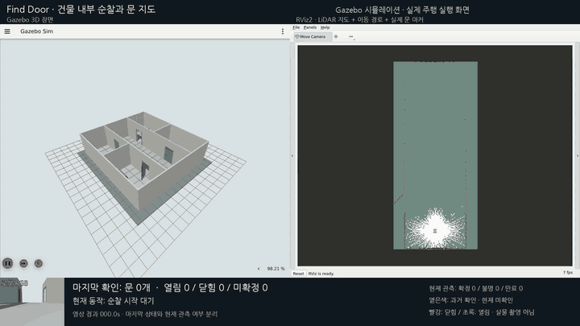
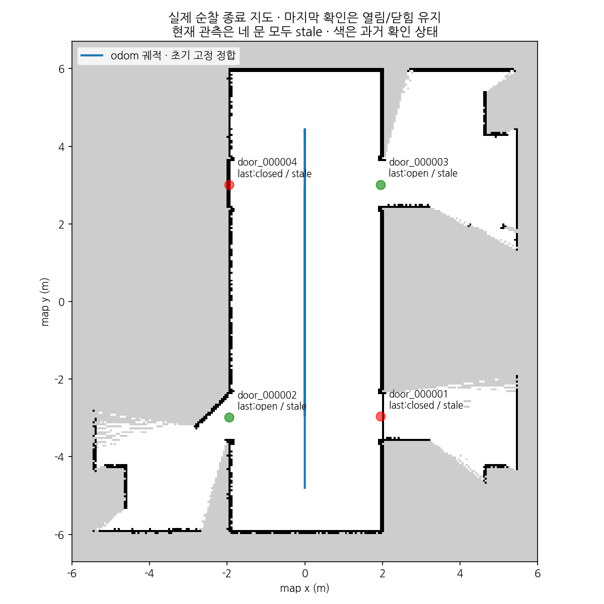
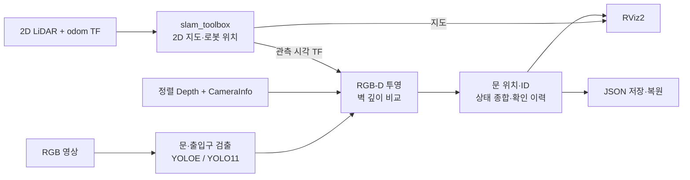

# Find Door — 문 위치와 상태를 기억하는 실내 지도

**로봇이 건물 안을 이동하며 문을 찾고, 지도에 위치와 열림·닫힘 상태를 기록하는 컴퓨터비전 과목 프로젝트입니다.**

2D LiDAR로 공간의 지도를 만들고, RGB-D 카메라로 문을 찾아 상태를 판단합니다.
문이 시야에서 사라져도 마지막으로 확인한 상태를 남기며, 다시 방문하면 새 관측으로 갱신합니다.
현재는 **Gazebo에서 네 문을 순차적으로 관측하는 주행과 두 차례 재방문까지 검증**했습니다.
실물 로봇을 이용한 주행·깊이·지도 평가는 아직 수행하지 않았습니다.

[보고서와 시연 GIF](https://www.notion.so/40df0ccb1ddb81a99149fc89ed8c96ab) ·
[재방문 검증 결과](docs/door-revisit.md) ·
[기능 검증 버전 v0.2.0-door-revisit.1](https://github.com/find-door/find-door/tree/v0.2.0-door-revisit.1)



*실제 실행을 녹화한 Gazebo·RViz 통합 영상입니다. 원본 232.9초를 약 8배속, 29.11초 GIF로 줄였습니다.
왼쪽은 Gazebo, 오른쪽은 RViz 지도이며 하단에 로봇 RGB와 문 상태를 표시합니다.
미리 정한 경로를 주행하고, 문은 시야 밖에서 `set_pose`로 순간 변경합니다. 연속 경첩 회전 시연은 아닙니다.*

## 어떤 문제를 해결하나요?

일반적인 실내 지도만으로는 벽 사이의 공간이 출입구인지, 문이 열려 있는지 알기 어렵습니다.
Find Door는 공간 지도에 다음 정보를 더합니다.

- **문 위치:** 움직이는 문짝 대신 출입구의 고정 위치를 추정하고 문마다 ID를 부여합니다.
- **문 상태:** 문 주변의 벽 깊이와 문 안쪽 깊이를 비교하고, 여러 관측을 종합해 판단합니다.
- **관측 이력:** 지금 확인한 상태와 과거에 마지막으로 확인한 상태를 나누어 기록합니다.

LiDAR는 공간 구조와 로봇 위치 추정에, 카메라는 문 검출과 상태 판단에 사용합니다.
LiDAR만으로 문을 구분하는 방식은 아닙니다.

## 구현한 기능

| 기능 | 현재 구현과 확인 범위 |
|---|---|
| 실내 지도 생성 | 2D LiDAR와 `slam_toolbox`로 지도·로봇 위치 생성 |
| 문·출입구 검출 | 기존 YOLOE와 학습한 YOLO11 후보를 설정으로 선택 |
| 문 상태 판단 | RGB-D 깊이와 주변 벽 평면을 이용한 `open` / `closed` / `unknown` 판단, 시간 종합 |
| 문 위치·ID 관리 | RGB-D와 관측 시각 TF로 지도에 투영하고 고정 위치·ID 유지 |
| 마지막 확인 보존 | 현재 관측 유효성과 마지막 확정 상태·시각을 분리해 표시·저장 |
| 이동 순찰 | 네 방과 복도가 있는 별도 world에서 네 문을 차례로 관측 |
| 재방문 갱신 | 시야 밖에서 바뀐 문을 다시 보고 같은 ID의 닫힘→열림→닫힘 갱신 |
| 결과 확인·저장 | RViz 마커, 문 지도 JSON 저장·복원, Gazebo·RViz 통합 녹화 |

반열림 45°와 완전 열림 90°는 모두 `open`으로 묶습니다.
`open`은 로봇이나 사람이 통과할 만큼 공간이 확보됐다는 뜻은 아닙니다.

### 문을 보고 있지 않을 때

관측 유효 시간이 지나면 **현재 상태는 `unknown`, 관측 상태는 `stale`**로 바뀝니다.
이때 마지막으로 확인한 열림·닫힘과 확인 시각은 남습니다.
RViz에서는 오래된 관측을 옅은색으로 표시하고, 재방문 후 새 관측이 충분히 쌓이면 상태를 갱신합니다.



*저장된 지도와 문 위치로 만든 결과 그림입니다. 종료 시 마지막 확인은 `closed/open/open/closed`이며,
현재 관측은 네 문 모두 `unknown/stale`입니다. 옅은 색은 과거 확인 상태를 뜻합니다.
이 그림은 독립적인 지도 정확도 평가 결과가 아닙니다.*

## 처리 흐름



RGB·depth·CameraInfo를 동기화하고, 검출에 사용한 영상의 시각으로 TF를 조회합니다.
이번 Gazebo 시험의 odom은 시뮬레이터 pose 기반이며, 실물 휠 오도메트리나 IMU 융합 성능을 검증한 것은 아닙니다.
센서·토픽·좌표계의 상세 계약은 [아키텍처](docs/architecture.md)와 [문 ROS 연결](docs/door-ros.md)에 정리했습니다.

## 실험에서 확인한 결과

아래는 개발 중 사용한 장면과 자료의 결과입니다. Gazebo와 실제 RGB 사진의 결과를 따로 기록했습니다.

| 실험 | 확인한 결과 | 근거 |
|---|---|---|
| 첫 문 검출 실험 | 문 상태·거리·관측각을 조합한 36조건, 108프레임 수집. 같은 RGB 중복을 제외하면 36장 | [조건별 결과](docs/door-experiment.md) |
| 마지막 상태 보존 후 순찰 | 14/14단계, odom 기준 9.246m 이동. 네 문 ID와 마지막 확인 상태를 저장 | [순찰 재시험](docs/door-last-observation.md) |
| 재방문 갱신 | 28/28단계, odom 기준 28.404m 이동. 같은 문에서 닫힘→열림→닫힘 갱신, 네 문 ID·고정 위치 유지 | [재방문 시험](docs/door-revisit.md) |

순찰·재방문 수치는 각각 GUI 녹화 실행 기준입니다. 사전 정의한 경로의 동작 검증이며 자율 탐색 결과가 아닙니다.

### 검출 모델 비교

출입구 기준, confidence 0.1·대응 IoU 0.5 조건으로 비교했습니다.
TP는 기준 라벨에 대응한 검출, FP는 추가 검출, FN은 놓친 기준 라벨입니다.

| 평가 자료 | 기존 YOLOE TP / FP / FN | YOLO11 30 epoch | YOLO11 150 epoch |
|---|---|---|---|
| Gazebo 개발 사진 9장 — 사람 검수 라벨 | 4 / 0 / 5 | 4 / 7 / 5 | 8 / 2 / 1 |
| 실제 RGB 개발 검증 7장 — AI 라벨 | 1 / 0 / 2 | 2 / 2 / 1 | 1 / 4 / 2 |

YOLO11은 실제 RGB의 AI 라벨을 이용해 학습 32장·개발 검증 7장으로 실험했습니다.
독립 시험 세트는 확보하지 못했습니다. Gazebo에서는 검출이 개선됐지만 실제 사진에서는 오검출이 늘었습니다.
따라서 기본 검출기는 YOLOE로 유지하고, 위 순찰·재방문 시연에는 **YOLO11 150 epoch 출입구 후보를 선택**했습니다.
학습과 비교 조건은 [학습 자료 구성](docs/door-training-data.md), [학습 예산 비교](docs/door-yolo11-budget.md),
[실시간 후보 연결](docs/door-yolo11-live.md)을 참고하세요.

## 실행 환경과 재현

| 항목 | 사용 환경 |
|---|---|
| 운영체제·미들웨어 | Ubuntu 22.04, ROS 2 Humble |
| 시뮬레이터 | Gazebo Harmonic (`gz-sim 8`), `ros-humble-ros-gzharmonic` |
| 지도·표시 | `slam_toolbox`, RViz2 |
| 영상 처리·검출 | Python, OpenCV, PyTorch·Ultralytics 기반 YOLOE / YOLO11 |
| 시뮬레이션 로봇 | 외부 `wf_gazebo` 오버레이의 JetAuto 모델·LiDAR·RGB-D 센서 |

**저장소를 clone하는 것만으로 전체 시연이 실행되지는 않습니다.**
외부 `wf_gazebo` 워크스페이스와 `recon-report` 가상환경, 검출 설정 및 학습 가중치가 필요합니다.
이 자산들은 저장소에 포함하지 않았습니다. 준비 방법은 [환경 설정](docs/setup.md),
모델 경로와 설정은 [YOLO11 실행 문서](docs/door-yolo11-live.md)에 정리했습니다.

### 빌드

외부 오버레이와 의존성을 준비한 뒤 저장소 루트에서 실행합니다.

```bash
source /opt/ros/humble/setup.bash
source ~/worker_following_ws/install/setup.bash
colcon build --symlink-install
source install/setup.bash
```

### 순찰·재방문 시험

아래 `/path/to/`는 준비한 외부 저장소와 검출 설정의 실제 절대 경로로 바꿉니다.
검출 설정은 학습한 출입구 가중치를 가리켜야 하며, 출력 폴더는 매번 새 경로를 사용합니다.
시험 도구가 Gazebo 서버·SLAM·문 검출·상태 노드를 함께 시작합니다.

```bash
export ROS_DOMAIN_ID=12 GZ_PARTITION=codex OPENBLAS_NUM_THREADS=1
export FASTRTPS_DEFAULT_PROFILES_FILE=~/worker_following_ws/src/wf_gazebo/config/fastdds_bridge.xml

/usr/bin/python3 scripts/door_probe/patrol_check.py \
  --revisit --timeout 420 \
  --recon-root /path/to/recon-report \
  --detector-config /path/to/detector.json \
  --output experiments/door_probe/revisit-new-headless
```

위 명령은 화면 없이 실행합니다. `--revisit`을 빼면 최초 순찰만 수행합니다.
GUI와 통합 녹화는 별도 실행에 `--record`를 추가하며, Xephyr 등 [녹화 준비 조건](docs/door-patrol.md#재현)이 필요합니다.
같은 ROS 도메인에서 다른 시뮬레이션이나 ROS 테스트를 동시에 실행하지 않습니다.
실행 결과는 출력 폴더의 검사 요약·문 지도·관측 이력으로 확인합니다.

## 저장소 안내

| 경로 | 역할 |
|---|---|
| [src/mapping_gazebo](src/mapping_gazebo/) | 문 실험·건물 순찰 world와 시뮬레이션 연결 |
| [src/mapping_slam](src/mapping_slam/) | LiDAR SLAM 설정과 통합 launch |
| [src/mapping_semantic](src/mapping_semantic/) | 검출기 연결, RGB-D 투영, 문 상태·위치·ID·저장 |
| [scripts/door_probe](scripts/door_probe/) | 조건별 수집·라벨 검수·학습·평가·순찰·재방문 시험 |
| [scripts/demo](scripts/demo/) | Gazebo·RViz 화면 녹화와 통합 영상 구성 |
| [docs/data](docs/data/) · [docs/images](docs/images/) | 실험 요약 JSON과 검증 그림 |
| [docs/adr](docs/adr/README.md) | 인터페이스와 설계 결정 기록 |

기반 프로젝트의 매핑 평가·실물 준비·SLAM 분석 패키지도 함께 보존되어 있습니다.
문 기능의 상세 진행 기록은 [로드맵](docs/roadmap.md#find-door-과목-프로젝트)을 참고하세요.

## 남은 과제

- 다른 건물·문 재질·조명에서 사람 검수 라벨을 확보하고 독립 시험 세트로 평가하기
- 실제 로봇의 RGB-D·CameraInfo·TF를 수집해 문 위치와 상태 정확도 측정하기
- 한 화면의 여러 문 처리와 검출 누락·깊이 부족 상황의 안정성 개선하기
- 사전 정의한 경로에서 자율 탐색으로 확장하고, 열린 폭을 이용한 통과 가능성 판단하기

현재 개발 범위는 재방문 상태 갱신까지입니다. 위 항목은 후속 계획이며 완료된 기능이 아닙니다.

## 연구과제와의 경계

기존 **Prometheus Mapping**의 LiDAR SLAM·ROS 센서 연결·RGB-D 투영 구조를 재사용했습니다.
이번 Find Door에서는 문 전용 실험 환경, 검출 모델 비교·학습, 깊이 기반 상태 판단,
문 위치·ID·마지막 확인 이력, 순찰·재방문 검증을 추가했습니다.

외부 `wf_gazebo`의 로봇 모델과 센서 설정은 읽기 전용 오버레이로 사용합니다.
외부 모델·연구과제 비공개 자료·학습 가중치·대용량 원본은 이 저장소에서 배포하지 않습니다.
기존 `v0.1.0`은 기반 프로젝트의 이력이며, 문 기능의 단계별 결과는 `v0.2.0-door-*` 태그로 구분합니다.

브랜치·커밋·병합 규칙은 [CONTRIBUTING.md](CONTRIBUTING.md)를 따릅니다.
라이선스와 외부 자원의 재배포 범위는 🔍 미정입니다.
