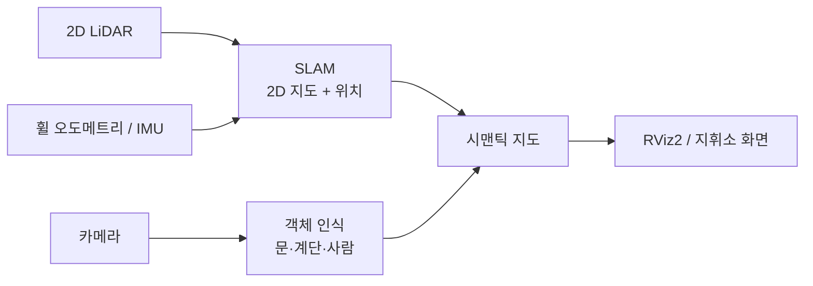

# 🛰️ Prometheus Mapping

> **사람이 들어가기 전에, 건물 내부 지도를 먼저 만든다.**

2D LiDAR와 카메라로 실내 지도를 만들고, 카메라로 인식한 문·계단·사람 등을 지도 위에 표시하는 **시맨틱 매핑** 프로젝트입니다.
최종 목표는 군·소방·탐사용 **내부 정찰 드론**에 탑재하는 것입니다. (영화 「프로메테우스」의 탐사 드론처럼)

> ⚠️ **상태: 초기 설계 단계 (Phase 0).** 문서는 뼈대이며, `🔍 미정`으로 표시된 항목은 아직 결정되지 않았습니다.

<!-- TODO: 데모 영상/GIF (왼쪽 카메라 화면 + 오른쪽 RViz 지도) -->

## 개요

| 항목 | 내용 |
|---|---|
| 기간 | 2026.10 ~ 진행 중 |
| 구분 | 개인 프로젝트 |
| 개발 플랫폼 | JetAuto Ultimate Kit (Jetson Orin NX 16GB, 4륜 메카넘) |
| 개발 환경 | Ubuntu 22.04, ROS 2 Humble, Gazebo Harmonic ([ADR-0002](docs/adr/0002-dev-environment.md)) |
| 기술 | Python, SLAM, RViz2 |
| 응용 목표 | 실내 정찰 드론 (군·소방·탐사) |

## 왜 어려운가

- **GPS 없음** — 실내에서는 센서만으로 위치를 추정해야 함 (SLAM)
- **드론의 기울기** — 2D LiDAR는 한 평면만 보므로, 기체가 기울면 바닥·천장을 벽으로 착각함
- **현장 환경** — 연기·어둠에서는 카메라가 거의 무용지물, 짙은 연기에서는 LiDAR도 노이즈 증가
- **통신 단절** — 건물 내부는 전파가 약해 지도를 실시간으로 밖에 전송하기 어려움
- **연산 제약** — 소형 기체에 실을 수 있는 Jetson급 컴퓨터에서 실시간 동작해야 함

## 시스템 구조 (요약)



자세한 내용은 [docs/architecture.md](docs/architecture.md)를 참고하세요.

## 로드맵

| 단계 | 완료 조건 | 상태 |
|---|---|---|
| Phase 0 개발 환경 | 실내 world에서 JetAuto 시뮬레이션 주행 | 🚧 진행 중 |
| Phase 1 2D SLAM | 실물로 만든 지도의 도면 대비 오차 측정 | ⏳ |
| Phase 2 카메라 융합 | 지도 위 객체 표시 + 위치 정확도 측정, 데모 영상 | ⏳ |
| Phase 3 3D (확장) | 3D 또는 층 구분 지도 생성 | ⏳ |
| Phase 4 드론 (확장) | 기울기 보정 매핑 검증 | ⏳ |

**MVP = Phase 1 + Phase 2.** 상세는 [docs/roadmap.md](docs/roadmap.md).

## 저장소 구조 (안)

```text
prometheus-mapping/
├── README.md
├── CONTRIBUTING.md        # 브랜치·커밋 규칙
├── .gitmessage            # 커밋 메시지 템플릿
├── .github/               # PR 템플릿
├── docs/
│   ├── architecture.md    # 시스템 구조, TF·토픽 설계
│   ├── roadmap.md         # 단계별 목표·체크리스트
│   ├── hardware.md        # 로봇·센서 사양
│   ├── setup.md           # 개발 환경·실행 방법
│   ├── evaluation.md      # 평가 지표·실험 기록
│   └── adr/               # 설계 결정 기록 (ADR)
└── src/                   # 🔍 미정 — ROS 2 패키지 (Phase 0에서 생성)
    ├── mapping_gazebo/    # 매핑용 실내 world·launch
    ├── mapping_slam/      # SLAM 설정·launch
    ├── mapping_semantic/  # 카메라 객체 인식 → 지도 표시
    └── mapping_eval/      # 지도 정확도 평가 도구
```

## 빠른 시작

> 🔍 미정 — Phase 0 완료 후 작성. [docs/setup.md](docs/setup.md) 참고.

## 검증 결과

> 결과가 나오면 채움 (예: 도면 대비 지도 오차 ○○ cm, 객체 표시 위치 오차 ○○ cm). [docs/evaluation.md](docs/evaluation.md) 참고.

## 연구과제와의 경계

| 구분 | 내용 |
|---|---|
| 연구과제에서 가져온 것 | JetAuto 로봇(하드웨어), Gazebo 시뮬레이션 모델·센서 설정(`wf_gazebo`) |
| 이 프로젝트에서 새로 만드는 것 | 매핑용 실내 world, SLAM 구성·평가, 카메라 융합(시맨틱 지도), 3D 확장 |
| 공개 범위 | 🔍 미정 — 교수님 확인 후 기록 (GitHub 공개 가능한 코드·자료 범위) |

## 기여 규칙

브랜치 전략(`main` / `dev` + 작업 브랜치)과 커밋 메시지 규칙은 [CONTRIBUTING.md](CONTRIBUTING.md)를 따릅니다.

## 라이선스

🔍 미정 — 공개 범위 확인 후 결정.
