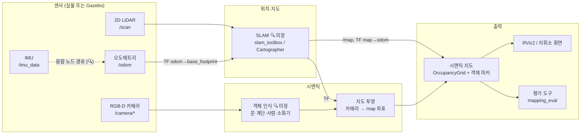

# 아키텍처

현재 Find Door 과목 범위는 문 위치·상태 지도입니다([실험·후속 단계](door-experiment.md)).
첫 실험의 Gazebo 문 world·RGB-D 파일 수집·외부 C 검출은 기존 ROS 시맨틱 노드와 별도입니다.
깊이 기반 상태 후보는 순수 모듈로 구현하고 [정답 ROI 개발 진단](door-state-evaluation.md)을 수행했습니다.
고정 위치·시간 상태 종합·JSON 복원은 [문 메모리 모듈](door-memory.md)로 구현했습니다.
RGB-D·문 검출에서 [출입구·문턱 위치를 추정하는 후보](doorway-evaluation.md)를 오프라인으로 구현했습니다.
동기화 RGB-D·Detection2D 입력에서 관측 시각 TF·문 메모리·JSON/마커·저장 서비스를 연결한
[문 ROS 노드](door-ros.md)를 구현했습니다([ADR-0009](adr/0009-door-ros-pipeline.md)).
[상주 YOLOE 발행 어댑터와 실제 LiDAR SLAM 동시 실행](door-live.md)을 단일 문·정지 관측에서 확인했습니다
([ADR-0010](adr/0010-live-door-detector.md)). [짧은 직선 주행](door-motion.md)과
[작은 회전](door-rotation.md)도 확인했으며 장거리·독립 장면·실물 검증은 아직 미완료입니다.
[이미 확인한 출입구의 RGB-D 재관측](door-reobservation.md)은 문짝 검출 누락 중 같은 ID의 상태를 갱신합니다
([ADR-0012](adr/0012-known-door-reobservation.md)). 처음 보는 열린 문 검출은 여전히 미해결입니다.
기존 `mapping_semantic`의 표면 대표점과 정적 객체 JSON을 문 상태 지도 구현으로 간주하지 않습니다.

> ⚠️ 초안. `🔍 미정` 항목은 [ADR](adr/)로 결정한 뒤 이 문서를 갱신합니다.

## 1. 설계 목표

| 목표 | 의미 | 관련 단계 |
|---|---|---|
| GPS 없이 자기 위치 추정 | LiDAR + 오도메트리/IMU 기반 SLAM | Phase 1 |
| 정찰 정보 표시 | 카메라 객체 인식 결과를 지도 좌표에 투영 | Phase 2 |
| 온보드 실시간 동작 | Jetson Orin NX에서 처리 주기·자원 사용률 측정 | 전 단계 |
| 드론으로 이식 가능 | 센서 입력·좌표계를 플랫폼과 분리 (지상 로봇 → 드론) | Phase 3~4 |

## 2. 전체 구조



> SLAM 후보마다 입력이 다릅니다. 예: slam_toolbox는 `/odom` 토픽을 직접 구독하지 않고 `/scan` + TF `odom→base_footprint`를 사용합니다. IMU를 쓰려면 별도 오도메트리 융합 노드(예: `robot_localization`)가 TF를 발행하도록 구성해야 합니다. 후보별 입력 요구사항은 SLAM ADR에서 정리합니다.

## 3. 패키지 구성 (안)

현재 구현된 실행 경계와 실제 센서 이름은 [초기 인터페이스 계약](interfaces.md)을 따릅니다.
`mapping_slam`은 slam_toolbox 초기 기준선이며 최종 알고리즘 선택은 아직 미정입니다.
`mapping_eval`은 입력 검사와 [시뮬레이션 지도 기하 평가](simulation-evaluation.md)를 구현했습니다.
기록 실행에서는 SLAM 시작 전 bag 구독을 준비하고 TF·그래프·단계 이벤트를 수집합니다.
종료 후 sensor·static/dynamic TF coverage와 진단 유효성을 검사하며, 기록 유효성과 지도
품질은 구분합니다. [진단 인터페이스와 재생 QoS](slam-startup-capture.md)를 참고합니다.
`mapping_semantic`은 색상 표적 또는 외부 Detection2DArray와 RGB-D를 관측 시각 TF로 투영하고 정적 객체를 관리합니다. NanoDet CPU 검출 노드를 별도로 제공합니다. 실물 정확도·Jetson 성능은 미검증입니다.
`mapping_robot`은 실물 프로파일·읽기 전용 센서 preflight·SLAM/선택 검출 실행을 맡습니다.
`mapping_slam_debug`는 시뮬레이션 분석 때만 켜는 루프 수락 기록 솔버 플러그인입니다.
Gazebo·`wf_gazebo`를 의존하지 않으며 드라이버·오도메트리·장착 TF·구동 제어는 외부에서 제공합니다.
[배포·첫 시험 절차](robot-deployment.md)로 실물 인수를 준비합니다.

| 패키지 | 역할 | 주요 입력 | 주요 출력 | 단계 |
|---|---|---|---|---|
| `mapping_gazebo` | 매핑용 실내 world, 로봇 스폰·브리지 launch | `wf_gazebo` 모델 | 시뮬 센서 토픽 | 0 |
| `mapping_slam` | SLAM 파라미터·launch, 지도 저장 | `/scan`, TF `odom→base_footprint` (후보별 상이) | `/map`, TF `map→odom` | 1 |
| `mapping_semantic` | 객체 인식, 지도 좌표 투영, 객체 지도 관리 | 카메라 이미지·depth·`CameraInfo`, TF | 객체 마커, 객체 목록 | 2 |
| `mapping_eval` | 입력 검사·시뮬 주행·지도 기하 평가 / 예정: 실물·성능 평가 | 센서·TF·지도·정답선·경로 | 검사 결과·cmd_vel·지도 지표·rosbag·궤적 잔차 | 1~2 |
| `mapping_robot` | 실물 프로파일·센서 점검·SLAM/선택 검출 실행 | 확인된 센서 토픽·TF·보정·모델 파일 | 검사 JSON·지도·선택 semantic, 구동 명령 없음 | 1~2 |

> 🔍 미정: Python만 쓸지, 성능 병목(투영 등)에 C++ 노드를 둘지.

## 4. 좌표계 (TF)

REP 105 관례를 따릅니다.

```text
map ──(SLAM)──▶ odom ──(오도메트리)──▶ base_footprint ──▶ base_link
                                                            ├──▶ lidar_frame ──▶ lidar_sim_frame
                                                            ├──▶ camera_link0 ──▶ camera_color_optical_frame
                                                            └──▶ imu_link
```

프레임 이름은 `wf_gazebo` 시뮬레이션에서 확인한 값입니다 (2026-10-21, `tf2_tools view_frames`). `/scan`의 `frame_id`는 `lidar_sim_frame`입니다. 실물 드라이버의 프레임 이름은 로봇 확인 후 맞춥니다 🔍

| 변환 | 발행 주체 | 정적/동적 |
|---|---|---|
| `map → odom` | SLAM 노드 | 동적 |
| `odom → base_footprint` | 실물: 로봇 드라이버 또는 융합 노드 🔍 / 시뮬: Gazebo 플러그인 (브리지 경유) | 동적 |
| `base_footprint → base_link` | `robot_state_publisher` (URDF) | 정적 (지상 로봇) |
| `base_link → 센서 프레임` | `robot_state_publisher` (URDF), 실물은 외부 보정 결과로 갱신 (Phase 2) | 정적 |

- `/odom` 메시지의 `header.frame_id = odom`, `child_frame_id = base_footprint`로 TF와 일치시킵니다
- 드론 단계(Phase 4)에서는 `base_footprint → base_link`가 자세·고도에 따라 변하므로 프레임 구성을 별도로 설계합니다
- 시뮬레이션의 `odom` 원점은 스폰 위치가 아니라 **world 원점**입니다 (실물은 출발점이 원점)

## 4-1. 시간·동기화

- 시뮬레이션: Gazebo → ROS 단방향 `/clock` 브리지, 모든 노드 `use_sim_time:=true`
- TF 조회는 현재 시각이 아니라 **센서 메시지의 타임스탬프** 기준으로 합니다
- RGB·depth·CameraInfo는 기본 exact-time입니다. 선택적 approximate는 최대 0.1초 안에서 명시한 편차만 허용하고, 외부 검출은 RGB와 항상 exact header입니다. TF·출력 시각은 RGB 시각이며 실물 허용 편차·정렬 보정은 별도 확인합니다 🔍
- `ros_gz_bridge` 토픽별 방향은 `wf_gazebo/config/gz_bridge.yaml`을 그대로 씁니다 ([ADR-0003](adr/0003-wf-gazebo-reuse.md)). 큰 영상의 BEST_EFFORT 프레임 손실을 막는 Fast DDS 설정(`fastdds_bridge.xml`)도 브리지 노드에 적용되어 있습니다

## 5. 토픽 인터페이스 (안)

| 토픽 | 타입 | 발행 | 비고 |
|---|---|---|---|
| `/clock` | `rosgraph_msgs/msg/Clock` | Gazebo (브리지) | 시뮬 전용 |
| `/scan` | `sensor_msgs/msg/LaserScan` | LiDAR | 시뮬 5 Hz |
| `/odom` | `nav_msgs/msg/Odometry` | 로봇 드라이버 / Gazebo | 시뮬 20 Hz |
| `/imu_data` | `sensor_msgs/msg/Imu` | IMU | 시뮬 100 Hz |
| `/camera/color/image_raw` | `sensor_msgs/msg/Image` | 카메라 | 시뮬 640×480, 15 Hz, `rgb8` |
| `/camera/camera_info` | `sensor_msgs/msg/CameraInfo` | 카메라 | 내부 보정값 (투영에 필수). 컬러·depth 공용 |
| `/camera/depth/image_raw` | `sensor_msgs/msg/Image` | 카메라 | 시뮬 0.2~10 m, `32FC1`(m), 컬러와 정렬됨 |
| `/cmd_vel` | `geometry_msgs/msg/Twist` | teleop / 상위 노드 | 로봇 속도 명령 |
| `/map` | `nav_msgs/msg/OccupancyGrid` | SLAM | |
| `/semantic/objects` | `vision_msgs/msg/Detection3DArray` | `mapping_semantic` | 정적 객체·표면 대표점·마지막 관측 score |
| `/semantic/markers` | `visualization_msgs/msg/MarkerArray` | `mapping_semantic` | RViz 표시용 |

> 시뮬레이션 토픽 이름·주기는 `wf_gazebo`에서 확인한 값입니다 (2026-10-21, `/scan` 5.0 Hz, `/odom` 19.9 Hz, `/imu_data` 100 Hz, 컬러 영상 14.2 Hz). 실물 드라이버 토픽 이름은 로봇 확인 후 맞춥니다 🔍

현재 카메라→지도 투영 계약 ([구현 상세](../src/mapping_semantic/README.md)):

- RGB에 정렬된 depth와 무왜곡 pinhole CameraInfo만 허용
- RGB는 rgb8/bgr8, depth는 `32FC1` m 또는 `16UC1` mm를 지원하고 내부에서 m로 정규화. 0·NaN·inf·0.2–10m 밖 깊이 거부. 깊이 단위 지원과 물리 정렬 보정은 별개
- 투영 기준 프레임: `camera_color_optical_frame` (REP 103 광학 좌표 규약)

## 6. 단계별 진화

| 단계 | 구조 변화 |
|---|---|
| Phase 1 | LiDAR + 오도메트리 → 2D SLAM. 카메라 미사용 |
| Phase 2 | 카메라 파이프라인 추가 (객체 인식 → 투영 → 시맨틱 지도). 융합 방식은 ADR로 결정 🔍 |
| Phase 3 | LiDAR 장착 방향 변경 또는 depth 카메라로 3D/층 구분 지도 🔍 |
| Phase 4 | IMU 기반 roll/pitch 보정, 바닥·천장 점 제거, 높이 변화 대응, **휠 오도메트리 없이** 운동 추정(VIO 또는 LiDAR 기반) 검토. 자세 보정은 기울어진 스캔을 회전시킬 뿐, 관측하지 못한 수평 단면을 복원하지는 못함 |

## 7. 미결정 사항

| 항목 | 선택지 | ADR |
|---|---|---|
| SLAM 개발 기준선 | slam_toolbox 기본·Cartographer 비교, 실물 최종 선정 유보 | [ADR-0004](adr/0004-prehardware-slam-baseline.md) |
| 카메라 융합 | 독립 2D 검출·RGB-D 관측 시각 TF 투영 | [ADR-0005](adr/0005-rgbd-projection.md) |
| LiDAR 장착 방향 (3D) | 수평 / 세로 / 비스듬히(30~45°) / 수평+세로 2개 | 0006 (예정) |
| 검출 개발 기준선 | NanoDet CPU·COCO80, 실물 목표 모델·Jetson 검증 유보 | [ADR-0007](adr/0007-cpu-detector-baseline.md) |
| 객체 지도 정책 | 정적 객체만 누적, 큰 보정에 epoch 초기화·고정 지도 우선 | [ADR-0008](adr/0008-semantic-map-policy.md) |
| 문 ROS 개발 연결 | 문 위치·상태 분리, 관측 시각 TF·JSON·마커 | [ADR-0009](adr/0009-door-ros-pipeline.md) |
| 문 실시간 검출 연결 | 별도 가상환경의 상주 YOLOE와 원본 RGB-D 묶음 발행 | [ADR-0010](adr/0010-live-door-detector.md) |
| 알려진 문 재관측 | 검출로 확인한 출입구의 현재 RGB-D 재관측, 새 ID 생성 금지 | [ADR-0012](adr/0012-known-door-reobservation.md) |
| 문 자료 계약 | 문짝·출입구 이중 bbox, 장면 그룹 분할·해시 중복 검증 | [ADR-0011](adr/0011-door-dataset-contract.md) |
| 결정됨: 개발 플랫폼 | JetAuto (지상 로봇) | [ADR-0001](adr/0001-dev-platform-jetauto.md) |
| 결정됨: 개발 환경 | Ubuntu 22.04 + ROS 2 Humble + Gazebo Harmonic | [ADR-0002](adr/0002-dev-environment.md) |
| 결정됨: `wf_gazebo` 재사용 | 오버레이 의존 (`worker_following_ws`) | [ADR-0003](adr/0003-wf-gazebo-reuse.md) |

## 8. 알려진 위험

- 현재 시뮬은 VelocityControl과 Gazebo 자세 기반 odom을 사용하므로 휠 미끄러짐·엔코더 오차를 재현하지 않습니다

- LiDAR 5 Hz(시뮬 설정) → 빠르게 움직이면 지도 번짐 가능
- 메카넘 바퀴 미끄러짐 → 오도메트리 오차가 SLAM 품질에 영향
- 2D LiDAR 단일 평면 → 낮은 장애물·계단은 LiDAR로 못 볼 수 있음 (카메라 보완 필요)

## 9. 로봇 도착 전 검증 범위

[동일 입력 재생](replay-evaluation.md), [검출 기준선](detector-baseline.md),
[시맨틱 패키지](../src/mapping_semantic/README.md)와 [실물 인수 절차](robot-acceptance.md)를 제공합니다.
외부 검출의 정적 클래스는 chair/cup/bottle이며 person 등 동적 클래스는 관측만 발행합니다.
표면 대표점은 물체 중심·크기·자세를 추정한 값이 아닙니다.
지도 보정 epoch의 변위가 0.2m 또는 yaw 0.1rad를 넘으면 객체를 초기화하고 재관측합니다.
작은 보정은 재투영하지 않으므로 정밀 누적에는 고정 지도 운용이 필요합니다.
