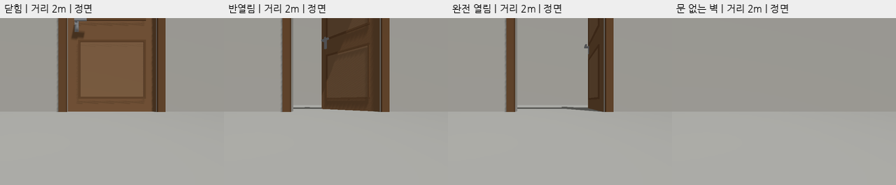

# 문 위치·상태 지도: 첫 Gazebo 실험

## 목적과 범위

`find-door`는 기존 Prometheus Mapping의 2D LiDAR 지도·RGB-D 투영을 기반으로
문의 고정 위치와 열림/닫힘/불명 상태를 지도에 표시하는 컴퓨터비전 과목 프로젝트다.
현재 단계는 **문 상태별 2D 검출 가능성 측정**이다. 문 검출 학습, 깊이 기반 상태 분류,
시간 누적 상태 추정, 지도 연결은 후속 단계이며 구현 완료로 표현하지 않는다.

기존 `indoor_v1`, `indoor_v2`, `indoor_demo`, `semantic_v1`에는 문짝이 없고
벽 사이 개구부만 있다. 이 파일들과 외부 `wf_gazebo`는 변경하지 않는다.
NanoDet는 COCO80 연결 기준선으로 문을 지원하지 않는다([ADR-0007](adr/0007-cpu-detector-baseline.md)).
첫 실험은 별도 `recon-report` C의 YOLOE 문 검출을 사용한다. C의 문 상태 출력은
항상 `unknown`이므로 **문 상태별 검출 성공률**과 **문 상태 분류 정확도**를 구분한다.

## 장면과 좌표 계약

[생성기](../scripts/door_probe/generate_worlds.py)가 생성한 독립 SDF 네 개를 사용한다.
world 이름은 모두 `door_probe_v1`이며 한 번에 하나만 실행한다.

| 조건 | 파일 | 문짝 각도 |
|---|---|---|
| 닫힘 | [closed](../src/mapping_gazebo/worlds/door_probe_closed.sdf) | 0° |
| 반열림 | [half](../src/mapping_gazebo/worlds/door_probe_half.sdf) | 45° |
| 완전 열림 | [open](../src/mapping_gazebo/worlds/door_probe_open.sdf) | 90° |
| 음성 대조 | [negative](../src/mapping_gazebo/worlds/door_probe_negative.sdf) | 문·문틀 없는 평벽 |

- 닫힌 문 평면 `x=0`, 개구부 `y=-0.5..0.5`, `z=0..2m`.
- 경첩 `(0,-0.5,0)`, 문짝 두께 0.04m·폭 1m·높이 2m. `yaw=-각도`로 +x 방향에 열린다.
- 문짝·양면 패널·손잡이의 visual과 collision을 함께 회전한다. 고정 각도 배치이며 동적 관절 제어는 없다.
- 문틀 앞면 `x=-0.105`, 바깥 경계 `y=±0.58`, `z=0..2.1m`. 뒷벽 앞면 `x=3.95m`.
- 로봇은 x<0 쪽에서 문을 본다. 문 위치 기준은 회전하는 문짝 표면이 아니라 고정된 문턱 중앙 `(0,0,0)`이다.

## 수집·평가 계약

거리 1/2/3m × 관측각 0/−30/+30° × 닫힘/반열림/열림은 27조건이다.
문 없는 벽의 같은 거리·각도 9조건을 추가해 총 36조건으로 구성한다.
각 조건의 서로 다른 시각 3프레임, 총 108 RGB-D 쌍을 수집한다.
동일 정적 장면의 반복 프레임은 독립적인 환경 표본이 아니다.

거리는 **카메라 광학 중심의 바닥 투영점에서 문턱 중앙까지의 수평거리**다.
관측각은 문 정면 법선으로부터의 수평각이며 카메라는 문 방향을 바라본다.
base 스폰 위치에 카메라 장착 오프셋을 반영하고 관측 시각 TF로 거리 2cm·각도 1° 이내인지 확인한다.
기존 카메라의 장착 높이·화각을 유지한다. 낮은 카메라로 인한 문 상단 잘림은
메타데이터의 `truth_truncated`에 기록하고 임의로 카메라를 높이거나 문을 축소하지 않는다.

[수집기](../scripts/door_probe/capture.py)는 다음을 보존한다.

- RGB PNG, float32 미터 depth NPY, 원본 인코딩, `CameraInfo` K/D/P.
- 정확히 같은 RGB/depth/CameraInfo 시각과 광학 프레임, 관측 시각 `odom←camera` 및 `odom←base` TF.
- `/clock` 단일 발행자 확인, 요청·실측 카메라 pose, world·입력·외부 설정 해시, launch 로그·PGID.
- `captures.json`의 전체 완료/실패 상태와 조건별 상태. 기존 결과 디렉터리는 덮어쓰지 않는다.

Gazebo pose odometry의 `odom` 원점은 world 원점과 같다는 기존 계약을 사용한다.
이 실험에서는 SLAM을 실행하거나 `map` 좌표 정확도를 측정하지 않는다.

정답 bbox는 고정 문틀 바깥 사각형을 실제 `CameraInfo`와 TF로 투영하고 영상 경계에 자른
**기하 기준 정답**이다. 문짝만의 bbox가 아니며 가림·사람 검수 정답을 대신하지 않는다.
원본 bbox와 클립 여부를 보존하고 실제 RGB에서 투영 위치를 점검한다.
문 조건은 `door` 검출과 정답의 IoU≥0.5면 성공, 추가·중복 검출은 FP로 기록한다.
음성 조건은 문 검출이 없어야 성공이다. 실행 오류는 미검출과 구분하며 전체 시도 분모에서 빼지 않는다.
검출 설정을 결과를 본 뒤 유리하게 바꾸지 않는다. C는 깊이를 입력받지 않는다.

현재 외부 설정은 `recon-report/experiments/configs/yoloe-door-person.json`이다.
체크포인트 `yoloe-26n-seg.pt`, 문 confidence 0.1, 사람 confidence 0.25,
NMS IoU 0.45, 입력 크기 640, device 0을 사용한다.
평가 `results.json`의 `recon`에 설정 전문·설정/체크포인트/임베딩/프롬프트 해시와
외부 저장소 revision·작업 상태를 보존한다. 지도 mapper의 0.5 점수 기준과는 별개다.

## 실행

설치·환경은 [setup](setup.md)을 따른다. 외부 모델은 읽기 전용 오버레이로 사용한다.
원시 결과 `experiments/door_probe/`는 Git 제외이며 요약은 이 문서와 [평가 기록](evaluation.md)에 남긴다.

```bash
source /opt/ros/humble/setup.bash
source ~/worker_following_ws/install/setup.bash
colcon build --symlink-install --packages-select mapping_gazebo
source install/setup.bash
export ROS_DOMAIN_ID=12 GZ_PARTITION=codex

# 새 출력 경로를 지정한다. 내부 launch는 gui:=false, headless_rendering:=true.
/usr/bin/python3 scripts/door_probe/capture.py --confirm-simulation \
  --output experiments/door_probe/run-01
```

수집기는 조건별 launch를 만들고 자신이 만든 프로세스 그룹만 종료한다.
같은 도메인에 이미 `/clock` 발행자가 있으면 실행을 거부한다.
개별 사전 점검은 `--states closed --distances 2 --angles 0`으로 범위를 제한할 수 있다.

추론은 수집 종료 후 별도 가상환경에서 실행한다. ROS Python 환경 변수는 제거한다.
로컬 `recon-report`의 설치·가중치·임베딩이 필요하며 자동 설치·다운로드하지 않는다.

```bash
/usr/bin/python3 scripts/door_probe/evaluate.py \
  --captures experiments/door_probe/run-01 \
  --output experiments/door_probe/eval-01 \
  --recon-root /home/blind/cv-middle/CV-VLM/recon-report
```

내부 명령은 해당 외부 저장소를 cwd로 사용한
`env -u PYTHONPATH -u PYTHONHOME .venv/bin/python -m recon_report.run --method C --image ... --log-dir ...`와 같다.
출력 bbox·점수·실패 로그·해시·overlay를 보존하며 Gazebo 결과만 집계한다.

## 확인 상태

2026-11-02 문 world 생성·XML 검사와 좌표 단위 검사를 수행했다.
2m 정면 닫힘 사전 실행에서 실제 Gazebo RGB-D 3쌍과 관측 시각 TF를 수집했다.
영상에서 문 상단 잘림이 확인되었다. C 실제 추론은 3/3 검출, IoU 0.729447,
점수 0.286945, 실행 오류 0이었다. 세 RGB 해시가 동일하므로 독립적인 세 환경 결과가 아니다.
문 중앙 깊이 1.98m는 카메라부터 문짝 앞면까지의 기하 기대값과 일치했다.
전체 행렬 수집·C 평가까지 완료했다. 아래는 동일 설정을 고정한 첫 실행 결과다.

## 전체 행렬 결과 — 2026-11-02

소스 커밋 `a8c124f`의 깨끗한 작업 상태에서 36조건·108프레임을 수집하고 전부 추론했다.
수집과 추론 실행 오류는 0이다. 종료 후 Codex 도메인의 `/clock` 발행자가 0개인 것도 확인했다.
모델 변경·추가 학습·임계값 조정은 하지 않았다.

**표의 값은 `door 박스 출력 프레임 수 (문틀 IoU 성공 프레임 수)`이며, 각 분모는 3이다.**
박스가 나왔다는 사실만으로 올바른 출입구 검출이라고 판정하지 않는다.

| 거리 | 관측각 | 닫힘 0° | 반열림 45° | 완전 열림 90° |
|---|---:|---:|---:|---:|
| 1m | 0° | 0/3 (0/3) | 3/3 (0/3) | 3/3 (0/3) |
| 1m | −30° | 0/3 (0/3) | 3/3 (0/3) | 0/3 (0/3) |
| 1m | +30° | 0/3 (0/3) | 3/3 (0/3) | 3/3 (0/3) |
| 2m | 0° | 3/3 (3/3) | 3/3 (3/3) | 3/3 (0/3) |
| 2m | −30° | 3/3 (0/3) | 3/3 (0/3) | 0/3 (0/3) |
| 2m | +30° | 3/3 (0/3) | 3/3 (3/3) | 3/3 (0/3) |
| 3m | 0° | 3/3 (3/3) | 3/3 (3/3) | 3/3 (0/3) |
| 3m | −30° | 3/3 (3/3) | 3/3 (0/3) | 0/3 (0/3) |
| 3m | +30° | 3/3 (3/3) | 3/3 (3/3) | 3/3 (0/3) |

| 배치 상태 | door 박스 출력 | 문틀 IoU≥0.5 성공 | 대응되지 않은 박스 수 |
|---|---:|---:|---:|
| 닫힘 | 18/27 | 12/27 (서로 다른 조건 4/9) | 12 |
| 반열림 | 27/27 | 12/27 (서로 다른 조건 4/9) | 36 |
| 완전 열림 | 18/27 | 0/27 (서로 다른 조건 0/9) | 18 |
| 문 없는 평벽 | 0/27 | 음성 판정 성공 27/27 (9/9조건) | 0 |

대응되지 않은 박스는 문틀 정답에 대한 FP로 집계했다. 별도 물체를 환각한 경우만 뜻하지 않으며,
문짝만 감싼 박스와 장식 패널 중복 검출도 포함한다. 추가 박스가 있어도 정답과 대응한 하나가
있으면 해당 프레임의 문틀 위치 검출은 성공으로 기록한다. 따라서 성공률만 읽고 오검출이 없다고 해석하면 안 된다.

### 결과 해석과 한계

- 문 조건 81프레임 모두 문 상단이 잘렸다. 108 RGB의 고유 해시는 36개이며, 각 조건의 세 프레임은
  같은 이미지다. 이 결과는 **27개 문 장면 + 9개 평벽 장면**의 소규모 합성 환경 평가다.
- 열린 문에 door 박스가 나온 18프레임을 무검출로 표현하지 않는다. 실제로 확인한 `open_d2_a0_00`은
  문짝을 감싼 폭 47.6px 박스(confidence 0.331)와 문틀 정답 폭 305.7px가 달라 IoU가 0.154였다.
  `open_d3_a30_00`은 confidence 0.770이어도 문틀 IoU는 0.451이었다.
- 원본과 overlay의 교차 검토에서는 회전한 문짝을 감싸는 검출과 빈 공간까지 포함한 문틀 정답의
  **대상 정의 차이**가 확인되었다. 정면·사선 일부 사례의 근거이며 모든 실패 원인을 확정한 것은 아니다.
  낮은 카메라 시점·잘림·단순한 렌더링과 학습 영상 차이도 원인 후보다(🔍).
- 문짝 기준 정답으로 다시 평가하려면 별도 지표·새 평가로 남긴다. 이번 문틀 기준 결과를 사후에 바꾸지 않는다.
- 2m 정면 중앙 깊이는 닫힘 1.980m, 반열림 2.469m, 완전 열림 5.950m였다.
  문짝·배경 벽의 기하와 부합하지만 **깊이 상태 분류기를 구현하거나 정확도를 측정한 결과는 아니다**.
- C 상태 출력은 모두 `unknown`이다. 상태 분류·지도 위치 정확도·SLAM 누적·실물 영상은 미검증이다.
- 평균 CLI wall time은 4.223초/프레임이며 프로세스 시작·모델 적재를 포함한다. 온라인 처리율로 해석하지 않는다.



*Gazebo `door_probe_v1`, 2m 정면, 기존 로봇 RGB-D 카메라의 RGB 영상이다.
왼쪽부터 닫힘·반열림·완전 열림·평벽이며 GUI 창 캡처나 실제 촬영 사진이 아니다.
문 상단 잘림을 유지했다. 상태명은 배치 정답이고 알고리즘이 추론한 상태가 아니다.*

[36조건 원본 RGB 모음](images/door-probe/rgb-grid.png) ·
[36조건 검출 비교](images/door-probe/detections-grid.png).
비교 그림은 초록=기하 문틀 정답, 파랑=IoU 대응 검출, 빨강=미대응 검출이다.
각 조건 첫 프레임만 표시하며, AI 이미지 생성으로 장면을 대체하지 않았다.

### 재현 자료와 검증

| 항목 | 기록 |
|---|---|
| 실행 소스 | `a8c124f` (world `1ccfbb9`, 수집·평가 `105a1c0`) |
| 단계 버전 | `v0.2.0-door-probe.1` — 첫 실험 단계, 문 상태 지도 완성 버전이 아님 |
| 수집 원문 | 저장소 로컬 `experiments/door_probe/run-01/` — RGB·depth·TF·조건/실패 기록, Git 제외 |
| 추론 원문 | 저장소 로컬 `experiments/door_probe/eval-01/` — `results.json`, `summary.csv`, `raw/`, `overlays/`, Git 제외 |
| 추적 요약 | [기계 판독 요약](data/door-probe-summary.json) — 조건별 수치·설정·원문 해시 |
| 외부 recon-report | `fca8bb9c1c7c546c025e2a15f8811f5c1cd79e24`, 추론 시작 시 작업 상태 깨끗함 |
| YOLOE 체크포인트 SHA-256 | `1741c1f8da3cea47e2c01829c334a50dc0b9bbd05e685b90a3ce84fae32c8c1b` |
| wf_gazebo | 기존 오버레이, 변경·재빌드 없음. 카메라/모델/브리지/launch 해시를 `captures.json.external_hashes`에 보존 |
| 원시 결과 SHA-256 | `d3a8a6f3e0488a57d57a69fb54c4539bb4c25b265d44137f9eb67a55af7a1b10` (`eval-01/results.json`) |

원시 RGB-D·추론 기록은 Git clone에 포함되지 않는다. 같은 저장소 코드를 다시 실행하거나 위 로컬 산출물을 별도로 보존해야 한다.
사전 실행은 `pilot-01/`, `pilot-eval-01/`이며 전체 결과 분모에 합산하지 않았다.

확인한 검증: world 4개 `gz sdf -k`, `mapping_gazebo` 빌드·colcon 테스트 8개,
전체 오프라인 pytest 523개, 문서 상대 링크·앵커 검사, 36조건 실제 headless 실행·108회 C 추론.
중단 시 자기 프로세스만 정리하는 subprocess 회귀 검사와 실제 실행 종료 후 `/clock` 발행자 0개 확인도 수행했다.

그림은 [비교 그림 생성기](../scripts/door_probe/figures.py)로 재현한다. 기존 한글 글꼴이 필요하며
기본값은 로컬 나눔고딕이다. 새 출력 디렉터리를 지정한다.

```bash
/usr/bin/python3 scripts/door_probe/figures.py \
  --results experiments/door_probe/eval-01 --output /tmp/door-probe-figures-new
```

## 후속 단계

1. 첫 검출 결과를 바탕으로 문 데이터·라벨·학습/평가 분리를 정하고 YOLO 계열 추가 학습 여부를 결정한다.
2. 문 내부 깊이와 주변 벽 평면의 차이를 비교한다. 사선 벽 기울기, 뒷벽, 무효 깊이를 처리하고 불명 상태를 둔다.
3. 여러 프레임으로 상태를 종합한다. 문틀의 고정 ID·위치와 변하는 상태를 분리한다.
4. [현재 투영 계약](adr/0005-rgbd-projection.md)과 [정적 객체 정책](adr/0008-semantic-map-policy.md)을
   검토한 뒤 Detection2D 어댑터·문 상태 저장·지도 표시를 통합한다.
5. 실제 촬영 영상은 별도 데이터셋·분모로 평가한다. Gazebo 성공률을 실제 문 성능으로 표현하지 않는다.
