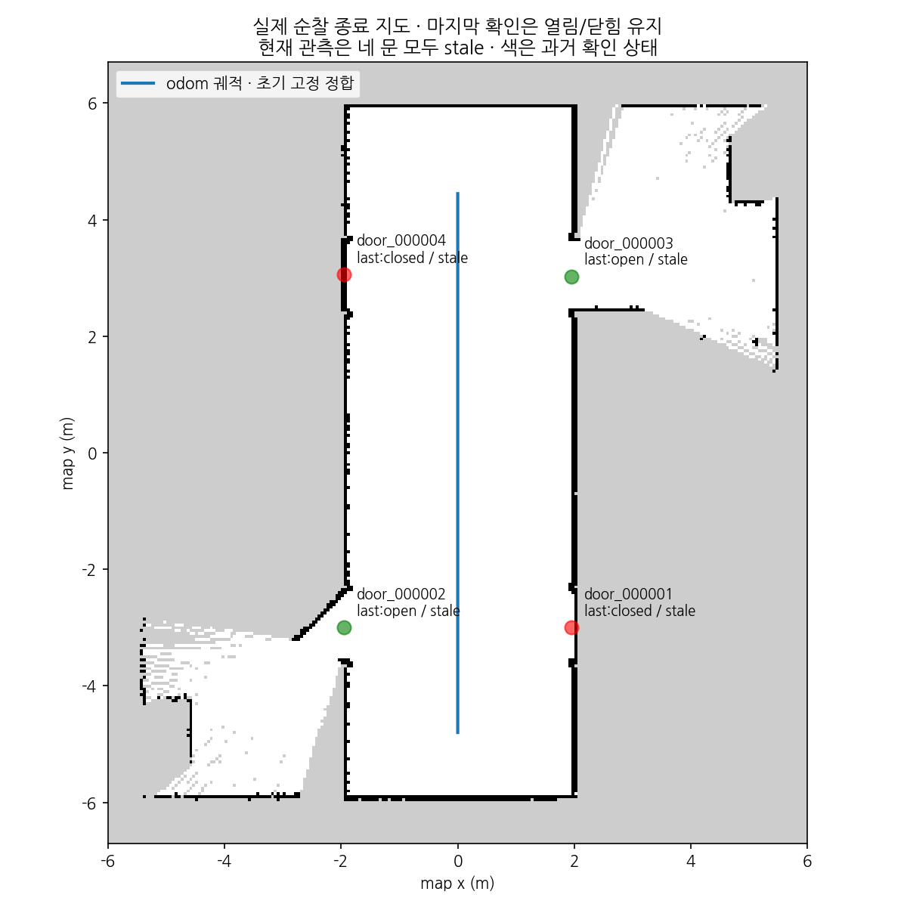
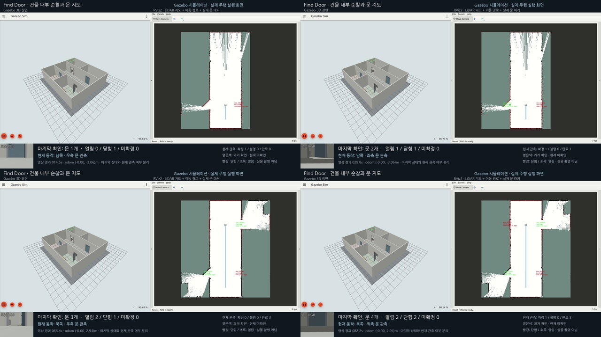

# 마지막 문 확인 상태 보존과 순찰 재시험

2026-11-03 사용자 요청에 따라 **마지막으로 확정한 열림/닫힘과 현재 관측 유효성을 분리**했다.
관측이 끝나도 RViz의 마지막 상태 색과 확인 시각을 보존하며, 오래된 관측은 옅은색과 stale로 표시한다.
동일한 건물·경로를 실제로 다시 주행해 네 문의 마지막 확인 결과를 유지했고 새 통합 영상을 저장했다.
설계는 [ADR-0015](adr/0015-door-last-confirmed-state.md), 최초 순찰은 [이전 결과](door-patrol.md)를 따른다.

## 달라진 표시·저장

| 정보 | 의미 |
|---|---|
| state | 현재 신선한 관측의 판단. 미관측 TTL·불확실 관측에서는 unknown |
| last_confirmed_state | 마지막으로 연속 관측을 종합해 확정한 open/closed. 첫 확정 전에는 unknown |
| last_confirmed_stamp_ns | 마지막 확정을 만든 실제 관측 시각. 첫 확정 전에는 null |
| observation_status | confirmed: 현재 확정 / uncertain: 최근 관측의 판단 불가 / stale: 관측 TTL 초과 |
| last_confirmed_age_sec | 마지막 확정 관측부터 현재 ROS 시각까지 경과 |

unknown·TTL·반대 상태의 확정 전 후보는 마지막 확정 상태나 그 시각을 지우거나 연장하지 않는다.
새 상태가 연속 관측으로 확정되면 마지막 상태를 바꾼다. 지도/시간 epoch 초기화는 이력도 함께 지운다.

RViz는 마지막 확인 상태의 빨강/초록을 유지한다. stale은 구형 마커 alpha=0.4, 최근 uncertain은 alpha=0.65로 구분하고,
텍스트는 ID·last:상태·관측 유효성·확정 후 경과 시간을 함께 표시한다.
영상 자막도 마지막 확인 개수와 현재 관측의 confirmed/uncertain/stale 개수를 별도로 보여 준다.
따라서 과거 열림/닫힘을 지금도 확실한 상태라고 주장하지 않는다.

DoorMap·세션은 schema2로 저장하며 마지막 확인 상태·실제 시각을 포함한다.
age/status는 상대값이므로 저장하지 않고 조회 시 다시 계산한다.
이전 schema1 파일도 읽는다. 예전 known은 그 관측 시각의 확인으로 이관하고,
이미 unknown으로 저장된 예전 파일에서 유실된 확인 이력을 만들지 않는다.
기존 schema1 전용 코드는 새 schema2 파일을 읽을 수 없으므로 현재 코드를 사용한다.

## 실제 재시험

[새 건물 world](../src/mapping_gazebo/worlds/door_patrol_v1.sdf)·14단계 경로·기존 로컬 모델과 문턱을 유지했다.
보조 재관측은 false다. 원문은 `experiments/door_probe/last-state-headless-01/`, `last-state-video-01/`이며
[실행·소스·영상 추적 요약](data/door-last-observation-summary.json)을 보존했다.

| 항목 | headless 재시험 | 실제 GUI 녹화 재시험 |
|---|---:|---:|
| 경로 | 14/14 | 14/14 |
| odom 주행 거리 | 9.243m | 9.246m |
| 주행 방향 최소 LiDAR 거리 | 1.475m | 1.473m |
| 문별 신선한 상태 확인 | 4/4 | 4/4 |
| 마지막 확인 상태 보존 | 4/4 | 4/4 |
| 저장 파일·수신 지도 대조 | 통과 | 통과 |

GUI 시험에서 종료 후 확인한 값은 다음과 같다. 시간은 최종 지도 snapshot의 시뮬레이션 시각 기준이다.

| 문 ID | 마지막 확인 | 확인 후 경과 | 현재 관측 |
|---|---|---:|---|
| door_000001 | closed | 76.144초 | stale |
| door_000002 | open | 61.624초 | stale |
| door_000003 | open | 27.370초 | stale |
| door_000004 | closed | 12.917초 | stale |

네 문 모두 마지막 확인 상태와 실제 관측 시각이 schema2 저장 파일에 남았다.
현재 state는 모두 unknown, 현재 관측은 모두 stale이며 이 두 값과 과거 확인을 분리해 검증했다.
기존 문별 신선한 현재 상태 평가도 통과했다. 신선한 정답 known 관측은 각 문에서 31/35/8/22회였으며
과거 보존 상태를 현재 상태의 정답 관측으로 세지 않았다. 반대 known·미대응·중복 ID는 없었다.
관측 수는 영상 프레임 정확도가 아니며 완전 열림의 상태 판단 불가 구간도 남아 있다.

*실제 OccupancyGrid·저장 위치에 마지막 확인 색을 표시한 그림이다. 네 문은 현재 stale이고
옅은 빨강/초록은 과거 확인이다. 파랑은 초기 고정 정합으로 옮긴 odom 궤적이며 독립 SLAM 오차 평가가 아니다.*

## 새 영상과 검증

전달 폴더: `/home/blind/다운로드/find-door-last-state-20261103/`.
통합 영상은 find-door-patrol-gazebo-rviz.mp4이며 **1920×1080 H.264·10fps·101.1초**다.
Gazebo와 RViz 분리 영상도 저장했다. 기존 영상·world·결과는 보존했다.

*실제 MP4의 네 관측 단계에서 발췌했다. 상태·자막은 수신한 문 지도에서 가져왔으며 정답 상태를 덧씌우지 않았다.*

총 1,011프레임 중 실제 캡처 996회·반복 15프레임이다. 캡처 지연은 직전 실제 화면으로 채우고
metadata에 표시했다. 영상과 벽시계 차이는 약 0.001초다. 통합·분리 MP4 세 개 모두 전체 디코딩 검사했다.
전용 Xephyr 화면만 캡처했고 생성한 이미지로 실행 장면을 대신하지 않았다.

패키지 빌드·ROS 363검사 통과, 전체 오프라인 956검사 통과·ROS 전용 5개는 위 ROS 환경에서 별도로 실행했다.
TTL·불확실/반대 관측·중복·reset·저장/복원·잘못된 이력의 원자 거부·schema1 안전 이관·실제 ROS 마커를 검사했다.
실행 하네스·녹화 코드 snapshot을 보존했고 각 프로세스 그룹·검출 worker 종료를 확인했다.

재현은 [순찰 실행](door-patrol.md#재현)과 같으며 새 출력 경로를 사용한다.
현재 코드로 --record를 실행하면 마지막 확인과 현재 관측을 분리한 영상을 만든다.
표시·저장 정책의 개선이며 새 검출 모델 학습·자율 탐색·동시 다중 문·실물 평가를 수행한 결과는 아니다.
Git 기준은 2b6ac04 이후이며 단계 식별자는 `v0.2.0-door-last-observation.1`이다. 로컬 dev에 통합하고 해당 사전 릴리스 태그로 보존했다.
