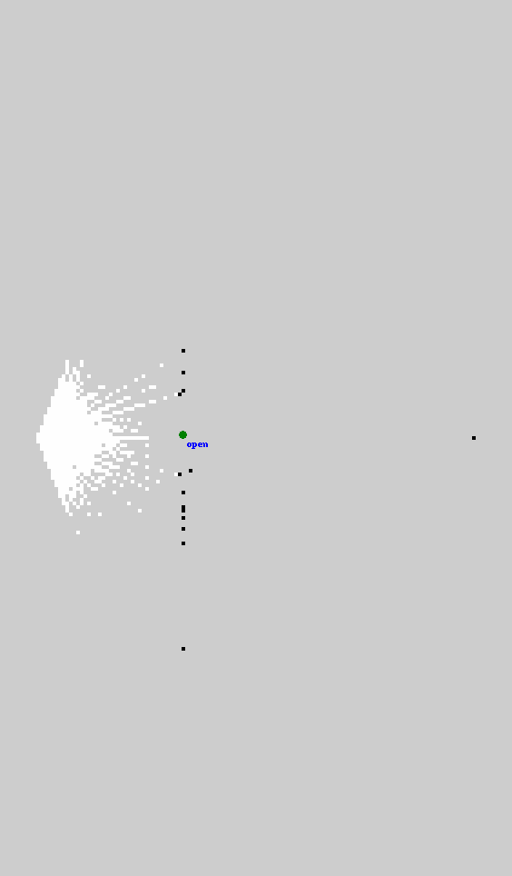

# 실시간 YOLOE·RGB-D·LiDAR SLAM 통합

기록 재생에 이어 Gazebo에서 새로 들어오는 영상의 실제 YOLOE 추론과
LiDAR `/scan` 기반 slam_toolbox를 함께 실행하는 경로를 구현했다.
관측 시각 TF와 문 메모리·마커·저장 서비스는 기존 문 mapper를 사용한다.
설계는 [ADR-0010](adr/0010-live-door-detector.md)을 따른다.

## 실행 경계

`live_door_detector`는 exact RGB-D·CameraInfo를 받고 최신 대기 묶음 하나와 단일 진행 작업을 관리한다.
외부 가상환경 worker는 로컬 YOLOE 모델을 상주시킨다. 원본 외부 설정은 바꾸지 않고
임시 설정의 release_policy만 keep으로 바꾼다. 설정·모델 해시와 override를 상태에 남긴다.
worker의 Python 환경에서는 PYTHONPATH·PYTHONHOME을 제거한다.
worker 설정·캐시는 실행 임시 폴더에 두고 종료 시 정리한다.

| 발행 토픽 | 타입 | 의미 |
|---|---|---|
| `/doors/input/rgb` | `sensor_msgs/msg/Image` | 추론한 원본 RGB |
| `/doors/input/depth` | `sensor_msgs/msg/Image` | 같은 시각의 원본 정렬 depth |
| `/doors/input/camera_info` | `sensor_msgs/msg/CameraInfo` | 같은 시각 CameraInfo |
| `/doors/input/detections2d` | `vision_msgs/msg/Detection2DArray` | 원본 픽셀 bbox·header |
| `/doors/detector_status` | `std_msgs/msg/String` | 교체·추론·완료·오류 횟수, 지연, 모델·설정 메타데이터 |

문 mapper는 위 묶음 토픽을 입력으로 사용하고 `/semantic/door_map`과 마커·저장 서비스를 제공한다.
검출 완료 시각으로 header를 갱신하지 않는다. source_age는 시뮬레이션 ROS 시각 기준 편차이며,
latency는 작업 제출부터 결과 수신까지의 벽시계 시간이다. 둘을 동일한 지연 지표로 해석하지 않는다.
완료된 결과도 mapper에서 지연 거부나 TTL에 따른 unknown이 될 수 있다.

## 실행

ROS·외부 오버레이·현재 checkout의 install 환경을 준비한다.
별도 터미널의 Gazebo·SLAM과 같은 ROS 도메인·Gazebo partition을 사용한다.

```bash
source /opt/ros/humble/setup.bash
source ~/worker_following_ws/install/setup.bash
source install/setup.bash
export ROS_DOMAIN_ID=12 GZ_PARTITION=codex OPENBLAS_NUM_THREADS=1
export FASTRTPS_DEFAULT_PROFILES_FILE=~/worker_following_ws/src/wf_gazebo/config/fastdds_bridge.xml
ros2 launch mapping_semantic live_doors.launch.py \
  recon_root:=/home/blind/cv-middle/CV-VLM/recon-report map_id:=my_map \
  output_path:=/tmp/live-doors-new.json
```

외부 가상환경·가중치·문 임베딩이 이미 준비되어 있어야 한다. 이 launch는 Gazebo·SLAM을 추가 시작하지 않는다.
시뮬레이션을 포함한 자동 확인은 [live_check.py](../scripts/door_probe/live_check.py)를 사용한다.

```bash
/usr/bin/python3 scripts/door_probe/live_check.py --state closed \
  --recon-root /home/blind/cv-middle/CV-VLM/recon-report \
  --output experiments/door_probe/live-closed-new
# 종료·정리가 끝난 뒤 다른 새 경로로 --state open 실행
```

하네스는 기존 `/clock` 발행자가 있으면 실행을 거부한다.
직접 생성한 시뮬레이션·SLAM·검출기 프로세스 그룹만 종료하고 정리 실패도 기록한다.

## 확인 상태

2026-11-03 `live-closed-06`, `live-open-04` 두 실행이 complete로 끝났다.
원문은 로컬 `experiments/door_probe/<실행 이름>/check.json`이며 RGB·지도 PNG·OccupancyGrid NPY·문 JSON·로그를 보존했다.
[추적 요약](data/door-live-summary.json)에 실제 설정·모델·소스 해시와 수치를 함께 기록했다.
실행한 모듈 7개와 하네스의 해시가 최종 소스와 일치함을 확인했다.

| 조건 | scan 수신 | 지도 갱신 | 검출 완료 | mapper 처리 | 저장 상태 |
|---|---:|---:|---:|---:|---|
| 닫힘 | 18 | 4 | 5 | 4 | closed |
| 완전 열림 | 20 | 4 | 5 | 4 | open |

각각 정상 무검출 1회가 있었다. 입력은 닫힘 53묶음·열림 59묶음이며 최신 대기 교체가 각각 46·52회였다.
이전 영상 모두를 추론하는 방식이 아니므로 수신·완료·지도 처리 횟수가 다르다.
`/map`의 유일한 발행자는 실제 `slam_toolbox`, `/clock` 발행자는 1개였다.
별도 항등 map→odom을 주입하지 않았고 실제 scan과 SLAM TF를 사용했다.

최종 snapshot의 작업 지연은 닫힘 0.141초·열림 0.139초(벽시계),
source age는 각각 0.168초·0.215초(시뮬레이션 시각 기준)였다.
이는 해당 완료 작업의 값이며 평균 처리율·초기 모델 적재 시간·지연 상한을 뜻하지 않는다.
완료 후 두 worker 프로세스 그룹의 소멸과 종료 로그의 traceback 부재도 확인했다.

사용 모델은 `yoloe-26n-seg.pt`, SHA-256은
`1741c1f8da3cea47e2c01829c334a50dc0b9bbd05e685b90a3ce84fae32c8c1b`이다.
실제 문 추가 학습을 수행한 것은 아니다.




*위 그림은 각각 별도로 실행한 정지 관측의 실제 OccupancyGrid를 그린 것이며
닫힘은 빨강, 열림은 초록 문 위치다. 화면 여백을 더해 표시했고 원본 그리드는 NPY로 보존한다.
주행 전의 제한된 지도이며 정확도 평가·RViz GUI 캡처가 아니다.*

[닫힘 카메라 RGB](images/door-live/closed-rgb.png) · [열림 카메라 RGB](images/door-live/open-rgb.png).
실제 Gazebo 센서 영상이며 생성 이미지가 아니다. 마지막 RGB와 문 관측의 시각은 같다고 가정하지 않으며,
RGB 시각은 원문의 rgb_stamp_ns, 문 관측 시각은 door_map.observation_stamp_ns로 구분한다.

오프라인 검사 612개 통과·ROS 전용 2개는 기본 환경에서 제외했다.
ROS 격리 환경에서는 그 2개도 통과했고, 관련 패키지 colcon 검사도 오류·실패 없이 끝났다.

첫 시도 `live-closed-01`은 ROS Node의 읽기 전용 `publishers` 속성과 이름이 충돌해 어댑터가 종료됐다.
`bundle_publishers`로 변경했다. 두 번째 시도는 첫 완료 이후 시각 함수에 Image 전체를 전달한 오류로
worker가 중단됐으며 `rgb.header.stamp` 전달로 수정했다.
두 오류는 ROS 초기화·연속 완료 발행 회귀 검사에 포함했다. 실패 원문도 로컬에 보존한다.
이후 기능은 통과했지만 중복 SIGINT가 worker 정리를 중단하는 로그가 발견되어 종료 구간을 보호했다.
회귀 검사에서는 정리 중 추가 SIGINT를 보내도 자원 정리가 끝나는지 확인한다.
최종 실행은 worker PGID·Linux 시작 시각을 추적해 소멸을 확인하며, 남으면 해당 그룹만 추가 정리하고 실패로 기록한다.

## 범위와 한계

- 단일 문 모델·2m 정면·정지 로봇 조건이며 닫힘과 열림은 각각 별도 시뮬레이션이다.
- 실제 LiDAR 지도와 문 상태를 함께 생성하는 기능 확인이다. 주행·루프·지도 정확도 수치는 측정하지 않는다.
- 카메라는 기존 낮은 시점으로 문 상단이 잘린다. 독립 문 모델·재질·조명·실물 자료 평가는 아니다.
- 저장하는 문 위치는 제한된 문틀 추정 후보의 결과다. 실측 위치 정답으로 교정하거나 검증한 것은 아니다.
- 마커 메시지와 지도 기반 PNG를 보존한다. PNG는 실제 OccupancyGrid에서 만든 그림이며 RViz GUI 캡처가 아니다.
- 문 상태가 실제로 변하는 연속 장면·복수 문·장시간 부하와 장애 복구는 후속 검증이다.

후속 [실행 중 각도 변경 검증](door-transition.md)에서 같은 문을 순간적으로 열고 닫았을 때
ID·위치 유지와 상태 전이를 확인했다. 연속 경첩 회전이나 실제 촬영 영상 검증과 구분한다.
이후 [짧은 후진·복귀 주행](door-motion.md)에서도 단일 문 ID·anchor 유지와 정지 후 상태를 확인했다.
