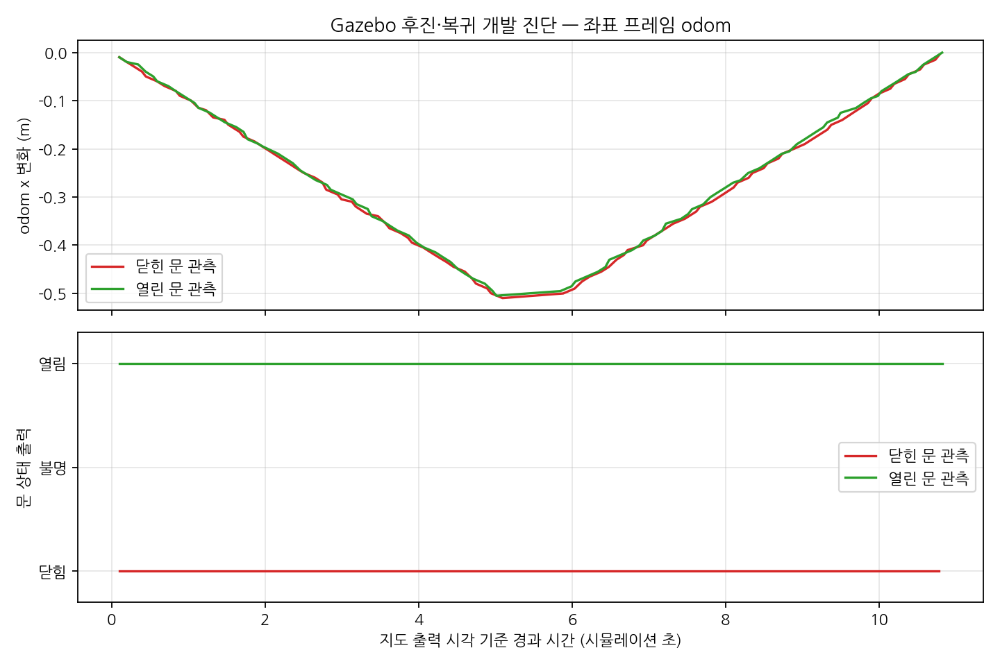

# 짧은 직선 주행 중 문 관측 검증

2026-11-03 기존 [실시간 연결](door-live.md)과 [순간 문 각도 변경](door-transition.md)에 이어,
문을 바라보는 로봇을 후진시켰다가 복귀시켰다. RGB-D·YOLOE·문 mapper·LiDAR SLAM을 계속 실행했다.
닫힘과 열림은 별도 실행이며 단일 문·정면의 짧은 직선 경로다.

## 주행과 판정 계약

하네스 `live_check.py --motion`은 Codex 격리 환경과 기존 clock 발행자 부재를 확인한 뒤
자체 Gazebo·SLAM·검출 프로세스를 시작한다. 2m 정면에서 문 상태가 확정된 후
`/cmd_vel`로 −0.1m/s를 약 5 시뮬레이션 초, +0.1m/s를 약 5초 명령한다.
각 구간 후 정지하며 초기 문 ID·anchor가 유지되는지 검사한다.

- odom 프레임은 odom→base_footprint, 좌표·quaternion은 유한하고 관측 시각은 최신이어야 한다.
  오래된 시각·NaN·프레임 불일치는 실행 실패다.
- 실측 x 이동은 구간별 목표 ±0.5m에서 0.1m 이내, y 이탈은 초기값에서 0.1m 이내여야 한다.
- 제어 루프의 시뮬레이션 시각 정체는 벽시계 30초 제한으로 종료한다.
- 상태 unknown은 주행 history에 그대로 남긴다. 구간 후에는 **정지·안정 대기 뒤 시각 경계보다
  새로운 관측**으로 원래 문 상태를 확인해야 한다.
- 문 ID 손실·중복·anchor 변경·이동 범위 위반·복귀 x 오차 초과·신규 상태 확인 실패는 전체 실패다.
- 구동 명령을 시작한 자체 실행에만 마지막 정지 명령을 보낸다. 정지 발행 실패도 기록하고
  나머지 생성 프로세스 그룹의 정리를 계속한다. 외부 실행이 발견돼 초기화를 거부한 경우에는 정지 명령을 보내지 않는다.

`--motion`과 `--transition`은 동시에 사용하지 않는다. 기존 world나 제품 알고리즘은 수정하지 않았다.

```bash
# door-live.md의 ROS·오버레이·도메인·DDS 환경을 준비한 뒤
/usr/bin/python3 scripts/door_probe/live_check.py --state closed --motion \
  --recon-root /home/blind/cv-middle/CV-VLM/recon-report \
  --output experiments/door_probe/live-motion-closed-new --timeout 45
# 정리가 끝난 뒤 새 출력 경로로 --state open --motion 실행
```

## 최종 결과

`live-motion-closed-02`, `live-motion-open-02` 두 실행이 complete로 끝났다.
원문은 로컬 `experiments/door_probe/<실행 이름>/check.json`에 보존했으며
[추적 요약](data/door-motion-summary.json)에 해시·실측·정지 후 신규 관측을 기록했다.
기존 01 실행은 정지 이후 신규 관측 기준을 강화하기 전 진단으로 구분한다.

| 문 상태 | 후진 x 이동 | 복귀 x 이동 | 초기 x 대비 복귀 오차 | 기록 샘플의 unknown |
|---|---:|---:|---:|---:|
| 닫힘 | −0.5100m | +0.5052m | 0.0048m | 0/97 |
| 열림 | −0.5051m | +0.5049m | 0.0002m | 0/95 |

두 실행 모두 ID `door_000001`과 최초 문 anchor가 유지됐다.
각 구간의 정지 후 새 관측 시각이 정지 경계를 넘는 것도 확인했다.
종료 후 검출 worker 그룹이 소멸했다. x 복귀 오차는 odom의 전후 축 차이며
2D 위치 정확도·SLAM 정확도·실물 주행 오차로 해석하지 않는다.



*독립된 닫힘/열림 실행을 시작 시각에 맞춰 겹쳐 그렸다.
odom 좌표는 Gazebo pose 기반이며 휠 슬립·센서 오차를 재현하지 않는다.
가로축은 polling 시점의 최근 지도 출력 시각이고 odom과 정확한 시각 동기화 궤적은 아니다.
하단은 기록한 샘플의 상태이며 모든 센서 프레임의 무중단 검출률을 나타내지 않는다.*

그림은 기존 Matplotlib와 나눔고딕 글꼴을 사용하는 [그림 생성기](../scripts/door_probe/motion_figure.py)로 재현한다.

```bash
/usr/bin/python3 scripts/door_probe/motion_figure.py \
  --reports experiments/door_probe/live-motion-closed-02/check.json \
            experiments/door_probe/live-motion-open-02/check.json \
  --output /tmp/door-motion-new.png
```

## 검증 범위와 한계

odom 검증 단위 검사 7개, 실제 주행 두 조건, 모듈·하네스 해시 및 문서 링크 검사를 수행했다.
전체 제품 테스트를 이 변경에서 다시 수행한 것은 아니다. 제품 모듈은 변경하지 않았다.
정확한 속도 추종·장거리 경로·회전·가림·센서 장애·독립 장소·실물 주행은 미검증이다.
실제 촬영 RGB-D 또는 rosbag 경로·보정·정답 제공 범위도 아직 확인되지 않았다.
