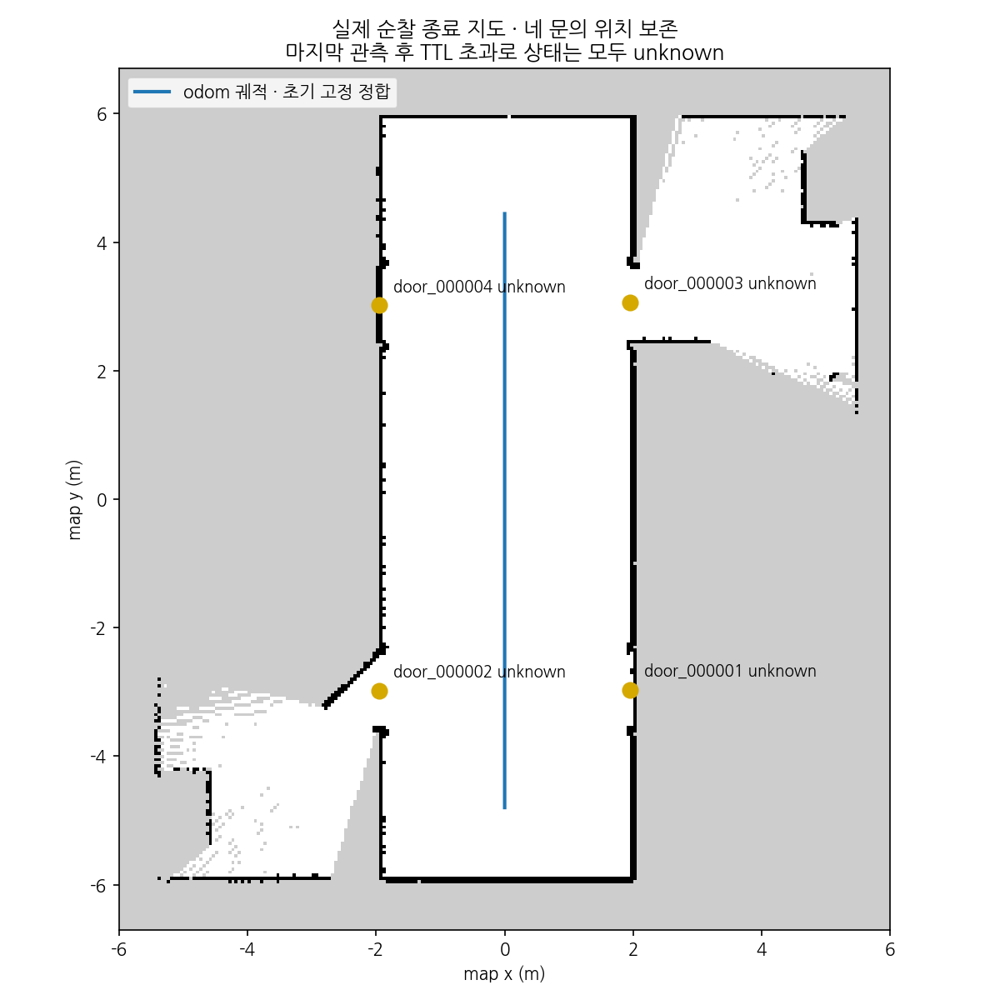
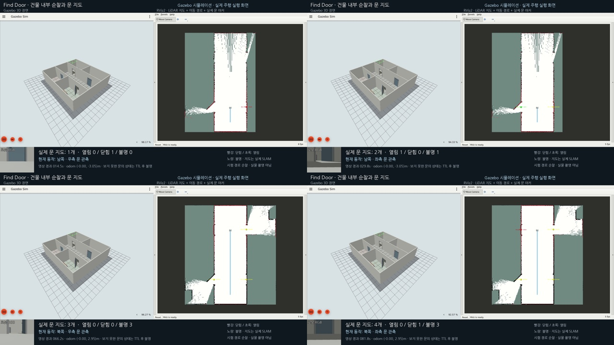

# 새 건물 내부 주행·문 순찰과 실제 GUI 녹화

2026-11-03, 지붕을 생략한 네 방·중앙 복도의 새 world에서 로봇을 실제로 주행시켰다.
YOLO11 출입구 검출과 기존 RGB-D 상태·문 메모리·slam_toolbox를 함께 실행해
**약 9.24m 주행 중 네 문의 위치를 서로 다른 ID로 누적**했고 관측 시점의 닫힘/열림을 확인했다.
Gazebo·RViz·실제 RGB·문 상태 출력을 같은 실행의 **100.4초 통합 MP4**로 저장했다.
사전에 정한 경로의 개발 검증이며 자율 프런티어 탐색·동시 다중 문 검출·독립 장소 성능은 아니다.

사용자 요청에 따라 로봇이 없는 현재 제출에서는 실제 촬영 영상 평가를 Gazebo·RViz 시뮬레이션 시연으로 대체한다.
기존 실제 RGB 사진의 AI 라벨 진단은 별도 이력으로 보존하고 이번 시뮬레이션 수치와 합산하지 않는다.

## world와 경로

- world: [door_patrol_v1.sdf](../src/mapping_gazebo/worlds/door_patrol_v1.sdf), 이름 door_patrol_v1.
- 생성기: [patrol_world.py](../scripts/door_probe/patrol_world.py), [기하 manifest](../src/mapping_gazebo/config/door_patrol_v1.json).
- 벽 중심선 기준 건물 x=[−5.5,5.5], y=[−6,6]m, 복도 x=[−2,2]m, 벽 높이 3.3m.
- 방 바닥의 색을 다르게 하고 책상·선반을 배치했다. 문은 폭 1.2m·높이 2.2m의 실제 문짝과 돌출 문틀이다.
- 기존 금속문 기하를 재사용한 새 합성 개발 배치다. 기존 world와 외부 wf_gazebo는 변경하지 않았다.

| 문 | 중심 (world m) | 문짝 각도 | 배치 상태 |
|---|---|---:|---|
| right_lower | (2, −3, 0) | 0° | closed |
| left_lower | (−2, −3, 0) | 45° | open |
| right_upper | (2, 3, 0) | 90° | open |
| left_upper | (−2, 3, 0) | 0° | closed |

로봇은 (0,−4.8), yaw=π/2에서 시작한다. 남쪽 y=−3으로 이동해 우측·좌측을 돌아보며
각 7 시뮬레이션 초 관측하고, 북쪽 y=3에서도 같은 순서로 관측한 뒤 y=4.5에서 정지·저장한다.
총 14단계이며 odom 오차로 닫힌 고리 제어를 한다. cmd_vel 속도 상한은 0.35m/s·0.5rad/s다.
주행 방향 ±25°의 유효 scan이 부족하거나 거리가 0.5m 미만이면 정지·실패한다.
odom/scan 수신이 벽시계 2초 이상 멎거나 지도 epoch가 초기화돼도 중단한다.

문 정답 위치·상태는 종료 후 대응 평가에만 사용한다. 검출·깊이 추론에 주입하지 않으며,
경로의 관측 대기 시간을 정답 검출 성공 여부로 연장하거나 조정하지 않는다.
새 학습·문턱 조정 없이 기존 150 epoch 모델·confidence=0.1을 사용했고 보조 재관측은 껐다.

## 실제 실행 결과

원문은 로컬 `experiments/door_probe/patrol-headless-02/`와 `patrol-video-01/`이다.
[추적 요약](data/door-patrol-summary.json)에 실행 당시 하네스 snapshot, world·설정·모델 식별,
실제 응답·로그·그림·영상 SHA를 보존했다.

| 항목 | headless 사전 시험 | 실제 GUI 녹화 시험 |
|---|---:|---:|
| 경로 단계 | 14/14 | 14/14 |
| odom 주행 거리 | 9.245m | 9.243m |
| 이동 방향 최소 LiDAR 거리 | 1.485m | 1.480m |
| 문별 위치·상태 확인 | 4/4 | 4/4 |
| 미대응 문 ID | 0 | 0 |
| 저장 | 성공 | 4개 ID·위치·상태 파일 대조 성공 |

영상 시험의 수치는 모든 문 지도 메시지 1,781건을 수신한 이력으로 계산했다.
같은 ID·관측 시각의 반복 지도는 새 상태 근거로 세지 않는다.

| 문 | 등록 ID | 신선한 정답 known 상태 관측 | 초기 투표·불명 관측 |
|---|---|---:|---:|
| right_lower | door_000001 | closed 29 | unknown 1 |
| left_lower | door_000002 | open 24 | unknown 1 |
| right_upper | door_000003 | open 13 | unknown 4 |
| left_upper | door_000004 | closed 41 | unknown 2 |

이 표는 서로 다른 관측 시각의 근거 수이며 전체 영상 프레임 정확도가 아니다.
각 문에 반대 known 상태가 나오면 실패하도록 했고 이번 이력에서는 없었다.
완전 열림 문은 다른 문보다 확정 근거가 적으며 관측 중에도 unknown 구간이 있다.
카메라가 다른 방향을 볼 때의 무검출·문틀/벽 평면 거부도 전체 영상과 카운터에 보존했다.
연속된 모든 시점에서 네 문 상태를 안정적으로 유지한 결과로 해석하지 않는다.

문 대응에는 최초 map←odom 고정 정합과 Gazebo pose odom을 사용했다.
문마다 고정 위치를 0.45m 이내의 배치 정답에 유일하게 대응시켜 누락·추가 ID를 검사했다.
이번 영상의 대응 거리는 약 0.052~0.080m이며 **독립적인 SLAM 정확도·실측 문 위치 오차가 아니다.**

**종료 시 저장된 네 문 상태는 모두 unknown이다.** 마지막 관측 이후 2초 TTL을 지나면
상태를 불명으로 바꾸며 위치와 ID를 보존하는 기존 정책이 적용됐다.
관측 중 open/closed 확인과 종료 파일의 현재 상태를 구분한다.



*실제 OccupancyGrid와 저장한 네 문 위치다. 파랑은 기록된 odom 궤적을 초기 고정 정합으로 옮긴 선이며
RViz 영상의 관측 시각 TF 기반 map 경로와 구분한다. 회색은 미관측이다. 닫힌 방 내부는 복도에서 스캔되지 않는다.*

## 통합 영상

전달 폴더는 로컬 `/home/blind/다운로드/find-door-patrol-20261103/`이다.

- find-door-patrol-gazebo-rviz.mp4: 1920×1080, H.264, 10fps, 100.4초, 약 19MB.
- find-door-patrol-gazebo.mp4 / find-door-patrol-rviz.mp4: 같은 실행에서 각각 창을 분리한 영상.
- world SDF·기하 manifest·문 저장 JSON·경로·검사 원문·안내 파일을 함께 보존했다.

왼쪽은 실제 Gazebo GUI, 오른쪽은 실제 RViz 지도·문 마커·TF 기반 주행 경로이며 하단은
같은 실행의 실제 RGB와 ROS 문 지도/순찰 상태 자막이다. GUI와 센서가 exact 동기화됐다는 뜻은 아니다.
전용 Xephyr 화면에서 캡처해 사용자의 다른 창이나 전체 바탕화면을 포함하지 않았다.



*네 관측 단계에서 시간 기준으로 발췌한 실제 MP4 프레임이다. 불명 구간도 포함한다.
그림·영상에 배치 정답을 인식 결과로 덧씌우지 않았다.*

영상 1,004프레임 중 실제 캡처는 990회, 반복은 14프레임이다.
캡처 지연 구간에 직전 실제 화면을 반복해 벽시계 재생 길이를 유지했고 metadata에 표시했다.
벽시계 녹화 100.368초와 영상 100.4초의 차이는 약 0.032초다.
세 MP4 모두 1,004프레임을 끝까지 디코딩했고 실패·unknown 구간을 편집해 제거하지 않았다.

## 재현

[setup](setup.md)의 ROS·외부 오버레이·현재 checkout 빌드를 준비한다.
기존 recon venv와 로컬 checkpoint는 [YOLO11 실행](door-yolo11-live.md)의 준비물을 사용한다.

```bash
source /opt/ros/humble/setup.bash
source ~/worker_following_ws/install/setup.bash
colcon build --symlink-install --packages-select mapping_gazebo mapping_semantic
source install/setup.bash
export ROS_DOMAIN_ID=12 GZ_PARTITION=codex OPENBLAS_NUM_THREADS=1
export FASTRTPS_DEFAULT_PROFILES_FILE=~/worker_following_ws/src/wf_gazebo/config/fastdds_bridge.xml
/usr/bin/python3 scripts/door_probe/patrol_world.py --check
# headless 사전 시험 — 매번 새 출력 폴더
/usr/bin/python3 scripts/door_probe/patrol_check.py --output experiments/door_probe/patrol-new-headless
# 위 시험 종료 후, 사용자 요청 범위의 실제 GUI·통합 녹화
/usr/bin/python3 scripts/door_probe/patrol_check.py --record --output experiments/door_probe/patrol-new-video
```

녹화에는 기존 설치된 Xephyr·PyQt5·OpenCV/GStreamer x264enc·mp4mux·Nanum 폰트를 사용한다.
새 의존성·가중치 다운로드는 하지 않았다. DISPLAY :92가 비어 있어야 하며 사용 중인 서버를 종료하지 않는다.
같은 ROS 도메인의 테스트와 시뮬레이션을 동시에 실행하지 않는다.
직접 생성한 프로세스 그룹과 검출 worker 종료를 확인했고 종료 오류는 없었다.

검사: 두 패키지 빌드 성공, 새 world·제어·판정 31검사 통과, 전체 오프라인 929검사 통과·ROS 전용 5개 제외,
실제 ROS mapping_semantic 340검사 및 mapping_gazebo 패키지 검사 오류·실패 0.
첫 preflight-01은 설치에 없는 mapping_eval helper import로 시뮬레이션 전에 실패했다.
불필요한 의존성을 제거하고 02로 시험했다. 교차 검토에서 저장 대기 중 관측 누락과
추가 인터럽트에 의한 정리 중단 위험을 보완한 뒤 GUI 시험을 실행했다.
headless-02는 보완 전 snapshot이며 영상 시험은 보완 후 소스다. 두 기록을 합치거나 덮어쓰지 않는다.

기준 커밋 3911341 이후 단계 태그는 `v0.2.0-door-patrol.1`이다. rosbag은 생성하지 않았다.
다음 범위는 새로운 배치·실패 조건의 확대, 동시 다중 문 관측, 자율 탐색과 장시간 복구 검증이며
이번 사용자 요청의 고정 경로 순찰·영상과 구분한다.

후속 [마지막 확인 상태 보존·재시험](door-last-observation.md)에서 과거 확인과 현재 유효성을 분리했다.
이 문서의 첫 순찰 unknown 결과와 영상은 수정 전 이력으로 보존한다.

추가 [재방문 상태 갱신](door-revisit.md)은 같은 건물의 왕복 경로에서 닫힘→열림→닫힘을 검증한다.
