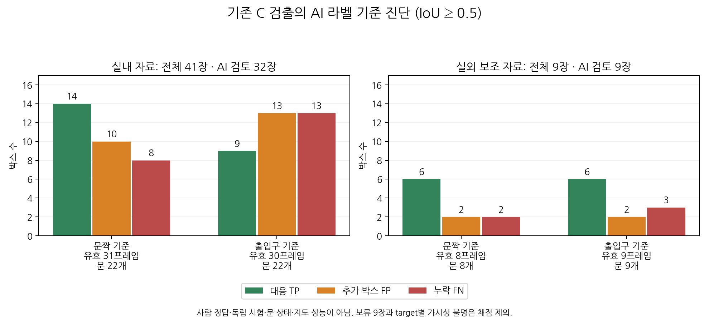

# 실제 RGB의 AI 라벨 기준 검출 진단

2026-11-03 [AI 시각 라벨](door-ai-labels.md)과 2026-11-01 완료된 기존 C 검출을 비교했다.
**AI 라벨 기준의 개발 진단이며 사람 정답 기준 정확도·독립 시험·현재 ROS 시스템의 실물 성능이 아니다.**
사진·라벨·검출을 바꾸거나 모델을 다시 실행하지 않았다. 기준선은 기존 YOLOE이며 YOLO11 학습 결과가 아니다.



## 자료와 분모

기존 실제 RGB 50장을 원래 평가 그룹에 따라 실내 41장·실외 보조 9장으로 분리했다.
실내는 AI 검토 32장·판단 보류 9장, 실외 보조는 AI 검토 9장이다.
기존 [Gazebo 사용자 검수 9장](door-reviewed-nine.md)은 이 계산에 포함하지 않는다.
현재 자료의 collection별 unassigned 분할은 유지했다. 같은 자료를 다시 채점해 새 독립 시험셋으로 바꾸지 않았다.

문짝과 출입구는 **동일한 기존 검출 박스**를 서로 다른 AI 참조 bbox에 비교한다.
IoU≥0.5 최대 개수 일대일 대응과 [기존 평가 규칙](door-label-evaluation.md)을 그대로 사용했다.
점수 문턱을 새로 조정하지 않았으며 person 검출은 문 지표에서 제외했다.
한 프레임에 문이 여러 개 있으면 각 출입구를 별개로 대응한다.
보류 프레임은 채점하지 않는다. 어느 문이라도 해당 target이 비가시·불명이면 그 target의 프레임 전체를 제외한다.
무시 영역 bbox가 없어 부분 채점할 수 없는 현재 규칙이며, 제외에 따른 선택 편향이 있다.

| 자료 | 기준 | 전체 | 보류 제외 | 가시성 제외 | 유효 프레임 | 유효 문 객체 |
|---|---|---:|---:|---:|---:|---:|
| 실내 | 문짝 | 41 | 9 | 1 | 31 | 22 |
| 실내 | 출입구 | 41 | 9 | 2 | 30 | 22 |
| 실외 보조 | 문짝 | 9 | 0 | 1 | 8 | 8 |
| 실외 보조 | 출입구 | 9 | 0 | 0 | 9 | 9 |

전체 50장에 예측이 연결됐고 유효 프레임의 실행 오류·누락은 0이다.
기존 개수 평가의 제외 6장을 그대로 버린 것이 아니라 새 AI 라벨·가시성 규칙으로 분모를 계산했다.
실내의 음성 11장은 두 기준 모두 유효 프레임에 포함한다.

## 결과

| 자료·기준 | TP | FP | FN | Precision | Recall | F1 | 프레임 exact |
|---|---:|---:|---:|---:|---:|---:|---:|
| 실내·문짝 | 14 | 10 | 8 | 58.3% | 63.6% | 60.9% | 16/31 |
| 실내·출입구 | 9 | 13 | 13 | 40.9% | 40.9% | 40.9% | 15/30 |
| 실외 보조·문짝 | 6 | 2 | 2 | 75.0% | 75.0% | 75.0% | 5/8 |
| 실외 보조·출입구 | 6 | 2 | 3 | 75.0% | 66.7% | 70.6% | 5/9 |

P/R/F1은 가시성·검토 조건을 충족한 유효 추론에 한정한다. 전체 실제 문의 성능이나 AP/mAP가 아니다.
프레임 exact는 그 프레임의 모든 문이 대응되고 추가 FP가 없어야 성공이다. 문 없는 프레임도 포함하므로 문 재현율과 다르다.
실내/실외 보조 및 문짝/출입구 결과를 합산하지 않는다. 가시성 분모가 달라 target 간 점수 차이만으로 원인을 확정하지 않는다.

## 확인한 실패와 다음 실험

실내 문짝 기준에서 AI 상태가 closed인 객체는 7/9, open은 5/11, unknown은 2/2가 대응됐다.
이는 **참조 상태별 검출 대응률**이며 열림/닫힘 상태 분류 정확도가 아니다.
누락 8개 중 4개는 해당 사진에 door 검출 박스가 전혀 없었다. 나머지는 다른 문·영역의 박스만 있거나 IoU가 부족했다.
가려진 문, 좁은 회전 문짝, 후경 문에서 누락이 나타났다. 이 소규모 결과만으로 각 요인이 원인임을 확정하지 않는다.
실내 음성 사진 11장 중 1장에서 FP 1개가 발생했고, 해당 사진은 벽 수납장이다.
나머지 문짝 FP 9개는 문이 있는 사진에서 발생했으며 중복·다른 영역·IoU 미달을 함께 포함한다.

출입구 기준에서는 실내 open 객체 13개 중 3개가 대응됐다.
문짝을 잘 감싼 박스도 고정 문틀과 IoU가 낮을 수 있어 문 검출과 고정 출입구 추정을 별도로 유지해야 한다.
기존 RGB-D 출입구·상태·지도 알고리즘을 이 RGB 박스 진단으로 평가한 것은 아니다.

다음에는 문짝 검출을 학습 대상으로 우선 검토하되, 실제 사진의 반복 장소를 확인해 그룹 단위 분할을 정해야 한다.
AI 보류 9장과 보이지 않는 문짝을 음성 정답으로 바꾸지 않는다. 보류가 해소되기 전의 학습 후보에서는 제외한다.
문 없는 사진과 가구문 사례는 배경 학습 후보가 될 수 있으나, 현재 50장을 독립 시험셋으로 보장할 수는 없다.
YOLO11의 새 가중치·학습은 아직 실행하지 않았으며 기준선·학습 모델을 동일한 고정 분할로 비교하는 계획이 남아 있다.

## 재현과 검증

최종 로컬 원문은 `experiments/door_probe/real-ai-eval-02/`다.
각 그룹의 `*-dataset.json`, `*-predictions.json`, `*-report.json`과 `reports.json`, `failure-analysis.json`,
실행 절차 `run.py`·`figure.py`를 보존했다. [추적 요약](data/door-real-ai-evaluation-summary.json)에
원본 AI manifest·예측·실제 subset·평가 소스·절차·그림 해시와 분모·상태별 집계를 기록했다.
기존 scorer CLI로 최종 입력을 다시 채점할 수 있다. 출력은 새 경로를 사용한다.

```bash
/usr/bin/python3 scripts/door_probe/label_evaluate.py score \
  --dataset experiments/door_probe/real-ai-eval-02/indoor_primary-dataset.json \
  --predictions experiments/door_probe/real-ai-eval-02/indoor_primary-predictions.json \
  --environment real_rgb --split unassigned \
  --output experiments/door_probe/real-ai-eval-check/indoor-report.json
```

실외 보조 재현은 입력 파일명에서 `indoor_primary`를 `exterior_auxiliary`로 바꾼다.
처음 생성한 `real-ai-eval-01`은 부모 파일 해시를 subset 해시 필드에 넣은 기록 오류가 있었다.
원문을 보존하고 최종 02에서는 실제 입력의 `dataset_sha256`·`predictions_sha256`과 부모 `source_*` 해시를 분리했다.
두 실행의 채점 수치는 같다. 모델 재추론 없이 기록 계보를 바로잡았다.
최종 두 그룹을 scorer CLI로 각각 재현해 모든 계산 필드·대응·입력 해시가 일치함을 확인했다.
상태별 TP·GT와 전체 TP·GT, 실패 목록의 FN·FP 합계도 대조했다. 문서 64개의 링크·앵커 검사 오류는 0이다.
제품 코드·평가 알고리즘은 바꾸지 않았으므로 패키지 빌드·전체 단위 테스트·Gazebo 실행을 반복하지 않았다.
