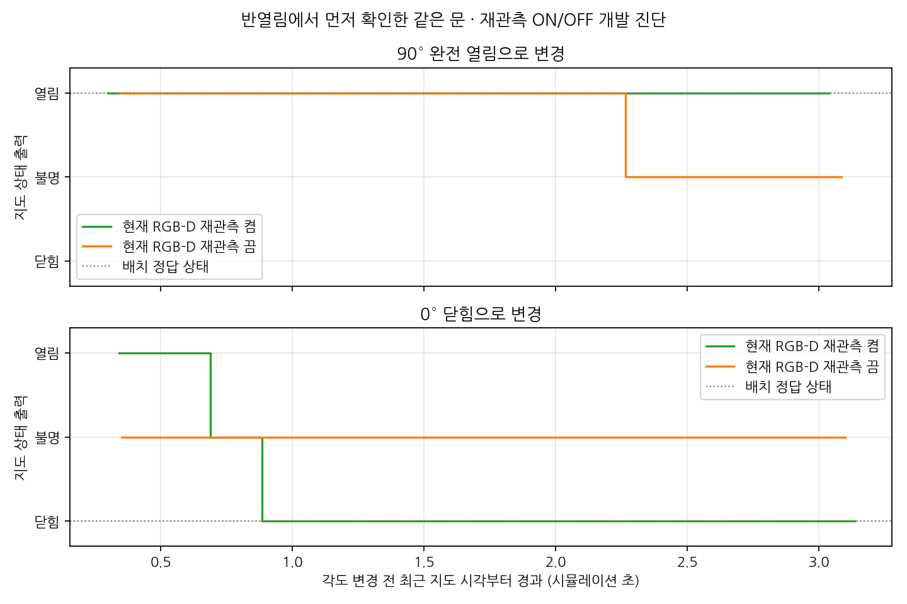

# 이미 확인한 출입구의 RGB-D 재관측

[ADR-0012](adr/0012-known-door-reobservation.md)에 따라 문짝 검출이 없는 프레임에서도
이미 확인한 출입구의 현재 RGB-D 근거를 사용할 수 있도록 보완한다.
처음 보는 열린 문의 검출과 기존 문의 상태 갱신은 구분한다.

## 구현 계약

[door_reobservation.py](../src/mapping_semantic/mapping_semantic/door_reobservation.py)는
출입구 평면 네 점의 map 저장·현재 카메라 재투영·새 기하 일치 검사를 제공한다.
검출 기반 연속 관측으로 확정된 문만 캐시에 넣고 새 ID 생성 없이 같은 문을 갱신한다.
무검출 시 현재 RGB-D에서 다시 양쪽 문틀·벽 평면·문턱과 상태를 추정한다.
캐시는 이전 상태를 복제하지 않으며 재관측만으로 기하가 조금씩 변하지 않는다.
기하 기준·epoch·저장/복원 정책은 ADR을 따른다.
캐시 네 점 생성에 실패해도 정상 검출 관측은 유지하고 cache_geometry_unavailable을 기록한다.
기능을 끄면 캐시 생성·재투영을 모두 생략한다.

기본 `reobserve_known_doors:=true`, 비교용 `false`를 doors/live_doors launch에서 지원한다.
no_detection은 검출 seed가 없던 입력 수이며 재관측까지 실패했다는 뜻은 아니다.
reobserved는 검출 없이 현재 RGB-D의 새 근거를 같은 ID에 반영한 수이고 processed에도 포함한다.
reobservation_unavailable과 reobservation_geometry_rejected는 재투영/기하 거부를 구분한다.

## 실행 전 Gazebo 시험 조건

평판 금속문 half world에서 실제 YOLOE가 반열림 문을 확인한 뒤 같은 실행의 문짝을
90° 완전 열림, 0° 닫힘으로 순서대로 바꾼다. 기대 상태는 open, closed다.
각 조건에서 동일 ID·anchor와 정지 뒤 새 관측으로 상태가 확정돼야 한다.
검출 없는 reobserved가 증가하고, 완전 열림은 최소 3 시뮬레이션 초 동안 새 관측이 이어져
2초 TTL보다 길게 기존 상태 복제로 유지되는 것이 아님을 확인한다.
닫힘 전환의 unknown 경유 여부도 기록한다. 상태와 world 각도는 검증 정답에만 사용한다.
문 상태 변경은 Gazebo set_pose의 순간 변환이며 연속 경첩 물리 운동은 아니다.
새로 시작한 열린 문의 검출 성능·실물·독립 장면 성능을 검증했다고 표현하지 않는다.

## 검증 상태

2026-11-03 `known-door-on-02`와 `known-door-off-01`을 같은 world·모델·설정으로 실행했다.
[추적 요약](data/door-reobservation-summary.json)에 소스·하네스·모델·설정·world·원문·그림 해시를 남겼다.
ON01은 캐시 생성 실패와 정상 관측 경계를 분리하기 전 진단이며 최종 수치에는 사용하지 않는다.

| 단계 정답 | 재관측 ON 최종 상태 | ON 무검출 재관측 | ON 확인 구간 | 재관측 OFF 최종 상태 | OFF 재관측 |
|---|---|---:|---:|---|---:|
| 완전 열림 | open | 15회 | 3.037 시뮬레이션 초 | unknown | 0회 |
| 닫힘 | closed | 21회 | 3.135 시뮬레이션 초 | unknown | 0회 |

두 실행의 모든 기록에서 ID `door_000001`과 최초 anchor가 유지됐다.
ON 닫힘 전환에서는 open→unknown→closed를 관측했다.
ON 마지막 관측의 age는 각각 0.388초·0.354초(시뮬레이션 시각)로 새 RGB-D 갱신을 확인했다.
OFF에서는 마지막 관측 age가 2.890초·5.990초로 TTL을 넘었고 unknown을 출력했다.
ON과 OFF 모두 기대한 비교 동작이 실행됐다는 뜻이며, OFF가 문 상태 정답을 맞혔다는 뜻은 아니다.
ON 저장 지도는 closed, OFF 저장 지도는 unknown이며 ID·anchor가 같았다.
두 실행의 `/clock` 발행자는 1개, `/map` 발행자는 실제 slam_toolbox 하나였고 검출 worker 그룹은 종료 후 소멸했다.



*서로 별도 실행한 ON/OFF를 각 각도 변경 전 최근 지도 시각에 맞춰 겹쳤다.
가로축은 polling한 지도 출력의 시뮬레이션 시각이며 pose 적용 시각·정밀 전이 지연을 측정한 것이 아니다.
기록 샘플에 중복 지도 출력이 포함될 수 있고 모든 센서 프레임의 정확도를 뜻하지 않는다.
회색 점선은 Gazebo 배치 정답이고 초록/주황은 지도 예측이다.*

```bash
# door-live.md의 ROS·오버레이·격리 환경 준비 후
/usr/bin/python3 scripts/door_probe/live_check.py --state open \
  --world experiments/door_probe/metal-scene-01/door_metal_half.sdf \
  --known-door-cycle --reobserve-known-doors true \
  --recon-root /home/blind/cv-middle/CV-VLM/recon-report \
  --output experiments/door_probe/known-door-on-new --timeout 45
# 종료·정리 후 false와 새 경로로 OFF 비교 실행
/usr/bin/python3 scripts/door_probe/reobservation_figure.py \
  --reports experiments/door_probe/known-door-on-02/check.json \
            experiments/door_probe/known-door-off-01/check.json \
  --output /tmp/door-reobservation-new.png
```

재현용 metal half world가 없으면 [장면 변형 생성기](door-scene-variation.md)로 새 실험 폴더에 생성한다.
하네스는 앞서 반열림에서 open을 확정한 뒤 실험 각도를 바꾼다. world 각도는 노드 입력으로 전달하지 않는다.

순수 재투영·기하·same-ID 경계 16검사, 실제 ROS 전용 5검사, 전체 오프라인 729검사가 통과했다.
오프라인 전체 실행의 ROS 전용 5검사는 건너뛰고 명시적 격리 환경에서 따로 통과했다.
mapping_semantic을 재빌드했고 colcon 검사 273개·오류 0·실패 0·건너뜀 0으로 마쳤다.
기존 [ROS 기록 재생 진단](door-ros.md)도 `ros-reobservation-01`에서 다시 통과했다.
이 재생은 인위적 시각·항등 map→odom 시험이며 Gazebo 실시간 비교와 구분한다.
기존 header/TF/TTL/저장·복원/지도 보정/시각 역행 거부와 새 캐시 제거·무검출 입력을 확인했다.

## 남은 한계

처음 보는 완전 열림 문의 검출 실패는 그대로다. 이 기능은 반열림 등에서 먼저 확인한 문의 상태 갱신을 보완한다.
다중 캐시가 보이면 갱신을 거부하며 문틀 가림·출입구 기하 불일치·재투영 실패도 상태 근거를 만들지 않는다.
그 경우 기존 관측 만료에 따라 unknown이 된다. 일반 다중 문·독립 장소·실물 검증과 라벨 검수는 남아 있다.
