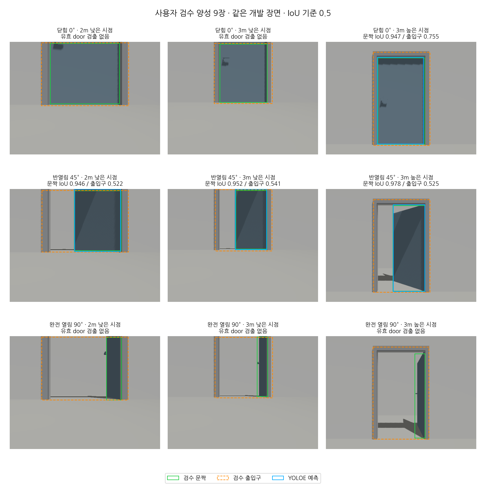

# 사용자 검수 9장으로 평가한 문 검출 기준선

2026-11-03 사용자 제공 `door-label-patch.json`을 원본 manifest SHA와 대조해 검수본으로 적용했다.
프레임 95개 중 정확히 앞의 9개가 reviewed이며 나머지 86개는 draft다.
두 bbox·가시성·상태를 그대로 보존했고 원본 사진·원본 manifest·제출 파일은 변경하지 않았다.
[검수 라벨 9장](data/door-nine-reviewed-labels.json)과 [원문·모델·입력·도구 해시](data/door-reviewed-nine-summary.json)를 보존했다.

## 평가 범위와 실행

기존 [3m 두 시점](door-view-diagnostic.md) 6장 예측을 그대로 재사용하고,
정확한 RGB 해시에 연결된 결과가 없던 2m 3장만 기존 YOLOE로 추론했다.
기존 6장과 config·checkpoint·embedding·prompt·backend 소스의 SHA가 같은지 추론 전에 확인했다.
가중치·문 confidence 0.1·NMS·입력 크기 640은 바꾸지 않았다. 새 학습은 수행하지 않았다.
모델에는 원본 이미지 경로만 전달했으며 검수 박스·문 상태·world 정답을 입력하지 않았다.
추론은 별도 기존 venv에서 PYTHONPATH/PYTHONHOME을 제거하고 캐시는 이번 출력 폴더에 뒀다.
3장 모두 유효 추론이 끝났고 worker 프로세스 그룹도 종료됐다.

[고정 9장 보완 하네스](../scripts/door_probe/complete_reviewed_nine.py)는 검수 9개·기존 6개 조합만 받는다.
기존 출력 경로·모델 변경·검수 누락은 새 추론 전에 거부한다. 기존 추론 오류를 자동 재시도하지 않는다.
중단된 실행에서는 기존 결과를 보존하고 미완료 수를 기록한다.
실행 후 중복 SIGINT 정리 보호를 보완했다. 실제 추론 시 스크립트 사본과 개선된 현재 스크립트 해시를 별도로 남겼고,
해시를 맞추기 위해 성공한 3장 추론을 다시 실행하지 않았다.

```bash
/usr/bin/python3 scripts/door_probe/complete_reviewed_nine.py \
  --dataset experiments/door_probe/reviewed-nine-01/dataset-reviewed.json \
  --predictions experiments/door_probe/reviewed-nine-01/predictions-six.json \
  --recon-root /home/blind/cv-middle/CV-VLM/recon-report \
  --output experiments/door_probe/reviewed-nine-new/completed
# 이미 완료된 결과를 채점만 할 때: 모델 추론 없음
/usr/bin/python3 scripts/door_probe/label_evaluate.py score \
  --dataset experiments/door_probe/reviewed-nine-01/dataset-reviewed.json \
  --predictions experiments/door_probe/reviewed-nine-01/completed/predictions.json \
  --environment gazebo --split development \
  --output experiments/door_probe/reviewed-nine-new/evaluation.json
```

## 결과

[ADR-0013](adr/0013-dual-box-evaluation.md)의 IoU≥0.5 일대일 대응을 적용했다.
선택 Gazebo 45개 중 검수 전 36개는 제외했고, 검수 9개·GT 9개 모두 유효 추론과 두 target의 visible 정답을 갖는다.
예측 누락·실행 오류·가시성 제외는 0개다. 분모를 검출된 4개로 줄이지 않았다.

| 기준 | TP | FP | FN | Precision | Recall | F1 | 프레임 exact 성공 | 대응 TP 평균 IoU |
|---|---:|---:|---:|---:|---:|---:|---:|---:|
| 보이는 문짝 | 4 | 0 | 5 | 1.000 | 0.444 | 0.615 | 4/9 | 0.956 |
| 고정 출입구 | 4 | 0 | 5 | 1.000 | 0.444 | 0.615 | 4/9 | 0.586 |

모든 9개에 유효 추론이 있으므로 이번 집합에서는 조건부 P/R/F1의 유효 추론 분모와 전체 유효 정답 분모가 같다.
다른 평가에 오류·미실행이 있으면 같은 해석을 그대로 적용하지 않는다.

| 문 배치 정답 | 2m 낮은 시점 | 3m 낮은 시점 | 3m 높은 시점 |
|---|---|---|---|
| 닫힘 0° | 미검출 | 미검출 | 두 기준 TP |
| 반열림 45° | 두 기준 TP | 두 기준 TP | 두 기준 TP |
| 완전 열림 90° | 미검출 | 미검출 | 미검출 |

닫힘은 1/3, 반열림은 3/3, 완전 열림은 0/3이다. 검출 유무 기준의 이전 관찰을 사용자 bbox 정답으로 확인했다.
문짝과 출입구의 TP 수가 같은 것은 IoU 0.5를 모두 넘었다는 뜻이며 두 박스가 같은 의미·위치라는 뜻은 아니다.
평균 IoU의 차이는 검출된 같은 4개에서 계산한 조건부 진단이다.
미검출 5개의 문제를 평균 IoU 0.956으로 가리지 않고 Recall 4/9에 포함했다.



*실제 Gazebo RGB 9장에 사용자 문짝 정답(초록)·출입구 정답(주황 점선)·YOLOE 예측(파랑)을 표시했다.
행 이름은 배치 정답이고 모델의 문 상태 예측이 아니다. 검출이 없던 5장은 파란 예측 박스가 없다.*

```bash
/usr/bin/python3 scripts/door_probe/reviewed_nine_figure.py \
  --labels docs/data/door-nine-reviewed-labels.json \
  --predictions experiments/door_probe/reviewed-nine-01/completed/predictions.json \
  --output /tmp/door-nine-reviewed-new.png
```

## 해석과 다음 단계

이 9장에서는 박스 크기 차이보다 유효 door seed 누락이 주된 실패였다.
문짝은 실제 검출된 4개에서 잘 감쌌지만, 완전 열림은 문 전체가 보이는 보조 시점에서도 누락됐다.
벽으로 분류했다는 근거는 없으며 내부 후보가 confidence 문턱 아래였는지는 반환된 결과만으로 알 수 없다.

동일 개발 장면·하나의 문 모델·양성 영상 9개이며 독립 장소·보지 않은 문 모델의 일반 성능을 추정하지 않는다.
음성이 없으므로 FP 0·Precision 1을 일반적인 오검출 억제·안전성으로 해석하지 않는다.
새 YOLOv11 학습이 반드시 성공한다는 근거도 아니다. 추가 학습 후보 비교에는 다양한 문·문 없는 장면,
독립 장소·모델별 분할과 검수 정답이 필요하다. 현재 개발 묶음을 임의로 나눠 독립 시험이라고 부르지 않는다.
기존 문의 무검출 RGB-D 재관측은 [별도 실시간 시험](door-reobservation.md)이고,
이 원 검출 bbox 점수로 출입구 추정·상태·지도 성능을 측정했다고 표현하지 않는다.
실제 RGB 50장과 기존 Gazebo 36장은 아직 이중 bbox 미검수이며 실제 RGB-D는 현재 없다.

관련 검사 52개·전체 오프라인 776개가 통과했고 ROS 전용 5개는 건너뛰었다.
제품 ROS 패키지·의존성·센서 설정은 변경하지 않아 재빌드하지 않았다.
9장 검수 적용·부족한 3장 실제 추론·9장 실제 채점·기존 6장 보존·중복 SIGINT 정리 회귀를 확인했다.
