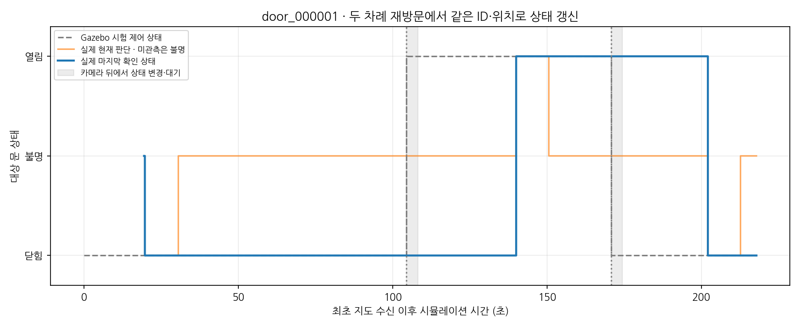
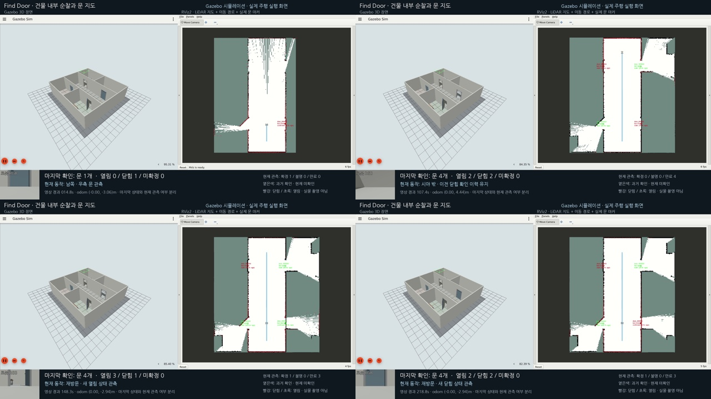

# 재방문 시 같은 문의 상태 갱신

사용자 요청 범위를 재방문 상태 갱신까지로 한정해, 같은 건물에서 **닫힘 → 떠남 → 열림으로 변경 →
재방문 확인 → 다시 떠남 → 닫힘으로 변경 → 두 번째 재방문 확인**을 실제 실행했다.
대상 door_000001과 나머지 세 문의 ID·고정 위치는 유지됐고, 대상 상태는 새 RGB-D 관측으로 갱신됐다.
기존 [마지막 확인 정책](door-last-observation.md)과 문 검출·깊이·시간 종합 코드를 사용했으며
새 재방문 경로·Gazebo 제어·시야 밖 증명·구간별 사후 검사를 추가했다.

## 시나리오와 검증 기준

기존 [네 방 건물](../src/mapping_gazebo/worlds/door_patrol_v1.sdf)과 14단계 최초 순찰을 유지한다.
추가 14단계에서 남쪽 우측 right_lower 문을 두 번 변경하고 왕복한다. 총 28단계다.

1. 최초 순찰에서 네 문을 등록하고 대상의 closed 확인 이력을 만든다.
2. 북쪽 y≈4.44m·북향에서 남쪽 문이 카메라 뒤에 있음을 RGB 관측 시각 TF로 확인한다.
3. Gazebo set_pose로 대상 문을 90°로 열고 약 3초 시야 밖에서 대기한다.
4. 남쪽 y≈−3m로 돌아와 우측 문을 7 시뮬레이션 초 관측한다.
5. 북쪽 y≈3m로 다시 떠나 대상이 카메라 뒤에 있음을 확인하고 0°로 닫는다.
6. 시야 밖 대기·두 번째 재방문 관측 후 복도 방향으로 회전해 정지·저장한다.

문 pose·배치 정답은 제어와 사후 평가에만 사용한다. 검출·상태 노드에 전달하지 않는다.
카메라 광학 좌표계의 대상 중심 z<0을 실제 관측 시각 TF에서 확인해 시야 밖임을 기록한다.
Gazebo boolean 성공 응답과 제어 명령·시각도 보존한다. 문 이동은 순간 pose 변경이며 연속 경첩 회전은 아니다.

[revisit.py](../scripts/door_probe/revisit.py)는 다음을 검사한다.

- 네 ID가 모두 존재하고 추가·중복·누락 없이 각각 초기 anchor와 정확히 같다.
- 시야 밖 대기 중 대상의 관측 횟수·마지막 관측 시각·확정 상태·확정 시각이 변하지 않는다.
- 재방문 갱신은 제어 이후 source 시각의 신선한 실제 known 관측에서만 일어난다.
- 처음 확정 상태 변경 시 누적 관측 근거가 있고, 서로 다른 시각의 확정 관측이 적어도 3개다.
- 과거 보존 상태·stale/unknown·같은 시각 반복은 새 상태 확인으로 세지 않는다.

[revisit_final.py](../scripts/door_probe/revisit_final.py)는 각 제어 경계로 전체 이력을 나눠 다시 평가한다.
첫 구간은 다음 상태 변경 직전까지, 둘째는 저장 응답 이후 마지막 수신 관측까지다.
스캔 종료 뒤 이동·회전·주차 중 잘못된 known이 잠깐 나왔다가 복구되는 경우도 통과하지 않는다.

## 실제 결과

원문은 `experiments/door_probe/revisit-headless-01/`, `revisit-video-01/`이다.
[원문·실행 소스·영상·그림 추적 요약](data/door-revisit-summary.json)을 보존했다.

| 항목 | headless | 실제 GUI·녹화 |
|---|---:|---:|
| 경로 | 28/28 | 28/28 |
| odom 이동 거리 | 28.405m | 28.404m |
| 주행 방향 최소 LiDAR 거리 | 1.482m | 1.475m |
| 전체 재방문 검증 | 통과 | 통과 |
| 네 문 ID·고정 위치 | 유지 | 유지 |

GUI 실행의 대상은 door_000001, 고정 위치는 약 (1.94952,−2.96228,−0.01553)m다.
이는 기존 추정 anchor이며 독립적인 문 위치 정확도·SLAM 오차가 아니다.

| 재방문 | 이전 확인 | 새 확인 | 시야 밖 이력 유지 검사 구간 | 서로 다른 신선한 확정 관측 |
|---|---|---|---:|---:|
| 첫 번째 | closed | open | 3.729초 | 34회 |
| 두 번째 | open | closed | 3.691초 | 29회 |

동적 구간의 지도 snapshot 2,161개에서 네 ID·anchor를 확인했다.
대상 문은 시야 밖에서 과거 확인을 유지하고, 돌아온 뒤 실제 관측 시각과 상태가 갱신됐다.
각 구간에 새로운 상태와 반대되는 현재 known이나 근거 없는 마지막 이력 변경은 없었다.
처음 네 문을 확인한 평가는 초기 구간에만 적용하고, 상태가 바뀐 이후는 제어별 정답으로 따로 검사했다.

제어 호출 직전부터 첫 새 확정 관측 시각까지는 열림 35.397초·닫힘 31.203초였다.
**이 시간에는 시야 밖 대기·회전·재방문 주행이 포함된다. 순수 인식 처리 지연이 아니다.**



*점선은 Gazebo 시험 제어 상태, 주황은 실제 현재 판단, 파랑은 실제 마지막 확인이다.
음영은 카메라 뒤에서 상태를 바꾼 뒤 대기한 구간이다. 제어가 발생해도 보지 않는 동안 파랑은 이전 값으로 남는다.*

종료 시에는 네 문 모두 현재 unknown/stale이며 마지막 확인 상태는 closed/open/open/closed다.
schema2 파일에 네 ID·위치·현재 판단·마지막 확인 상태·실제 시각을 저장하고 수신 지도와 대조했다.

## 통합 영상과 실행

전달 폴더는 `/home/blind/다운로드/find-door-revisit-20261103/`이다.

- find-door-patrol-gazebo-rviz.mp4: 실제 Gazebo·RViz·로봇 RGB·문 상태 통합, 1920×1080 H.264·10fps·232.9초.
- find-door-patrol-gazebo.mp4 / find-door-patrol-rviz.mp4: 같은 실행의 개별 창 영상.
- world·manifest·저장 JSON·경로·검사 원문·지도·상태 그래프·안내를 함께 저장했다.



*실제 MP4에서 초기 닫힘 관측, 시야 밖 변경 후 이력 유지, 첫 열림 재방문, 두 번째 닫힘 재방문을 발췌했다.
자막과 문 마커는 ROS 출력이며 시뮬레이터 정답으로 인식 결과를 덧씌우지 않는다.*

총 2,329프레임 중 실제 캡처 2,264회·반복 65프레임이다.
지연 구간을 직전 실제 화면으로 채워 벽시계 재생 길이를 보존했고 metadata에 표시했다.
통합·분리 MP4 세 개 모두 끝까지 디코딩했다. 전용 Xephyr만 캡처했고 다른 사용자 창은 포함하지 않았다.

재현은 [기존 환경 준비](door-patrol.md#재현) 후 다음을 실행한다. 매번 새 출력 경로를 사용한다.

```bash
/usr/bin/python3 scripts/door_probe/patrol_check.py --revisit --timeout 420 \
  --output experiments/door_probe/revisit-new-headless
# 위 실행 종료 뒤 사용자 요청 범위의 GUI 녹화
/usr/bin/python3 scripts/door_probe/patrol_check.py --revisit --record --timeout 420 \
  --output experiments/door_probe/revisit-new-video
```

모델·confidence·RGB-D/TF·SLAM·보조 재관측 false를 유지했다. 새 모델 학습이나 외부 의존성 설치는 없다.
순수 재방문·시간 범위 검사 35개와 전체 오프라인 991검사가 통과했고 ROS 전용 5개는 별도 환경 대상이다.
문 제품 패키지는 직전 단계와 같으며 그 단계의 빌드·ROS 363검사 통과 이력을 유지한다.
이번에는 실제 headless 및 GUI 왕복·문 상태 변경·종료까지 실행 검증했다.
첫 headless는 구간 검사 강화 전 하네스 snapshot을 보존했고, 전체 원문을 강화 검사로 재계산해 통과했다.
GUI는 처음부터 저장 응답 후 전체 구간을 검사하는 하네스를 사용했다.

Git 기준은 0af09bf 이후, 단계 태그는 `v0.2.0-door-revisit.1`이다. 로컬 dev에 통합하며 원격 push는 하지 않는다.
새 건물·모델·독립 장소·실물·자율 탐색의 일반 성능 평가는 이 재방문 시험의 범위가 아니다.
