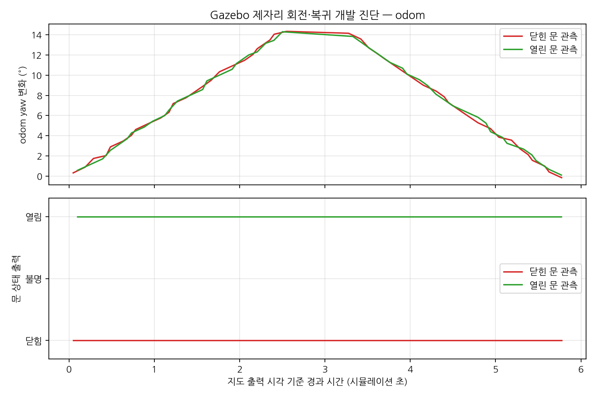

# 제자리 회전 중 문 관측 검증

[직선 주행](door-motion.md)에 이어 동일 Gazebo 실행에서 로봇을 제자리 회전시켜
RGB-D·YOLOE·문 mapper·LiDAR SLAM의 연결을 검사한다. 기존 world·제품 알고리즘은 변경하지 않는다.

## 실행 전 고정한 조건과 판정

- 2m 정면에서 시작해 문 상태가 확정되면 angular.z=+0.1rad/s를 2.5 시뮬레이션 초 명령한다.
- 정지·신규 관측 상태 확인 후 −0.1rad/s를 2.5초 명령해 원래 방향으로 복귀한다.
- 각 구간의 실측 odom yaw 변화는 목표 ±0.25rad(약 14.3°)에서 0.04rad 이내여야 한다.
  복귀 yaw 오차도 0.04rad 이내, 시작 위치 대비 평면 이동은 관측 중·복귀 시 0.1m 이내여야 한다.
- odom 수치·프레임·시각 검증은 직선 주행과 같고 quaternion을 정규화해 yaw를 구한다.
  ±π 경계를 넘는 각도 차이는 atan2(sin Δ, cos Δ)로 계산한다.
- 회전 중 unknown을 기록하고 같은 ID·고정 anchor 유지를 검사한다.
  각 구간 후에는 정지·0.4초 대기 뒤 경계보다 새로운 관측에서 원래 상태가 확인돼야 한다.
- ID 손실·중복·anchor 변경·위치 이탈·각도 허용 범위 초과·신규 상태 확인 실패는 전체 실패다.
  회전 중과 정지 후 polling한 지도에서 정답 반대의 known 상태가 나와도 전체 실패다.
- 시뮬레이션 시각 정체는 구간당 벽시계 30초, 정지 후 새 상태 확인은 10초 제한이다.
  실행·정리 실패는 실패로 보존한다. 자체 제어를 시작한 실행만 마지막 정지 명령을 보내고 자체 프로세스 그룹만 종료한다.

닫힘·열림은 별도 실행으로 검사한다. `--rotate`, `--motion`, `--transition`은 동시에 쓰지 않는다.

```bash
# door-live.md에 명시한 ROS·오버레이·도메인·DDS 환경 준비 후
/usr/bin/python3 scripts/door_probe/live_check.py --state closed --rotate \
  --recon-root /home/blind/cv-middle/CV-VLM/recon-report \
  --output experiments/door_probe/live-rotate-closed-new --timeout 45
# 종료·정리 후 새 출력 경로로 --state open --rotate 실행
```

## 검증 상태

2026-11-03 `live-rotate-closed-02`와 `live-rotate-open-02`가 모두 complete로 끝났다.
[추적 요약](data/door-rotation-summary.json)에 원문·모듈·world·모델·설정·하네스 해시와 구간별 결과를 기록했다.
01 실행은 반대 known 상태의 실패 판정을 강화하기 전 진단이며 최종 수치에는 사용하지 않는다.

| 문 상태 | 좌회전 실측 | 복귀 실측 | 초기 방향 대비 복귀 오차 | 회전 중 polling 샘플 | 정지 후 polling 샘플 |
|---|---:|---:|---:|---:|---:|
| 닫힘 | +14.6448° | −14.9141° | 0.2693° | 48 | 8 |
| 열림 | +14.3239° | −14.3641° | 0.0401° | 46 | 10 |

모든 기록 샘플에서 정답 상태가 유지됐고 unknown·반대 known 상태는 0이었다.
ID `door_000001`과 최초 anchor가 유지됐고 각 구간 정지 후 새 관측 시각도 경계를 넘었다.
최종 odom 평면 복귀 오차는 각각 약 6.80×10⁻⁷m와 6.60×10⁻⁷m였다.
이는 Gazebo pose 전후 값이며 로봇·SLAM의 물리적 정확도 수치로 해석하지 않는다.
두 실행 모두 `/clock` 발행자는 1개, `/map` 발행자는 slam_toolbox 하나였고 종료 후 worker 그룹이 소멸했다.



*별도 닫힘·열림 실행을 각 시작 시각에 맞춰 겹쳐 그린 개발 진단이다.
가로축은 polling한 최근 지도 출력의 시뮬레이션 시각이며 odom과 정확히 동기화한 궤적이 아니다.
위 표와 그림의 샘플은 중복 지도 출력이 포함될 수 있고 모든 센서 프레임의 정확도·검출률을 뜻하지 않는다.
정지 직후 0.4초 대기는 루프에서 표본을 따로 수집하지 않는다. 상단 각도는 odom yaw, 하단은 지도 상태다.*

그림은 [기존 주행 그림 생성기](../scripts/door_probe/motion_figure.py)의 회전 입력 지원으로 재현한다.
기존 직선 주행 원문의 그림 생성도 다시 실행해 호환성을 확인했다.

```bash
/usr/bin/python3 scripts/door_probe/motion_figure.py \
  --reports experiments/door_probe/live-rotate-closed-02/check.json \
            experiments/door_probe/live-rotate-open-02/check.json \
  --output /tmp/door-rotation-new.png
```

odom·yaw·회전 지도 판정 검사 24개와 전체 오프라인 검사 690개가 통과했다.
전체 실행에서 ROS 전용 2개 검사는 건너뛰었으며 이번 변경에서 패키지 빌드·colcon을 다시 실행하지 않았다.
제품 모듈·launch·의존성은 변경하지 않았고 실제 Gazebo 실행 두 조건으로 변경한 하네스를 검증했다.

이 시험은 단일 문과 작은 회전 범위의 개발 진단이며 독립 장소 평가·실물 정확도 검증이 아니다.
Gazebo pose 기반 odom은 휠 슬립을 재현하지 않는다. 시점 변화에 따른 검출·추정 실패도 결과에 남긴다.
