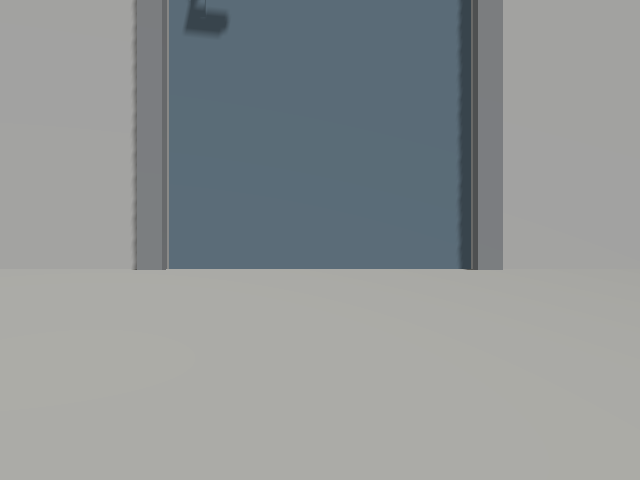
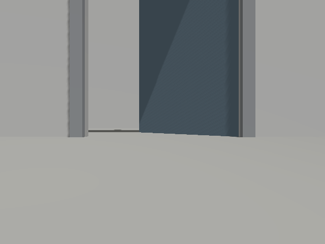
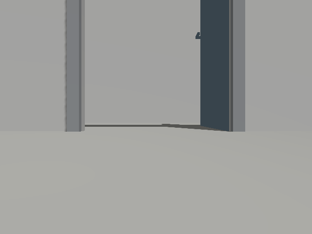

# 평판 금속문 Gazebo 장면 변형 시험

기존 목재 패널 문 장면에서 개발한 검출·상태 파이프라인이 다른 외형에도 동작하는지 확인한다.
기존 world와 제품 알고리즘·임계값·모델 가중치는 바꾸지 않는다.
이 장면은 기존 생성기에서 파생한 **개발 변형**이며 완전히 독립된 시험 장소나 실물 자료가 아니다.

## 실행 전 고정 조건

[scene_variant.py](../scripts/door_probe/scene_variant.py)는 기존 world XML의 별도 사본을 변환한다.
문폭 1.2m·높이 2.2m, 경첩 y=−0.6m, 평판 청회색 문짝과 회색 문틀을 사용한다.
목재 패널·몰딩을 제거하고 손잡이는 보존한다. 뒤벽은 x=4m에서 3m로 당기고 측벽 길이도 맞춘다.
시각 형상과 충돌 형상을 함께 변환하며 로봇·센서는 기존 외부 오버레이를 그대로 사용한다.
기존 생성기와 저장소 world 파일은 변경하지 않고 결과는 Git 제외 실험 폴더에 생성한다.

| 조건 | 문짝 각도 | 기대 상태 | 로봇 조건 |
|---|---:|---|---|
| closed | 0° | closed | 2m 정면 정지 |
| half | 45° | open | 2m 정면 정지 |
| open | 90° | open | 2m 정면 정지 |

각 조건에서 실제 Gazebo RGB-D→기존 YOLOE→출입구 추정→시간 종합→지도 저장을 실행한다.
초기 격리 점검 2초 후 두 launch를 시작하고, 모델 적재를 포함해 그때부터 45초 내 LiDAR 지도와 기대 상태가 확인돼야 한다.
성공 출력에도 문 객체가 정확히 1개인지 별도 확인한다. unknown·누락·반대 상태·실행 오류는 실패다.
통과는 최초 상태 확정과 저장 확인이며, 45초 전 구간의 정확도나 상태 유지율을 의미하지 않는다.
문 pose·각도는 정답에만 사용하고 검출·상태 노드 입력에 넣지 않는다.
실패 시에도 마지막 지도·검출 상태와 RGB를 보존한다. 실패를 없애기 위해 이 시험의 외형·임계값을 조정하지 않는다.

```bash
/usr/bin/python3 scripts/door_probe/scene_variant.py \
  --output-dir experiments/door_probe/metal-scene-new
# door-live.md의 ROS·오버레이·도메인·DDS 환경을 준비한 뒤
/usr/bin/python3 scripts/door_probe/live_check.py --state closed \
  --world experiments/door_probe/metal-scene-new/door_metal_closed.sdf \
  --recon-root /home/blind/cv-middle/CV-VLM/recon-report \
  --output experiments/door_probe/metal-closed-new --timeout 45
# 정리 후 half/open world는 각각 --state open으로 별도 실행
```

`--world`는 정지 관측에서만 허용하며 기존 전이·주행·회전 모드와 결합하지 않는다.
기존 `/clock` 발행자가 있으면 시작을 거부하고 생성한 프로세스 그룹만 종료한다.

## 결과

2026-11-03 `metal-closed-01`, `metal-half-01`, `metal-open-01`을 한 번씩 실행했다.
[추적 요약](data/door-scene-variation-summary.json)에 실행 전 조건 문서·world·제품 모듈·하네스·모델·설정·결과 해시를 남겼다.
시험 후 world·제품 모듈·가중치·임계값을 바꾸거나 실패 조건을 재시도하지 않았다.

| 조건 | 최종 객체 수 | 최초 상태 확정·저장 | mapper 동기화 묶음 | 유효 문 검출 없음 | 처리 관측 |
|---|---:|---|---:|---:|---:|
| 닫힘 0° | 0 | 실패: 45초 제한 | 232 | 232 | 0 |
| 반열림 45° | 1 | 성공: open | 5 | 1 | 4 |
| 완전 열림 90° | 0 | 실패: 45초 제한 | 236 | 236 | 0 |

세 조건 중 성공은 **1/3**이다. 실패도 분모에 포함한다.
각 실행은 최초 확정 시 끝나거나 제한 시간까지 기다리므로 묶음 수의 분모와 실행 길이가 다르다.
묶음 수는 정확도·독립 사진 수가 아니며 정지 장면의 인접 프레임이 반복된다.
반열림은 최종 지도 출력과 저장 `doors.json` 모두 객체 1개·open을 확인했다.
닫힘·완전 열림의 검출 worker는 각각 232·236작업을 완료했고,
mapper의 모든 동기화 묶음에서 `no_detection`이 기록됐다. 이는 문 클래스·점수·bbox 조건을 통과한
seed가 없다는 뜻이며 원 모델의 전체 클래스 출력이 비었다는 뜻은 아니다.
깊이 상태 판단에 도달하지 못했으므로 이를 깊이 분류기의 오분류로 세지 않는다.
최종 문 지도에서 객체가 없으므로 상태·지도 파이프라인 전체로는 실패다.
마지막 검출 오류 문자열은 모두 비어 있었고 세 실행의 worker 그룹 소멸도 확인했다.

### 실제 Gazebo 카메라 영상



*0° 닫힘. 낮은 로봇 RGB 카메라에서 문 상단과 손잡이 일부가 잘린 실제 센서 영상이다.
실패 종료 시 마지막 수신 RGB이며 마지막 mapper 묶음과 정확히 동기화된 그림은 아니다.*



*45° 반열림. 저장 상태는 open이다. 마지막 수신 RGB와 문 관측 시각은 요약에서 별도 기록했다.*



*90° 완전 열림. 출입구와 회전한 문짝이 보이지만 유효 문 seed가 나오지 않았다.
장면의 정답을 검출 결과처럼 덧그리지 않은 원본 RGB다.*

## 해석·검증·다음 작업

평판 기하·색상이 금속문을 표현하지만 금속 반사·깊이 결손을 물리 재현하지는 않았다.
폭·높이·패널·색상·뒤벽을 동시에 바꿨으므로 어느 요인이 검출 실패의 원인인지 분리할 수 없다.
낮은 카메라 시점의 잘림도 유지된다. 따라서 한 번의 실패로 YOLOv11 추가 학습이 필수라고 확정하지 않는다.
현재 문짝 검출 seed에 의존하는 경로가 이 두 외형·각도 조건을 처리하지 못한다는 사실을 확인했다.
다음에는 문짝/출입구 라벨 검수, 전체 문이 보이는 보조 시점과의 원인 분리,
같은 평가셋에서 기준선·학습 후보 비교를 진행해야 한다. 모델 다운로드·학습은 이번에 수행하지 않았다.

변형 기하 검사 5개·기존 world/주행을 포함한 관련 42검사와 전체 오프라인 695검사가 통과했다.
전체 실행의 ROS 전용 2검사는 건너뛰었으며 이번에는 ROS 패키지 소스·설정을 바꾸지 않아 재빌드하지 않았다.
실제 Gazebo 세 조건을 실행했고, 잘못된 `--world`+`--rotate` 조합이 노드·출력 생성 전에 거부되는 것도 확인했다.
시험 코드 검사가 통과한 사실과 모델의 실패 결과를 구분한다.

이 시험으로 문짝 bbox 정답 평가·검출 추가 학습 판단·독립 장면 분할·실제 RGB-D 평가를 완료했다고 간주하지 않는다.
