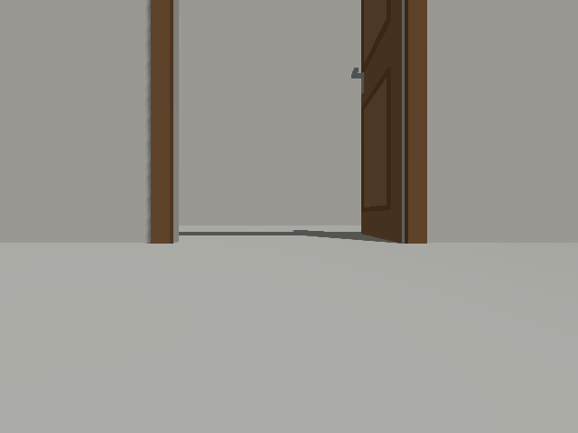
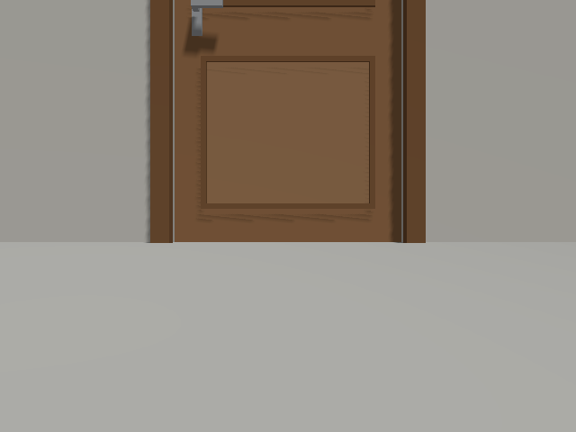

# 실행 중 문 각도 변경과 상태 전이 검증

2026-11-03 기존 [실시간 연결](door-live.md)의 별도 닫힘·열림 실행에 이어,
하나의 Gazebo·YOLOE·LiDAR SLAM 실행 안에서 같은 문의 각도를 바꿨다.
로봇은 2m 정면에서 정지해 있고 모델·조명·카메라 설정은 유지했다.
이는 단일 문 모델의 개발 확인이며 일반 환경 성능이나 실제 촬영 영상 결과는 아니다.

## 장면 제어와 판정

새 `live_check.py --transition`은 닫힘 상태가 확정된 뒤 Gazebo의 `set_pose` 서비스로
`door_leaf` 각도를 0°→90°→0°로 바꾼다. 기존 world 파일을 수정하지 않는다.
명령의 pose·각도는 시뮬레이터 장면 제어와 평가 기록에만 쓰며 인식 함수에 전달하지 않는다.
실제 카메라의 새 RGB-D와 상주 YOLOE 출력에서 문 영역·상태를 추정한다.

문짝 각도는 **순간 변경**된다. 물리 경첩의 연속 회전·회전 중 인식·충돌 동역학 시험이 아니다.
명령 실패, ID 손실·중복, 고정 위치 변경, 새 관측의 상태 확정 timeout은 전체 실행 실패다.
상태 history에서 전이 중 unknown 관측 여부도 기록한다.

```bash
# door-live.md의 ROS·오버레이·도메인·DDS 환경을 준비한 뒤
/usr/bin/python3 scripts/door_probe/live_check.py --state closed --transition \
  --recon-root /home/blind/cv-middle/CV-VLM/recon-report \
  --output experiments/door_probe/live-transition-new --timeout 45
```

`--timeout`은 초기 준비와 각 상태 확정에 별도로 적용된다.
진단은 직접 생성한 시뮬레이션·SLAM·검출 worker만 종료한다.

## 최종 결과

로컬 원문 `experiments/door_probe/live-transition-02/check.json`은 complete로 끝났다.
[추적 요약](data/door-transition-summary.json)에 원문 경로·해시, 모듈/하네스 해시,
서비스 응답·입력 시각·사진 해시·최종 상태를 보존했다.

| 변경 | 출력 ID | 확정 상태 | 중간 unknown 관측 | 확인까지 wall 시간 | 관측 sim 시각 차이 |
|---|---|---|---|---:|---:|
| 닫힘→열림 | door_000001 | open | 예 | 0.944초 | 0.499초 |
| 열림→닫힘 | door_000001 | closed | 예 | 0.967초 | 0.590초 |

위치는 두 전이에서 최초 값 `(-0.0500, 약 0, 0.0027)m`로 유지됐다.
이는 최초 추정 anchor를 유지하는 동작 확인이며 문 위치 정확도 수치가 아니다.
실제 `/map` 발행자는 `slam_toolbox`였고 종료 후 worker 그룹 소멸을 확인했다.

wall 시간은 pose 변경 명령 시작부터 상태를 확인할 때까지이며 `gz service` 실행·응답·polling을 포함한다.
sim 차이는 **명령 직전 마지막 지도 메시지 시각**과 **새 상태 확정에 사용한 관측 시각**의 차이다.
실제 pose 적용 시각을 직접 측정한 지연이 아니다. 두 전이는 작은 개발 확인이며 평균·상한·일반 지연 성능이 아니다.
첫 실행 `live-transition-01`도 통과했으나 위 표에는 사진과 최종 하네스 해시를 보존한 02 결과만 사용했다.






*모두 실제 Gazebo RGB-D 센서의 RGB 영상이며 GUI 창 캡처·실제 촬영 사진·생성 이미지가 아니다.
세 사진은 카메라 장면 변화의 증거다. 사진 시각과 상태 확정에 사용한 영상 시각이 같다고 가정하지 않으며
전이 후 사진의 시각은 원문에 별도 기록한다. 최초 닫힘 사진의 개별 시각은 기록하지 않았다.
실제 문 상태 전이 영상의 장기 강건성은 아직 검증하지 않았다.*

## 남은 검증

로봇 주행 중 관측·문 가림·연속 경첩 회전·복수 문·독립 장소와 실제 촬영 자료 평가는 남아 있다.
별도의 학습/시험 자료와 문짝 라벨을 확보하기 전에는 이 결과를 학습 모델의 일반 성능으로 표현하지 않는다.
