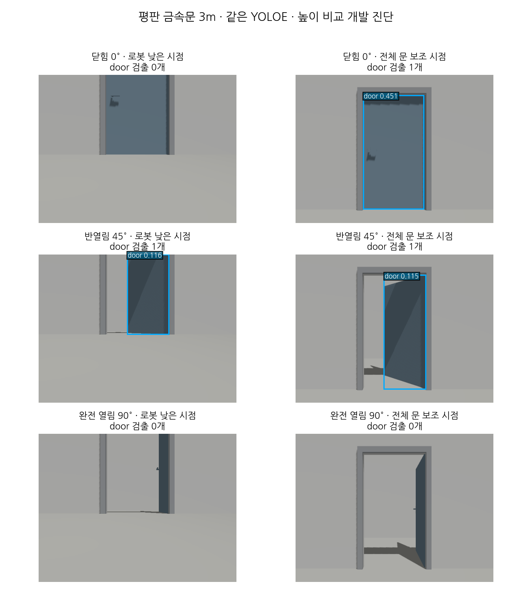

# 낮은 로봇 시점과 전체 문 보조 시점의 검출 비교

[금속문 개발 변형](door-scene-variation.md)의 닫힘·완전 열림 실패가 카메라 잘림과 관련 있는지 진단한다.
벽으로 분류했다는 로그는 없으며, 이전 실패는 문 클래스·점수·bbox 조건을 통과하는 seed가 없었다는 뜻이다.

## 추론 전 고정 조건

- 닫힘/반열림/완전 열림을 각각 한 번 생성하고, 같은 실행에서 낮은 로봇 RGB와 높은 보조 RGB를 한 장씩 촬영한다.
- 수평 위치는 두 광학 원점 모두 (−3, 0)m, 시선 방향 +x다. 높이만 바꾼다. 보조 높이는 1.16m다.
- 두 시점은 모두 640×480·수평 FOV 1.1397rad·15Hz, 같은 렌더 엔진·조명·재질을 사용한다.
  FOV·해상도 수치는 외부 센서 설정을 읽어 확인했으며 외부 모델·설정은 수정하거나 복사하지 않는다.
- 두 시점의 CameraInfo K가 일치하고 왜곡은 0이어야 한다. 각 RGB/CameraInfo는 exact 시각,
  두 시점 간 RGB 시각 차이는 50ms 이내다. 정적 장면이며 정확한 동시 촬영이라고 가정하지 않는다.
- 기존 TF에서 로봇 카메라의 수평 위치·광축을 확인한다. 보조 위치·방향은 별도 정적 SDF 설정이다.
- 문틀 외곽의 기하 투영이 낮은 시점에서는 영상 밖으로, 보조 시점에서는 영상 안으로 들어오는지 검사한다.
  투영 검사는 전체 문틀의 기하 구도이며 가림 여부·문짝 bbox 정답을 뜻하지 않는다.
- 같은 기존 YOLOE worker·문 confidence 0.1·설정·가중치로 6장을 순차 추론한다. 학습·VLM 호출은 하지 않는다.
- 주 지표는 각 영상의 유효 door 검출 유무·개수다. 실행 오류·누락도 6장 분모에 남긴다.
  문짝/출입구 정답 bbox 검수 전이므로 IoU·precision/recall·위치 정확도를 주장하지 않는다.

기존 실패 시험은 2m였고 이번 쌍 비교는 전체 문틀이 같은 K로 들어오는 **3m**다.
따라서 두 시점 간 높이의 영향은 3m 조건에서 비교하며 이전 2m 실패의 원인을 직접 확정하지 않는다.
높이를 바꾸면 투시·바닥 비율·문 손잡이 노출도 함께 달라지므로 잘림 하나만 독립적으로 조작한 실험은 아니다.
보조 RGB는 검출 진단용이며 깊이 투영·문 상태·지도 알고리즘에 입력하지 않는다.

```bash
# door-live.md의 ROS·오버레이·도메인·DDS 환경을 준비한 뒤 각 조건을 따로 실행
/usr/bin/python3 scripts/door_probe/view_capture.py --state closed \
  --output experiments/door_probe/view-closed-new
# 종료·정리 후 --state half / --state open을 별도 새 출력 경로로 실행
```

## 결과

2026-11-03 세 장면의 RGB 쌍을 촬영하고 기존 YOLOE로 6장을 한 번씩 추론했다.
[추적 요약](data/door-view-diagnostic-summary.json)에 사전 조건·입력·촬영별 소스·최종 검증 소스·모델·설정·응답 해시를 남겼다.
촬영 메타데이터는 모두 최종 검증 함수로 다시 검사했다.

| 문 각도 | 낮은 시점 door 수 | 보조 시점 door 수 | 관찰 |
|---|---:|---:|---|
| 닫힘 0° | 0 | 1 (score 0.451) | 높은 시점에서 검출 회복 |
| 반열림 45° | 1 (0.116) | 1 (0.115) | 두 시점 모두 유효 검출 |
| 완전 열림 90° | 0 | 0 | 전체 문틀 구도에서도 검출 없음 |

유효 door 출력은 낮은 시점 1/3장, 높은 시점 2/3장이며 실행 오류·미완료는 0/6장이다.
이는 **유효 문 출력의 존재**이며 정답 bbox와 대응한 TP·recall이나 상태 정확도는 아니다.
각 조건이 한 장뿐인 작은 개발 진단이며 통계적인 개선율로 해석하지 않는다.
모델·confidence·NMS·입력 크기는 바꾸지 않았다. 상주 worker는 release_policy만 keep으로 재정의하고 캐시는 이번 결과 폴더에 둔다.
기존 C와 같은 YOLOE 검출기를 사용했지만 C 규칙 보고서·VLM·문 상태 분류를 새로 실행한 것은 아니다.

로봇 카메라의 TF 높이는 0.119864m, 보조 높이는 1.16m였다. 두 시점 RGB 시각 차이는 세 쌍 모두 0ms였다.
K의 최대 차이는 약 4×10⁻⁵로 지정한 0.01 이내였다.
문틀 외곽 투영의 세로 범위는 낮은 시점 −137.815~260.677px, 높은 시점 41.616~440.109px였다.
촬영에 사용한 시뮬레이션·보조 브리지 6개 프로세스 그룹과 검출 worker 그룹의 소멸을 확인했다.



*실제 Gazebo RGB 여섯 장에 같은 YOLOE의 예측 박스·점수만 파랑으로 표시했다.
정답 박스·정답 상태를 예측처럼 덧그리지 않았다. 행 이름의 닫힘/반열림/완전 열림은 배치 정답이다.
가로 시점 비교는 같은 3m 수평 위치·K에서 높이를 달리한 것이다. 원본 RGB와 원 응답은 로컬 실험 폴더에 보존한다.*

촬영 후 검출과 그림 생성은 다음 명령으로 재현한다. 이미 완료된 결과를 덮어쓰거나 같은 프레임을 자동 재추론하지 않는다.

```bash
/usr/bin/python3 scripts/door_probe/view_detect.py \
  --captures experiments/door_probe/view-closed-01 \
             experiments/door_probe/view-half-01 \
             experiments/door_probe/view-open-01 \
  --recon-root /home/blind/cv-middle/CV-VLM/recon-report \
  --output experiments/door_probe/view-detection-new
/usr/bin/python3 scripts/door_probe/view_figure.py \
  --results experiments/door_probe/view-detection-01/results.json \
  --output /tmp/door-view-new.png
```

## 해석과 남은 일

닫힘의 3m 비교에서는 높은 시점에서 검출이 회복됐으므로 시점·구도가 검출에 영향을 줬다는 근거가 생겼다.
벽으로 분류했다는 근거는 없고, 닫힌 문을 원천적으로 인식하지 못하는 것도 아니다.
완전 열림은 높은 시점에서도 문 seed가 없으므로 모든 실패를 잘림 하나로 설명할 수 없다.
문짝이 얇게 보이는 시점·외형·검출 학습 범위 등은 후보 원인이며 이번 자료만으로 분리·확정하지 않는다.
추가 학습 판단에는 문짝/출입구 라벨 검수와 같은 독립 평가셋에서의 기준선·후보 비교가 필요하다.
높은 보조 카메라를 실제 로봇에 장착하거나 제품 입력으로 채택한 것은 아니다.

시점·촬영 메타데이터 경계 검사 18개와 전체 오프라인 713개가 통과했다. ROS 전용 2개는 건너뛰었다.
제품 ROS 패키지·외부 오버레이는 변경하지 않아 재빌드하지 않았고 실제 Gazebo 촬영 세 조건과 실제 검출 여섯 장으로 변경 동작을 확인했다.

이 자료는 기존 장면에서 파생한 개발 진단이며 독립 시험셋·실제 영상 결과가 아니다.
