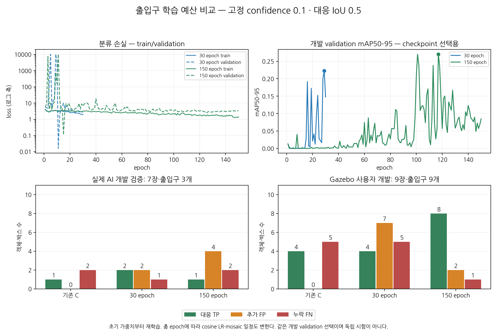
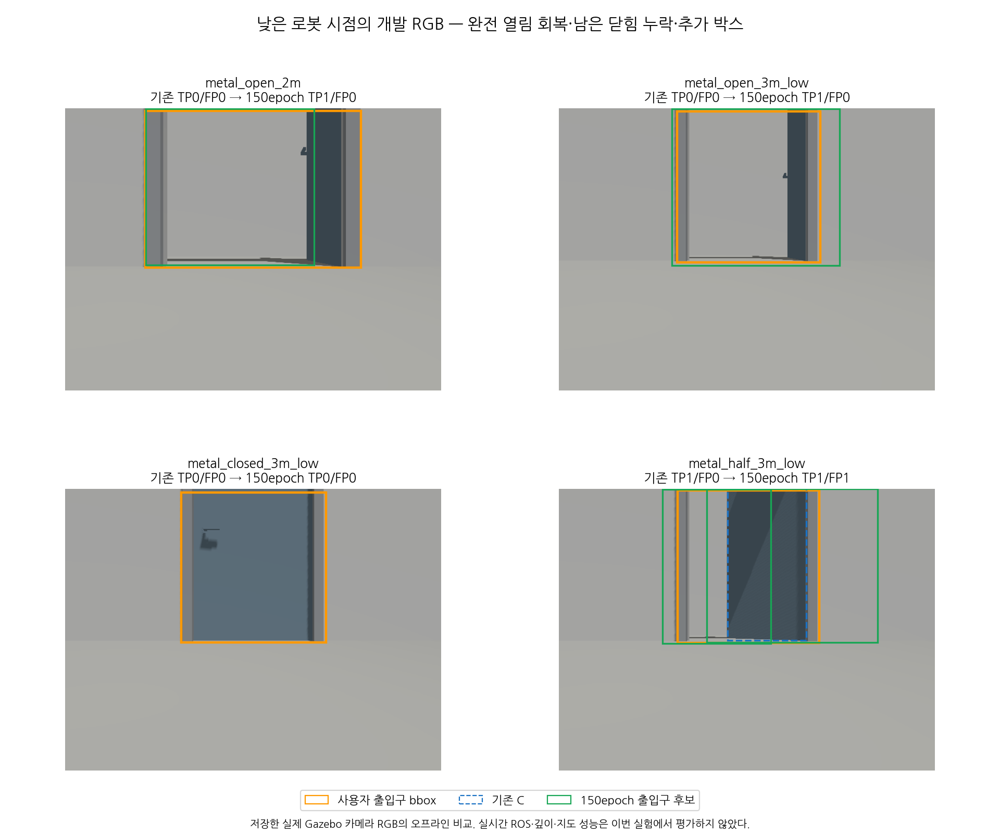

# 출입구 YOLO11 학습 예산 비교

2026-11-03 [첫 30 epoch 실험](door-yolo11-pilot.md) 뒤 출입구 후보를 같은 초기 가중치에서 150 epoch 재학습했다.
**Gazebo 개발 RGB의 검출은 회복됐으나 실제 AI 개발 검증의 고정 문턱 성능은 악화됐다.**
전체 기본 모델은 바꾸지 않고, Gazebo용 선택 후보의 실시간 RGB-D·상태·지도 연결을 다음 검증으로 남긴다.

## 가설·고정 조건·한계

첫 출입구 모델의 최고 개발 fitness는 29/30 epoch였고 train/validation 분류 손실은 마지막까지 감소했다.
학습량을 늘려볼 근거지만 학습 부족이나 과적합 원인이 입증된 것은 아니다.
문짝 모델은 이번 재학습 대상에서 제외하고 고정 출입구 target을 우선 검사했다.

명시적으로 바꾼 학습 인자는 epochs 30→150이다. 초기 YOLO11n checkpoint·32장 train/7장 AI validation·seed·나머지 인자는 같다.
resume=false로 초기 pretrained에서 다시 학습했으며 기존 30 epoch를 이어서 재개하지 않았다.
cosine LR의 분모가 총 epoch이고 close_mosaic=5의 종료 시점도 25→145로 바뀌므로
**총 예산에 종속된 스케줄을 포함한 재학습 비교**다. 업데이트 수만 분리한 인과 실험은 아니다.
[실행 전 프로토콜](data/door-yolo11-budget-protocol.json)은 첫 실행과 별도로 고정했다.

같은 AI 개발 validation 양성 3개로 checkpoint와 실험 방향을 선택하므로 선택 편향과 과적합 가능성이 있다.
곡선 초기에 validation 분류 손실의 큰 spike와 개발 mAP 변동도 관찰됐다. 손실 그림은 이를 숨기지 않도록 로그 축이다.
그 원인을 이 결과만으로 확정하지 않는다. validation mAP는 낮은 점수의 PR 곡선에서 계산되고,
아래 TP/FP/FN은 고정 confidence 0.1에서 계산되므로 둘이 함께 좋아질 필요는 없다.

150 epoch·2,400 batch를 완료했고 하네스 시작→학습 반환은 315.73초였다.
PyTorch CUDA 최고 allocated/reserved는 592,046,080/666,894,336bytes이며 전체 GPU 사용량이 아니다.
checkpoint는 선언한 개발 mAP50–95 기준 best.pt이고 최고 epoch는 117, fitness는 0.27033이다.
실제 7장·Gazebo 개발 9장의 주 비교 추론 16회는 오류 0이다. 모든 산출물은 저장소 내부 절대 경로에 생성했고 프로세스 그룹은 종료됐다.

## 같은 RGB·같은 문턱 비교

conf=0.1, NMS IoU=0.45, imgsz=640, max_det=300, 대응 IoU≥0.5를 유지했다.
기존 C와 30 epoch 검출은 저장 원문을 재사용했고 새 150 epoch만 같은 RGB에서 추론했다.
실제/Gazebo 및 문짝/출입구 기준은 합산하지 않는다. 아래 표는 모두 출입구 기준이다.

| 자료 | 기존 C TP/FP/FN | 30 epoch | 150 epoch |
|---|---|---|---|
| 실제 AI 개발 validation 7장·출입구 3개 | 1 / 0 / 2 | 2 / 2 / 1 | 1 / 4 / 2 |
| Gazebo 사용자 개발 9장·출입구 9개 | 4 / 0 / 5 | 4 / 7 / 5 | 8 / 2 / 1 |

실제 사진에서는 150 epoch가 30 epoch보다 TP가 줄고 FP가 늘었다. 사람 정답 성능·실제 일반화 개선이라고 표현하지 않는다.
Gazebo에서는 재현율이 4/9→8/9로 늘었고, 30 epoch의 FP 7개도 2개로 줄었다. 기존 C의 FP 0개와는 구분한다.
프레임 전체 성공(TP 완비·FP 0)은 기존 C 4/9, 30 epoch 0/9, 150 epoch 6/9다.
객체 대응 8/9와 프레임 성공 6/9를 같은 지표로 쓰지 않는다.

| Gazebo 개발 조건 | 기존 C TP/FP/FN | 150 epoch TP/FP/FN |
|---|---|---|
| 닫힘 2m | 0/0/1 | 1/0/0 |
| 반열림 2m | 1/0/0 | 1/0/0 |
| 완전 열림 2m | 0/0/1 | 1/0/0 |
| 닫힘 3m 낮은 로봇 시점 | 0/0/1 | 0/0/1 |
| 닫힘 3m 높은 보조 시점 | 1/0/0 | 1/0/0 |
| 반열림 3m 낮은 로봇 시점 | 1/0/0 | 1/1/0 |
| 반열림 3m 높은 보조 시점 | 1/0/0 | 1/1/0 |
| 완전 열림 3m 낮은 로봇 시점 | 0/0/1 | 1/0/0 |
| 완전 열림 3m 높은 보조 시점 | 0/0/1 | 1/0/0 |

완전 열림 3조건은 모두 TP1/FP0이며 낮은 로봇 시점도 포함한다.
하지만 같은 개발 장면의 저장 RGB 결과다. **처음 열린 문을 실시간으로 등록하고 올바른 위치·상태를 지도에 저장했다는 증거는 아직 아니다.**
닫힘 3m 낮은 시점은 누락되고 반열림 3m 두 시점에는 추가 박스가 남아 있다.

사진은 실제 Gazebo 카메라 RGB에 사용자 bbox와 두 모델 박스를 겹친 오프라인 그림이다.
새 GUI 실행이나 생성 이미지가 아니다. 주황은 사용자 출입구, 파랑 점선은 기존 C, 초록은 150 epoch 후보다.

## 별도 낮은 점수 진단

주 비교 문턱을 바꾸지 않고 두 학습 모델을 conf=0.001로 별도 관찰했다. 같은 NMS·max_det를 사용했고 총 32회 추론 오류는 0이다.
각 정답과 IoU≥0.5인 남은 박스의 최고 점수를 살폈다. 이번 자료는 사진당 정답 문이 하나이므로 객체별 집계가 가능하다.
낮은 floor·NMS·max_det=300 이후의 후보에 대한 진단이며 모든 원시 head 제안이나 threshold 최적화 결과가 아니다.

| 모델·자료 | 점수≥0.1 대응 후보 있음 | 0.001≤점수<0.1에만 있음 | 진단 floor에서 대응 후보 없음 |
|---|---:|---:|---:|
| 30 epoch·실제 3객체 | 2 | 0 | 1 |
| 150 epoch·실제 3객체 | 1 | 1 | 1 |
| 30 epoch·Gazebo 9객체 | 4 | 4 | 1 |
| 150 epoch·Gazebo 9객체 | 8 | 1 | 0 |

남은 Gazebo 누락에서 낮은 점수의 대응 후보가 보이지만, 문턱을 낮추면 추가 박스도 늘 수 있다.
현재 주 결과의 conf=0.1을 바꾸지 않았고 이 진단만으로 문턱을 선택하거나 성능 개선으로 보고하지 않는다.
진단 floor에서 후보가 없다는 사실만으로 위치 오류와 더 낮은 점수·NMS 억제를 구분할 수도 없다.

## 기록과 검증

원문은 `experiments/door_probe/yolo11-budget-01/`의 `doorway-01`, `comparison`, `score-diagnostic`에 있다.
`doorway-01/runs/doorway/weights/best.pt`가 이번 저장소 내부 checkpoint다.
실행 당시 하네스 snapshot, 초기/학습 checkpoint, CSV, 입력·출력, 비교·진단·그림 소스를
[추적 요약](data/door-yolo11-budget-summary.json)에 해시로 기록했다. 원본·라벨·기존 모델을 바꾸지 않았다.
6개 비교 조건을 기존 scorer CLI로 재현해 모든 공통 계산 필드·대응·입력 해시가 일치했다.
학습 전 전체 RGB·라벨·그룹·YAML·checkpoint를 기존 하네스로 확인했다. 제품/하네스/평가 코드는 바꾸지 않아 전체 단위 테스트를 반복하지 않았다.

다음은 150 epoch 모델을 기본 교체 없이 선택 가능한 Gazebo 검출 경로로 연결하고,
새로운 완전 열림 관측부터 RGB-D 상태·고정 문 위치를 실제로 생성하는지 검사하는 단계다.
그 후 기존 기준선·음성 장면·상태 전이·다른 장소 검증이 필요하며 실제 촬영 영상·독립 정답도 여전히 부족하다.
