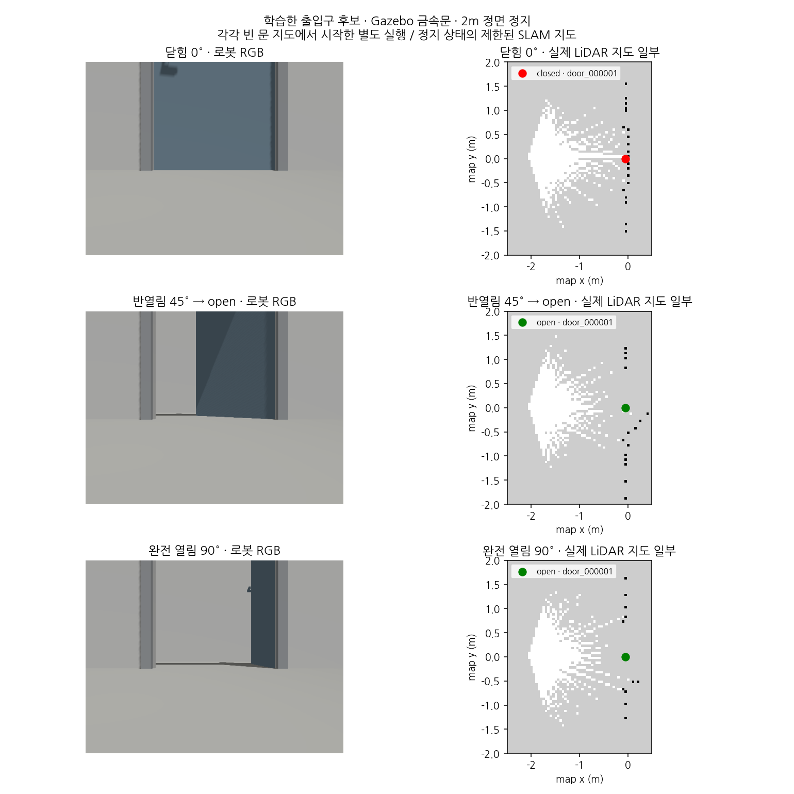
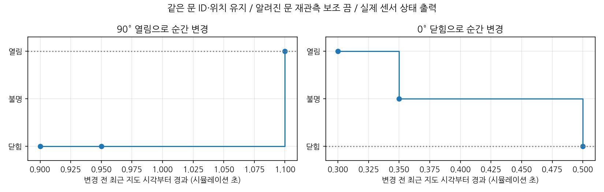

# 학습한 출입구 후보의 실시간 RGB-D·지도 연결

2026-11-03, [150 epoch 출입구 모델](door-yolo11-budget.md)을 선택 가능한 worker로 연결했다.
같은 금속문 개발 장면의 **닫힘·반열림·완전 열림에서 빈 문 지도부터 등록**했고,
실제 LiDAR SLAM 지도와 RGB-D 상태를 함께 저장했다. **기본 모델은 YOLOE를 유지한다.**
실제 RGB AI 검증 악화, 독립 장소·실제 RGB-D 미검증 한계는 그대로다.
설정 계약은 [ADR-0014](adr/0014-yolo11-live-candidate.md), 원문·소스·그림 해시는
[추적 요약](data/door-yolo11-live-summary.json)을 따른다.

## 구현과 실행

기존 JSON-lines worker가 detector_config의 backend에 따라 분기한다.
backend가 없거나 yoloe면 기존 외부 YOLOE, yolo11이면 로컬 단일 doorway checkpoint를 사용한다.
checkpoint SHA-256·설치 버전·클래스·RGB PNG·원본 픽셀 xyxy를 검사한다.
출력 source_label=doorway를 보존하고 기존 door seed 경계에 연결한다.
ROS 노드의 원본 RGB-D/CameraInfo/header·관측 시각 TF·깊이 판단·문 메모리는 유지한다.
모델 자동 설치·다운로드는 끄고 worker 전용 캐시를 사용한다.

현재 로컬 설정은 `experiments/door_probe/yolo11-live-01/detector.json`이다.
checkpoint는 `yolo11-budget-01/doorway-01/runs/doorway/weights/best.pt`, SHA-256은
`818142878071d643a9d6d5d5f703272b8eb95677c93aae09e47a00a03a6dd144`이다.
Ultralytics 8.4.191, device=0, imgsz=640, confidence=0.1, iou=0.45, max_det=300을 유지했다.
외부 recon-report의 기존 venv를 실행에 사용하며 외부 소스·자산은 변경하지 않았다.
설정·가중치·원문은 로컬 실험 산출물이므로 새 clone에 자동 포함되지 않는다.

[실시간 실행](door-live.md)의 ROS·오버레이·install 환경을 준비한 후 실행한다.
이 launch 자체는 Gazebo·SLAM을 시작하지 않는다.

```bash
ros2 launch mapping_semantic live_doors.launch.py \
  recon_root:=/home/blind/cv-middle/CV-VLM/recon-report \
  detector_config:=/home/blind/cv-middle/prometheus-mapping/experiments/door_probe/yolo11-live-01/detector.json \
  reobserve_known_doors:=false map_id:=new-yolo11-map \
  output_path:=/tmp/new-yolo11-doors.json
```

시뮬레이션까지 자동 실행하는 예시는 다음과 같다. 매번 새 출력 경로를 사용한다.

```bash
export ROS_DOMAIN_ID=12 GZ_PARTITION=codex OPENBLAS_NUM_THREADS=1
export FASTRTPS_DEFAULT_PROFILES_FILE=~/worker_following_ws/src/wf_gazebo/config/fastdds_bridge.xml
/usr/bin/python3 scripts/door_probe/live_check.py --state open \
  --world experiments/door_probe/metal-scene-01/door_metal_open.sdf \
  --detector-config experiments/door_probe/yolo11-live-01/detector.json \
  --require-cold-start --reobserve-known-doors false \
  --recon-root /home/blind/cv-middle/CV-VLM/recon-report \
  --output experiments/door_probe/new-yolo11-open
```

`--state negative`는 문 없는 벽 대조군이다. `--state closed --transition`과 닫힌 금속문 world로
같은 문을 순간적으로 열고 닫는다. world 이름·경첩 위치는 시험 제어에만 사용하며 인식 입력에 넣지 않는다.
ROS 검사는 시뮬레이션이 끝난 뒤 실행한다. 같은 도메인의 테스트와 시뮬레이션을 동시에 돌리지 않는다.

## 실제 Gazebo 결과

금속문·2m 정면·낮은 로봇 카메라·정지 조건이다. 모든 후보 실행은 빈 문 지도에서 시작했고
알려진 문 재관측을 비활성화했다. 반열림 45°는 상태 정의상 open이다.
각 행은 별도 실행이며 같은 문자열 ID가 나왔다고 실행 간 추적 연속성을 주장하지 않는다.

| 실행 | 배치 | 저장 상태 | 최초 판정 관측 수 | 최초 판정 source age |
|---|---|---|---:|---:|
| cold-closed-01 | 0° | closed | 16 | 0.087초 |
| cold-half-01 | 45° | open | 15 | 0.159초 |
| cold-open-02 | 90° | open | 16 | 0.085초 |

위 수치는 저장 요청 전 cold-start 판정 snapshot이다. 저장 응답 시점에는 추가 관측이 있을 수 있다.
source age는 시뮬레이션 시각 기준이며 평균 추론 지연이 아니다.
각 실행의 `/clock` 발행자는 1개, `/map` 발행자는 slam_toolbox 하나였고 worker 그룹 종료를 확인했다.
저장된 문 위치는 대략 map 좌표 (-0.0500, 0, 0.00273)m이다.
이는 공통 초기 조건의 추정 위치이며 world→map 독립 정답과 대조한 절대 위치 오차가 아니다.
각 후보 양성 실행에서 초기 관측 시각 TF 대기 초과 1회가 기록됐다. 이후 신선한 관측으로 등록·갱신했다.



*실제 Gazebo RGB와 OccupancyGrid 기반 문 위치 그림이다. RGB와 문 관측의 시각은 별도 기록하며
동일 시각이라고 가정하지 않는다. 지도는 정지 상태의 제한된 영역이고 GUI 캡처·지도 정확도 결과가 아니다.*

문 없는 벽은 negative-02에서 26묶음·3.166 시뮬레이션 초 동안 등록 0개였다.
빈 문 지도 저장은 제품 계약상 거부되어 문 JSON을 만들지 않았으며, 이를 정상 음성 결과로 기록했다.
최종 판정을 저장 응답 뒤로 옮긴 수정은 negative-03에서 추가 실행했고,
최종 28묶음·3.299 시뮬레이션 초 동안 등록 0개를 확인했다.

기존 YOLOE는 원래 목재문 닫힘 baseline-closed-01에서 3관측으로 등록·저장했다.
동일 금속문 완전 열림 baseline-open-01은 45초 대기 중 242묶음을 처리했으나 문을 등록하지 못했다.
worker 오류가 아닌 관측 실패이며 **원문 status=failed와 timeout을 그대로 보존**한다.
이 단일 장면 비교를 모델 전체 우열로 일반화하지 않는다.

## 같은 문 상태 전이

transition-01은 금속문을 0°→90°→0°로 순간 변경했다.
빈 지도부터 시작해 보조 재관측 0회로 같은 door_000001과 anchor를 유지했다.
변경 전 최근 지도 시각부터 확정에 사용한 관측 시각까지는 열림 0.992·닫힘 0.353 시뮬레이션 초였다.
확정 상태를 담은 지도 snapshot까지는 각각 1.100·0.500초였다.
제어 명령 호출 직전부터 상태 확인까지의 벽시계 경과는 0.601초·0.626초이며 명령 실행 시간도 포함한다.
두 시간의 기준점이 다르며 실제 경첩 움직임 시작부터의 반응 시간으로 해석하지 않는다.
닫힘으로 바뀔 때 unknown을 경유했고, 열림 변경에서는 수신 이력에 unknown이 없었다.



*점은 수신한 지도 snapshot이며 제어 직후부터 모든 내부 프레임을 기록한 연속 곡선이 아니다.
연속 경첩 회전·이동 로봇·여러 문 실험은 아니다.*

## 검증·실패 이력·남은 범위

mapping_semantic 빌드 성공, ROS 패키지 340검사 통과·오류/실패 0이다.
오프라인 전체 898검사 통과, ROS 전용 5개는 그 환경에서 제외하고 위 패키지 검사에서 실행했다.
단위 검사는 실제 GPU 추론을 대신하지 않는다. 실제 두 worker에서 저장 RGB를 요청해
YOLO11 결과가 기존 오프라인 추론과 일치하고 metadata·프로세스 정리가 정상임을 별도로 확인했다.

첫 cold-open-01은 같은 도메인의 ROS 테스트를 동시에 실행해 다른 map_id가 섞인 **무효 실험**이다.
원문과 실행 소스를 보존하고 이후 map_id 검사를 추가해 다른 지도의 혼입을 거부한다.
negative-01은 문 0개를 확인했으나 하네스가 양성 저장 성공을 요구해 실패했다.
음성 저장 거부 계약에 맞춰 판정을 고쳐 negative-02로 재실행했다.
교차 검토에서 저장 대기 중 관측이 바뀌는 판정 틈을 찾아 최종 이력을 응답 뒤 검사하도록 보완했다.
기존 완료 실행의 전체 원문 이력도 이 조건으로 재검사한다. 실행 당시 하네스 snapshot과 현재 소스 해시는 구분한다.

기준 커밋은 17f6425, 단계 태그는 `v0.2.0-door-yolo11-live.1`이다. 원문은
`experiments/door_probe/yolo11-live-01/`이며 rosbag은 생성하지 않았다.
공유 wf_gazebo는 기존 오버레이로만 사용했고 재빌드하지 않았다.

남은 것은 독립 장면·다중 문·거리/관측각·장거리/큰 회전 검증, 사람 검수 정답,
실제 촬영 영상과 실제 RGB-D·지도 평가, 과목 데모·보고서다.
이번 성공은 같은 개발 장면의 통합 실행 근거이며, 실제 자료 결과와 합산하지 않는다.
