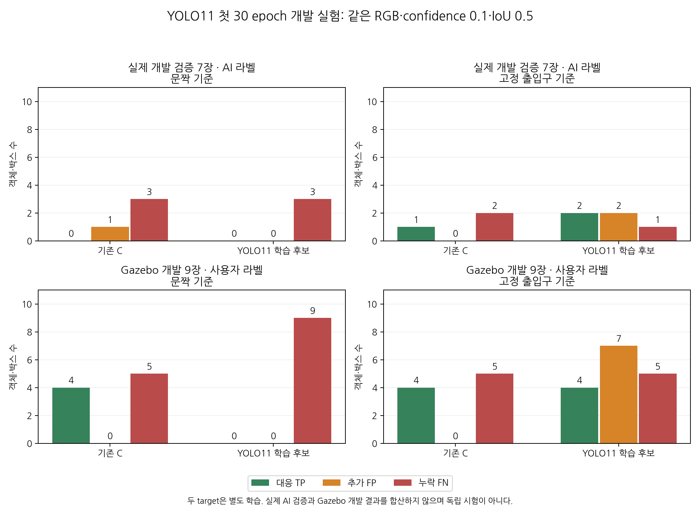
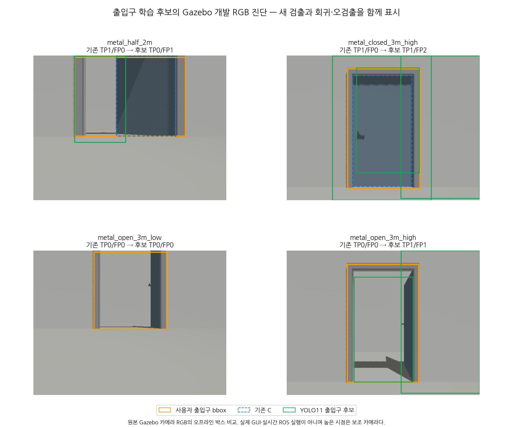

# YOLO11 첫 개발 학습 실험

2026-11-03 문짝·고정 출입구를 각각 단일 클래스로 YOLO11n에 학습했다.
**두 학습은 완료했으나 기존 YOLOE 기준선을 교체하지 않았다.** 문짝 후보는 고정 confidence에서 무검출이고,
출입구 후보는 일부 검출 회복과 오검출·회귀를 함께 보였다. 독립 시험·실시간 ROS·지도 성능 검증은 아니다.



## 고정 조건과 실제 실행

[출처 그룹별 입력](door-training-data.md)의 train 32장·개발 validation 7장을 사용했다.
두 target의 validation RGB는 같고 AI 라벨 양성 3장·음성 4장이다. 이미 관찰한 자료이며 사람 정답·독립 시험셋이 아니다.
문짝과 출입구를 별도 모델로 학습했고 각 모델의 class 0 의미는 door_leaf/doorway다.
추론 기록에서는 기존 평가기에 연결하기 위해 class=door로 변환하되 source_label과 training_target을 남겼다.

| 항목 | 설정·확인 |
|---|---|
| 초기 가중치 | 공식 release v8.4.0 YOLO11n, 5,613,764bytes |
| 초기 SHA-256 | `0ebbc80d4a7680d14987a577cd21342b65ecfd94632bd9a8da63ae6417644ee1` — 공식 asset digest와 일치 |
| 라이브러리 | ultralytics 8.4.191, torch 2.14.1+cu126, torchvision 0.29.1+cu126 |
| GPU | RTX 3050 Laptop 4GB, CUDA 장치 0 |
| 학습 | 30 epoch, batch 2, nbs 2, imgsz 640, AdamW lr0=0.001 |
| 기타 | seed 20261103, deterministic=true, AMP=false, workers=0, patience=0 |
| checkpoint 선택 | Ultralytics best.pt: 개발 validation mAP50–95 fitness 최대값 |
| 비교 추론 | confidence 0.1, NMS IoU 0.45, max_det 300, imgsz 640 |
| 정답 대응 | 기존 평가기의 IoU≥0.5 일대일 대응 |

가중치는 [공식 GitHub asset](https://github.com/ultralytics/assets/releases/download/v8.4.0/yolo11n.pt)에서 받았고
설치된 구현과 [공식 학습 안내](https://docs.ultralytics.com/modes/train/)를 확인했다.
정확한 학습 인자·입력 해시는 [실행 전 고정한 프로토콜](data/door-yolo11-pilot-protocol.json)에 있다.
최초 COCO 80클래스 모델의 nc를 1로 바꾸어 493/499 weight 항목을 전이한 로그를 보존했다.
기존 venv를 사용했으며 패키지는 설치하지 않았다. 자동 설치와 원격 integration을 끄고 기존 시스템 폰트를 사용했다.

| 모델 | 실제 epoch / batch 이벤트 | 하네스 시작→학습 반환 | 최고 allocated / reserved |
|---|---:|---:|---:|
| 문짝 | 30 / 480 | 65.84초 | 592,046,080 / 666,894,336bytes |
| 출입구 | 30 / 480 | 69.46초 | 592,046,080 / 666,894,336bytes |

시간에는 라이브러리·모델 초기화와 학습 종료 검증이 포함된다. 메모리는 해당 프로세스의 PyTorch CUDA allocator 최고치이며
전체 GPU 사용량·다른 batch 크기·Jetson 자원 검증을 뜻하지 않는다. 두 작업은 별도 프로세스 그룹에서 순차 실행했고 모두 종료됐다.

## 같은 입력의 비교

기존 C는 이미 완료된 YOLOE 검출 원문을 재사용했다. 새 후보는 best.pt로 실제 7장과 Gazebo 사용자 검수 9장을 추론했다.
각 후보의 16장 추론 오류는 0이다. 표는 학습 target과 같은 정답을 비교한 결과이며 두 target·두 환경을 합산하지 않는다.

| 자료·기준 | 기존 C TP/FP/FN | YOLO11 후보 TP/FP/FN |
|---|---|---|
| 실제 AI validation 7장·문짝 3객체 | 0 / 1 / 3 | 0 / 0 / 3 |
| 실제 AI validation 7장·출입구 3객체 | 1 / 0 / 2 | 2 / 2 / 1 |
| Gazebo 사용자 개발 9장·문짝 9객체 | 4 / 0 / 5 | 0 / 0 / 9 |
| Gazebo 사용자 개발 9장·출입구 9객체 | 4 / 0 / 5 | 4 / 7 / 5 |

문짝 모델은 confidence 0.1에서 두 환경 모두 무검출이다. FP 감소만을 개선으로 해석하지 않는다.
출입구 모델의 실제 AI validation Recall은 1/3→2/3으로 늘었지만 Precision은 1→1/2로 낮아졌다.
양성 3개뿐인 개발 validation을 모델 일반화나 사람 정답 성능의 증거로 삼을 수 없다.
checkpoint 선택에 쓰인 저점수 PR 기반 mAP와 여기의 고정 confidence TP/FP/FN도 서로 다른 지표다.

Gazebo는 같은 개발 장면의 저장 RGB를 오프라인 비교했다. 실제로 Gazebo·LiDAR SLAM·ROS를 다시 실행한 시험이 아니다.
기존 95장 manifest에서 reviewed 9장만 채점하고 나머지 Gazebo draft 36장은 제외했다.
실제 자료에서 학습했지만 Gazebo 9장은 학습 입력에 넣지 않았으며, 이미 사용한 개발 진단 자료라는 한계는 유지한다.



출입구 후보는 높은 3m 보조 카메라의 완전 열림에서 새 TP 1개를 얻었으나 같은 사진에 FP 1개도 생겼다.
2m 반열림은 기존 TP가 후보에서 IoU 미달 FP/FN으로 바뀌었고 다른 사진에서도 추가 박스가 나왔다.
완전 열림은 기존 0/3→후보 1/3 객체 대응이지만 **낮은 로봇 시점의 완전 열림은 여전히 무검출**이다.
전체 TP 수는 그대로이며 FP가 늘어 현재 기본 모델 교체 근거가 되지 않는다.

## 수정·산출물·검증

[학습 하네스](../scripts/door_probe/train_pilot.py)는 입력 manifest·YAML·라벨·RGB·checkpoint를 해시로 확인한다.
고정 목록 밖 이미지 추가도 학습 시작 전에 거부한다. 추론 실패는 빈 성공으로 바꾸지 않으며 출처 class를 보존한다.
기존 출력은 덮어쓰지 않고 PID/PGID·epoch·batch·메모리·종료 상태를 남긴다.

첫 문짝 시도 `leaf-01`은 CUDA 초기화 전 메모리 통계 reset 순서 오류로 0 epoch에서 실패했다.
명시적으로 장치를 초기화한 `leaf-02`가 성공했고 실패 원문·당시 실행 소스는 별도로 보존했다.
라이브러리가 설정 디렉터리에 붙이는 Ultralytics 하위 경로에 맞춰 로컬 폰트 alias 위치도 바로잡았다.

성공한 두 실행의 상대 project 경로가 외부 recon-report의 ignored runs 아래로 해석됐다.
학습 생성물은 이 저장소의 실험 폴더에 복사한 뒤 모든 파일 SHA가 같음을 확인했고 원 생성물도 보존했다.
사진·라벨·기존 모델·외부 소스 코드는 바꾸지 않았다. 이후 하네스는 출력 경로를 절대 경로로 고정하고
실제 라이브러리 get_save_dir가 이 저장소 아래를 가리키는지도 별도로 확인했다.
현재 하네스와 실제 학습 당시 소스는 이 출력 경로 보완 등으로 다르며 각 실행의 원 소스 snapshot·해시를 보존했다.
소스 해시를 맞추기 위해 성공한 학습을 다시 실행하지 않았다.

로컬 원문은 `experiments/door_probe/yolo11-pilot-01/`에 있다.
문짝 실행은 `leaf-02`, 출입구 실행은 `doorway-01`, 최종 비교는 `comparison-02`다.
각 실행의 `runs/{target}/weights/best.pt`에 이 저장소로 복사한 checkpoint가 있다.
초기/학습 가중치·args·results.csv·원본 추론·비교·사진·실행 소스·출력 복사의 계보는
[추적 요약](data/door-yolo11-pilot-summary.json)에 기록했다. 가중치·원시 학습 결과는 Git에 넣지 않는다.

```bash
env -u PYTHONPATH -u PYTHONHOME \
  YOLO_AUTOINSTALL=false YOLO_OFFLINE=true OPENBLAS_NUM_THREADS=1 \
  OMP_NUM_THREADS=4 CUBLAS_WORKSPACE_CONFIG=:4096:8 \
  /home/blind/cv-middle/CV-VLM/recon-report/.venv/bin/python \
  scripts/door_probe/train_pilot.py \
  --protocol docs/data/door-yolo11-pilot-protocol.json --target doorway \
  --output /절대/경로/새로운/학습실행
```

하네스 입력 보호·추론 오류·출처·덮어쓰기·추가 확장자/깨진 symlink 거부 12검사와 전체 오프라인 811검사가 통과했다.
ROS 전용 5검사는 건너뛰었고 문서 66개의 상대 링크·앵커 검사 오류는 0이다.
실제 두 번의 CUDA 학습·총 32장 추론·원본/라벨 불변·출력 복사 해시·프로세스 그룹 종료도 확인했다.
제품 ROS 패키지·센서 설정·기존 모델은 변경하지 않아 패키지 재빌드·실시간 ROS 시험은 반복하지 않았다.

## 다음 단계

현재 후보는 기본 채택하지 않는다. 검증이 3개 양성에 한정된 상황에서 threshold를 결과에 맞춰 낮추거나
같은 검증 수치만 반복 최적화해 독립 성능으로 보고하지 않는다.
학습 곡선·과적합·점수 분포를 확인하고 학습량·문/가구·시뮬레이션과 실제 도메인 차이를 별도 가설로 다룬다.
낮은 로봇 시점의 새 열린 문과 다중 문에 대한 별도 검증, 실제 촬영 영상·독립 정답 확보가 남아 있다.
이후 [출입구 150 epoch 개발 비교](door-yolo11-budget.md)에서 낮은 시점의 완전 열림 bbox 대응이 회복됐다.
첫 30 epoch 결과와 이후 회복·실제 AI 검증 악화를 구분하며 실시간 지도 연결은 아직 미검증이다.
