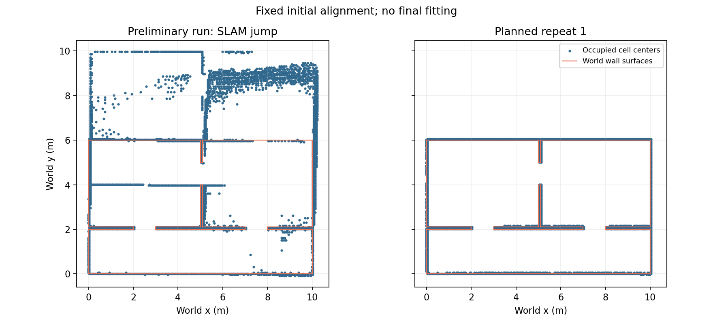

# 실험·검증

## 자료 인벤토리·과거 실제 사진 참고 감사 — 2026-11-03

Gazebo 108프레임의 중복 72개를 제외한 36개와 기존 실제 RGB 사진 50개를 점검했다.
새 문짝·출입구 bbox 검수 완료는 0이며 실제 RGB-D는 0개다.
과거 C 원문을 새 추론 없이 감사한 문 개수 일치는 실내 20/35·실외 보조 6/9였다.
현재 시맨틱 파이프라인의 실제 환경 성능과 구분한 [계약·해시·분모·한계](door-dataset.md)를 참고한다.

## 짧은 주행 중 문 관측 — 2026-11-03

Gazebo의 닫힘·열림 별도 실행에서 약 0.5m 후진·복귀하며 같은 문 ID와 anchor를 유지했다.
정지 후 신규 관측으로 상태를 확인했다. 최종 02 실행의 odom x 복귀 차이는 0.0048m·0.0002m였다.
단일 문·정면·짧은 직선·Gazebo pose odom 개발 확인이며 SLAM/실물 정확도 지표가 아니다.
[원문·그림·허용 기준·실패 처리와 한계](door-motion.md)를 참고한다.

## 동일 실행의 문 각도 전이 — 2026-11-03

하나의 Gazebo·YOLOE·LiDAR SLAM 실행에서 같은 문짝의 pose를 닫힘→열림→닫힘으로 변경했다.
동일 ID·고정 위치를 유지하고 두 전이 모두 unknown을 거쳐 새 상태가 확정됐다.
최종 02 실행의 명령 시작부터 확인까지 wall 시간은 0.944초·0.967초였다.
단일 문·정지 로봇·순간 각도 변경이며 실제 경첩 회전이나 일반 지연 성능 수치가 아니다.
[원문·그림·시각 정의와 한계](door-transition.md)를 참고한다.

## 실시간 문 검출·LiDAR SLAM 동시 실행 — 2026-11-03

새 Gazebo RGB-D를 로컬 상주 YOLOE로 추론하고 `/scan` 기반 실제 slam_toolbox 지도에서
문 위치·상태를 출력·저장했다. 2m 정면 닫힘·열림 별도 실행 모두 통과했다.
각 실행의 실제 map 발행자, clock 단일성, 입력/처리 수와 worker 그룹 종료를 확인했다.
[상세 수치·원문·지도/카메라 그림·지연 해석·실패 수정 기록](door-live.md)을 참고한다.
단일 문 모델의 정지 기능 확인이며 주행·지도 정확도·독립 장면·실물 결과가 아니다.

## 문 ROS 연결 재생 진단 — 2026-11-03

실제 저장 Gazebo RGB-D·C 검출을 ROS 메시지로 재생해 같은 문 ID의 상태 전환·마커·저장/복원·TTL과
입력 거부·지도 보정·시각 역행 초기화를 확인했다. 역행 후 동일 시각에 이전 TF를 재사용하지 않고,
새 TF가 들어오면 변경된 좌표를 사용하는 회귀도 통과했다.
항등 map→odom을 제공한 인위적 재생이며 LiDAR SLAM 지도를 실행한 정확도 시험은 아니다.
[실행 명령·실패 기록·원문 해시·한계](door-ros.md)를 참고한다.

## 실제 검출 기반 출입구 후보 개발 평가 — 2026-11-02

기존 C 검출·RGB-D에서 출입구 ROI를 추정한 뒤 깊이 상태 후보를 연결했다.
문 81프레임 중 출입구 IoU 성공과 정확한 상태는 각각 51개, unknown은 30개였다.
실행 오류는 0이며 검출 누락도 전체 분모에 포함했다.
위치를 출력한 51개에서 Gazebo odom 기준 3D 오차 중앙값은 약 5.8cm, 최대 약 9.6cm였다.
미출력 30개와 반복 프레임 한계를 포함한 [상세 결과](doorway-evaluation.md)를 참고한다.
정답은 채점에만 사용했으며 실제 SLAM 지도·독립 장면·실물 평가는 아니다.

## 깊이 문 상태 후보 개발 진단 — 2026-11-02

후속 구현 승인 후 주변 벽 평면과 출입구 깊이를 비교하는 후보를 추가했다.
정답 출입구 ROI를 제공한 개발 진단에서 닫힘 24/27·열림 48/54, 합계 72/81이 맞았고
9프레임은 벽 영역 부족으로 unknown이었다. 평벽 27프레임은 출입구 ROI가 없어 별도 제외했다.
검출·지도·독립 시험 성능과 구분한 [상세 결과와 재현 명령](door-state-evaluation.md)을 참고한다.

## Find Door 첫 문 검출 실험 — 2026-11-02

커밋 `a8c124f`에서 별도 문 world의 36조건·108 RGB-D 프레임을 수집하고 YOLOE 기반
recon-report C를 실행했다. 문틀 포함 기하 bbox의 IoU≥0.5 성공은 닫힘 12/27,
반열림 12/27, 완전 열림 0/27이며 평벽 음성 판정은 27/27이다. 실행 오류는 0이다.
열린 문도 18/27프레임에 문짝 검출 박스가 있어, 문 검출 부재와 문틀 위치 일치 실패를 구분한다.

문 영상은 전부 상단이 잘렸고 조건마다 세 RGB 해시가 같다. 실제 영상·문 상태 분류·지도 정확도 결과가 아니다.
전체 표, 원문 경로·설정·해시·외부 의존성 상태와 실제 카메라 비교 그림은
[문 실험 결과](door-experiment.md#전체-행렬-결과--2026-11-02)에 보존했다.
단계 태그 `v0.2.0-door-probe.1`은 첫 실험 완료를 표시하며 전체 문 상태 지도 완성을 뜻하지 않는다.

## 평가 지표

| 지표 | 측정 방법 | 단위 | 단계 |
|---|---|---|---|
| 지도 정확도 | 실제 도면(또는 줄자 실측) 대비 벽 길이·복도 폭 오차 | cm | 1 |
| 위치 추정 오차 | 시뮬: Gazebo 정답 궤적 대비 위치·방향 오차 / 실물: 독립 측정한 기준 지점 대비 | cm, ° | 1 |
| 종점 폐합 오차 | 출발점 복귀 시 위치 차이, 루프 클로저 전·후 비교 (SLAM 자체 출력이라 보조 지표) | cm | 1 |
| 시맨틱 표시 정확도 | 객체가 지도에 찍힌 위치와 실제 위치 차이, 놓친 객체 수 | cm, 개 | 2 |
| 성능 | 처리 주기, Jetson CPU·GPU 사용률 | Hz, % | 전 단계 |

> 시뮬레이션 지도 기하 평가는 [반복 평가 절차](simulation-evaluation.md)로 정의했습니다.
> 실물 측정 절차와 독립적인 위치 정답 수집은 미정 🔍

## 결과 기록

| 날짜 | 환경 (시뮬/실물·장소) | 실험 | 기대값 | 측정값 | 결과 | 커밋/태그 |
|---|---|---|---|---|---|---|
| | | | | | | |

> 재현성을 위해 결과마다 사용한 커밋 해시(또는 태그)와 rosbag/파라미터 파일 위치를 남깁니다.

## 지도 캡처

실험별 생성 지도와 실제 도면을 나란히 붙입니다. 이미지는 `docs/images/`에 둡니다.

## 초기 패키지 연결 검증 — 2026-10-25

- 기준 커밋: `d58be6f` (`feat/indoor-world`), 작업 브랜치: `feat/project-structure`의 미커밋 변경 포함.
- 환경: Ubuntu 22.04 / ROS 2 Humble / Gazebo Harmonic, slam_toolbox 2.6.10.
- world: `src/mapping_gazebo/worlds/indoor_v1.sdf`, SLAM 설정: `src/mapping_slam/config/slam.yaml`.
- 격리: `ROS_DOMAIN_ID=12`, `GZ_PARTITION=codex`, GUI 없이 기본 스폰 위치에서 정지 상태.
- 이 실험에는 rosbag을 기록하지 않았습니다. 정확도·주행·루프 클로저 성능 결과가 아닙니다.

| 검사 | 결과 |
|---|---|
| `colcon build --symlink-install` | 3개 패키지 빌드 통과 |
| `mapping_eval` 순수 단위 테스트 | 34개 통과 (frame·scan·map·odom 시각 오류 입력 포함) |
| colcon 테스트 결과 | 오류·실패 0, launch 린트·CMake·XML 검사 포함 |
| 시뮬 없는 격리 도메인에서 `check_interfaces --timeout 2` | 시간 초과, 종료 코드 1 확인 |
| 통합 launch + `check_interfaces --timeout 60 --require-map` | 센서·시간 진행·TF·지도 검사 통과 |
| `/scan`, `/clock` 발행자·QoS | 각각 발행자 1, RELIABLE/VOLATILE 확인 |
| `map_saver_cli` 저장 | PGM + YAML 생성, 201×122셀, 해상도 0.05 m |
| SLAM 종료 후 `map_server` configure/activate | 저장 지도 수신, 동일 크기·해상도 확인 |
| 독립 에이전트 검토 | 오래된 odom 반복 발행 오통과 가능성 수정, 최종 재검토 차단 사항 없음 |

XML 스키마 검사와 ROS DDS 실행은 샌드박스의 네트워크·소켓 제한 때문에
권한 승인 후 재실행했습니다. 최초 재로딩 검사에서는 검사 프로세스에 도메인 설정이
누락되어 서비스 검색이 실패했으며, 동일 도메인을 적용한 재검사에서 통과했습니다.

로컬 로그·지도: `/tmp/prometheus-structure-validation/` (임시 산출물, 저장소에 포함하지 않음).
재현 명령은 [mapping_slam README](../src/mapping_slam/README.md)와
[mapping_eval README](../src/mapping_eval/README.md)를 참고합니다.

외부 의존성은 Git으로 관리되지 않아 이번에 읽은 주요 파일의 SHA-256을 기록합니다.

| `wf_gazebo` 상대 경로 | SHA-256 |
|---|---|
| `launch/spawn_robot.launch.py` | `279cfceeecb1f8fb40b42a1cf0ea32e46fcc91da0256b09d1c2e1d68ccf8fa6e` |
| `config/gz_bridge.yaml` | `7b984fc32d60f82f84a9b8819541fc86a450b49abfe33380d9970322b3816735` |
| `urdf/rosorin.gz.xacro` | `13f4aea542a248dc5e8830bcda0017100f393adc12a1402b8e74d3a6dcd13b74` |
| `urdf/mecanum.xacro` | `c42d801f711b05f74a5da30b5afc868b49b604fb37995cb43c11317ce6cf5346` |

## 자동 주행·지도 기하 평가 — 2026-10-25

- 실행 당시 기준 커밋: `262b838`, 미커밋 변경 포함. 이후 구현·기록을 `c4beede`로 커밋했습니다.
- 환경: ROS 2 Humble / libgz-sim8 8.15.0 / slam_toolbox 2.6.10 / nav2_map_server 1.1.20.
- 경로·정답·고정 초기 정합·임시 품질 기준: [평가 절차](simulation-evaluation.md).
- 실행: `run_benchmark --runs 3 --record --confirm-simulation`, 속도 0.35 m/s, headless.
- 출력: `/home/blind/lab2/prometheus-evaluation-results/2026-10-25-baseline-v2/`.
  `manifest.json`에 설정·외부 모델·평가 코드 해시와 회별 원자료가 있습니다.
  `inputs/`에 실제 사용한 world·SLAM 설정·경로·정답을 보존했고,
  `source_snapshot/`에 프로젝트 소스, `provenance.json`에 기준 커밋·패키지 버전을 보존했습니다.
  3회차의 실제 ROS 파라미터는 `run_03/slam_toolbox.yaml`에 별도 저장했습니다.

| 회차 | waypoint | 벽 RMSE | 벽 P95 | precision (10 cm) | coverage (10 cm) | 임시 기준 |
|---|---|---|---|---|---|---|
| 1 | 12/12 | 3.71 cm | 6.28 cm | 100.0% | 100.0% | 통과 |
| 2 | 12/12 | 2.36 cm | 3.46 cm | 100.0% | 100.0% | 통과 |
| 3 | 12/12 | 2.55 cm | 3.14 cm | 100.0% | 100.0% | 통과 |

3회 벽 RMSE 평균은 2.87 cm, 표본 표준편차는 0.73 cm입니다.
P95 평균은 4.29 cm, 표본 표준편차는 1.73 cm입니다.
세 실행 모두 궤적 기록 유효 조건을 충족했고 TF 누락은 각각 1·2·2개였습니다.
궤적 잔차는 SLAM 입력과 공유하는 Gazebo odom 기준이므로 독립적인 ATE가 아닙니다.

### 예비 실행에서 관측한 실패

정식 3회 이전 예비 실행도 삭제하지 않고
`/home/blind/lab2/prometheus-evaluation-results/2026-10-25-baseline/`에 보존했습니다.
주행·지도 저장·bag 기록은 성공했으나 평가 CLI가 음수 지수 표기를 읽지 못해 실행기가
실패했습니다. 인자를 고정 소수점으로 전달하도록 수정한 뒤, 저장된 지도는 별도로
평가하여 `metrics-recovered.json`에 남겼습니다. 정식 3회 통계에는 포함하지 않습니다.

이 예비 지도는 벽 RMSE 167.49 cm, precision 약 50.0%, coverage 약 98.6%로 실패했습니다.
시뮬 49.95초까지 궤적 잔차 RMSE는 1.47 cm였으나 50.00초에서 y 잔차가 약 3.57 m
급변했습니다. bag의 원본 map→odom TF에서도 같은 변화가 확인되며,
Ceres 실행 중 스레드 수 상한 경고가 출력된 시점과 인접해 발생했습니다.
이 경고는 최적화 성공이나 루프 수락을 입증하는 로그는 아닙니다. 반복되는 벽 구조의 잘못된 루프 클로저가
유력한 가설이지만, 루프 수락 로그나 on/off 비교가 없어 아직 확정하지 않습니다.
설정 변경 없이도 정식 반복 3회에서는 정상 결과가 나왔으므로 **안정성 확보 완료로 해석하지 않습니다**.

### 검증과 다음 과제

- 3개 패키지 빌드 통과, 순수 단위 테스트 98개 통과, colcon 오류·실패 0.
- 에이전트가 구현을 분담하고 별도 읽기 전용 검토를 수행했습니다. 프로세스 그룹 종료,
  실행 입력 고정, TF 누락에 따른 궤적 유효성 처리를 보완했습니다.
- 정식 3회 모두 인터페이스 검사·전체 경로·지도 저장·평가·rosbag 기록 완료.
- 다음 과제: 같은 조건에서 루프 클로저 on/off 및 그래프 연결 로그를 비교하여 예비 실패 원인 확인.
- 실물 주행, 휠 오도메트리, 독립적인 위치 정확도, 카메라 융합, 알고리즘 비교는 미검증입니다.

## 루프 클로저 ON/OFF 비교 — 2026-10-25

`c4beede` 이후 비교 도구의 미커밋 변경으로 ON/OFF 각 3회 실행했습니다.
실제 파라미터는 `do_loop_closing`만 다르며 양쪽 상세 로깅을 켰습니다.
6회 모두 지도 임시 기준 통과, 0.5 m 이상 위치 잔차 급변 후보는 0개였습니다.
최초 예비 실패 기록에서는 같은 분석기가 3.566 m 급변을 검출했습니다.

**실패를 재현하지 못했으므로 원인은 미확정이며 기본 설정은 유지합니다.**
회별 수치·해석·재현 명령은 [루프 클로저 조사](loop-closure-investigation.md)에 정리했습니다.
원자료는 `/home/blind/lab2/prometheus-evaluation-results/2026-10-25-loop-comparison/`에 있습니다.

## 로봇 도착 전 소프트웨어 준비 — 2026-10-25

기준 dev `0add5f0`, `feat/prehardware-readiness`의 변경으로 실행했습니다.
동일 기록 입력의 slam_toolbox·Cartographer 각각 3회와 OFF 1회 재생을 완료했습니다.
지도 지표는 [재생 결과](replay-evaluation.md), 실제 RGB-D의 두 표적 이동·ID·저장·복원과
학습 검출/외부 투영의 구분은 [시맨틱 결과](semantic-evaluation.md)에 기록했습니다.
최초 온라인 급변은 재생에서 재현되지 않았으며 초기 scan 전체가 기록되지 않은 한계가 있습니다.
4개 패키지 빌드, 순수 테스트 285개, colcon 303개 검사 오류·실패 0.
실물 검증은 [로봇 인수](robot-acceptance.md)에서 별도 수행합니다.

재생·시맨틱 소프트웨어 구현은 [PR #7](https://github.com/reconmap-lab/prometheus-mapping/pull/7), dev `f0b37c0`에 병합했고 원격 CI를 통과했습니다.

## SLAM 시작 전 입력·그래프 진단 — 2026-10-25

기준 dev `0448e5c`, `feat/slam-startup-capture` 변경으로 시작 전 recorder·진단 구독,
static/dynamic TF·scan coverage 감사, 명시적 재생 QoS를 구현·검증했습니다.
4개 패키지 빌드·순수 테스트 316개·colcon 334개 검사 통과.

첫 기록은 P95 3.21cm로 통과했으나 두 번째는 큰 TF 변화 3.709m와 지도 품질 실패를
기록했습니다(P95 391.30cm). 같은 두 번째 bag의 ON 재생은 P95 391.30cm,
OFF는 6.63cm·급변 후보 0개입니다. 실효 파라미터는 `do_loop_closing`만 다릅니다.
기록·재생 완료와 지도 품질을 구분하며, 새 실패·비연속 그래프 연결은 루프 처리
연관성을 지지하지만 수락 원인과 과거 예비 실패와의 동일성은 🔍입니다.

> 2026-10-26 갱신: 이 실패의 원인을 확정했습니다. 스캔 무게중심 기반 루프 후보 선택이 벽 너머 Room B를
> 연결했고, `use_scan_barycenter: false`로 기본 설정을 바꿨습니다(PR #15·#16). 과거 예비 실패와의 동일성은 계속 🔍입니다.
> [원인 분석](loop-closure-investigation.md#2026-10-26-원인-분석-스캔-무게중심-기반-루프-후보-선택)

[상세 수치·진단·Gazebo 캡처·지도 그림·재현 명령·원자료 위치](slam-startup-capture.md).

## 반복 구조 world 재검증 — 2026-10-31

`indoor_v2`에서 현재 기본값 5회 모두 품질 기준을 통과하지 못했습니다(벽 P95 291.5–300.5 cm).
조건별 결과와 한계는 [루프 클로저 조사](loop-closure-investigation.md#2026-10-31-indoor_v2-재검증)에 기록합니다.

2026-11-01: 재생한 실패 bag 2개에서 복도와 벽 너머 방을 맞춘 수락 연결이 정답과 3.1 m 어긋남을 [확인](loop-closure-investigation.md#루프-수락-기록과-정답-비교)했습니다. 후보 설정은 기준에 미달하거나, 처리 간격 0.5처럼 지도 점수는 통과해도 루프 수락이 0회여서 채택하지 않았습니다. 처리 간격 스윕에서도 [사전 기준을 통과한 값이 없어](loop-closure-investigation.md#처리-간격-스윕과-조사-결론) 시뮬레이션 튜닝을 마쳤습니다 ([후보와 설정 검증](loop-closure-investigation.md#2026-11-01-indoor_v2-실패-후보와-설정-검증)).

## 실물 배포 준비 — 2026-10-25

기준 dev `ab06e3c`, `feat/robot-deployment-readiness`의 변경으로 실물 전용 mapping_robot을 추가했습니다. Gazebo 없는 두 패키지 빌드, 시스템 시각 합성 센서 preflight·SLAM/선택 검출·지도/객체 저장·bag 기록/격리 재생을 실제 ROS에서 확인했습니다. 깊이 단위·BGR·동기화 경계와 실패 입력을 검사했고 실제 하드웨어 검증과 구분했습니다. 순수 테스트 445개·colcon 410개 검사 오류·실패 0. 같은 실패 bag ON/OFF 각 3회에서 ON만 품질 실패, OFF는 P95 6.63cm입니다.

[수치·한계·원자료·독립 검토](robot-readiness-evaluation.md), [설치·배포·도착 당일 명령](robot-deployment.md)을 참고합니다. ARM64·실물 드라이버·보정·정지·Jetson 성능·실물 정확도는 미검증입니다.

배포 준비 구현 커밋 `a4b5eaa`의 소스 bundle 63개 파일을 실제 추출해 manifest 검증·두 런타임 패키지 재빌드까지 통과했습니다. 모델 가중치·드라이버·바이너리는 소스 bundle에 포함하지 않습니다.

## 문짝·출입구 라벨 검수 도구 — 2026-11-03

기준 `ec1a239` 이후 `v0.2.0-door-labels.1` 단계에서
[오프라인 라벨 작성·검수](door-label-review.md)를 구현했다.
86프레임 HTML 생성·원본 해시와 크기 검사·별도 수정본 적용을 실행했고 결과는 여전히 86 draft / 0 reviewed다.
Firefox 158 headless의 실제 pointer 박스 입력, 프레임 이동, 명시적 검수 체크, 로딩/복원 중 편집 차단을 확인했다.
수정본 검증 12개·기존 계약 39개 통과. 전체 오프라인 673개 통과·ROS 전용 2개 건너뜀. 원본 이미지·기존 라벨·외부 recon-report는 수정하지 않았다.
[원문·도구 해시 요약](data/door-label-review-summary.json)을 보존했다.
사람의 이중 bbox 검수·학습·독립 장면 분할·실제 RGB-D 깊이 평가는 아직 완료되지 않았다.

## 작은 제자리 회전 중 문 관측 — 2026-11-03

기준 `3d27cb2` 이후 `v0.2.0-door-rotation.1` 단계에서
[회전·복귀 하네스와 개발 진단](door-rotation.md)을 추가했다.
Gazebo의 2m 정면에서 ±0.1rad/s·2.5초 회전 후 정지·새 상태 관측을 확인했다.
닫힘·열림 두 실행 모두 ID·고정 anchor·정답 상태가 유지됐다.
닫힘 48개·열림 46개 회전 중 polling 샘플에서 unknown·반대 known 상태는 0개였으며,
이는 센서 전체 프레임의 정확도나 독립 평가 결과가 아니다.
복귀 yaw 오차는 0.2693°·0.0401°다. Gazebo pose odom의 전후 차이며 실물·SLAM 정확도가 아니다.
[원문·모듈·world·설정·모델 해시와 분모](data/door-rotation-summary.json)를 보존했다.
odom·회전 판정 24검사, 전체 오프라인 690검사 통과·ROS 전용 2검사 건너뜀.
제품 모듈·외부 오버레이·추론 가중치는 변경하지 않았다.
