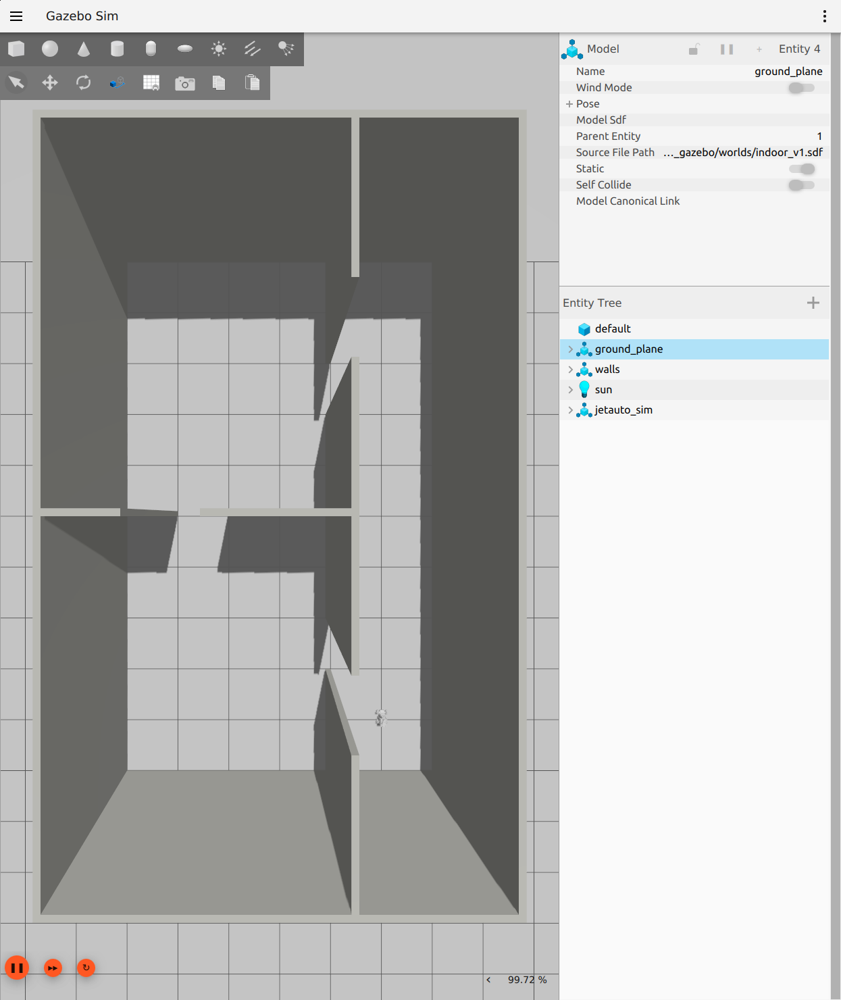
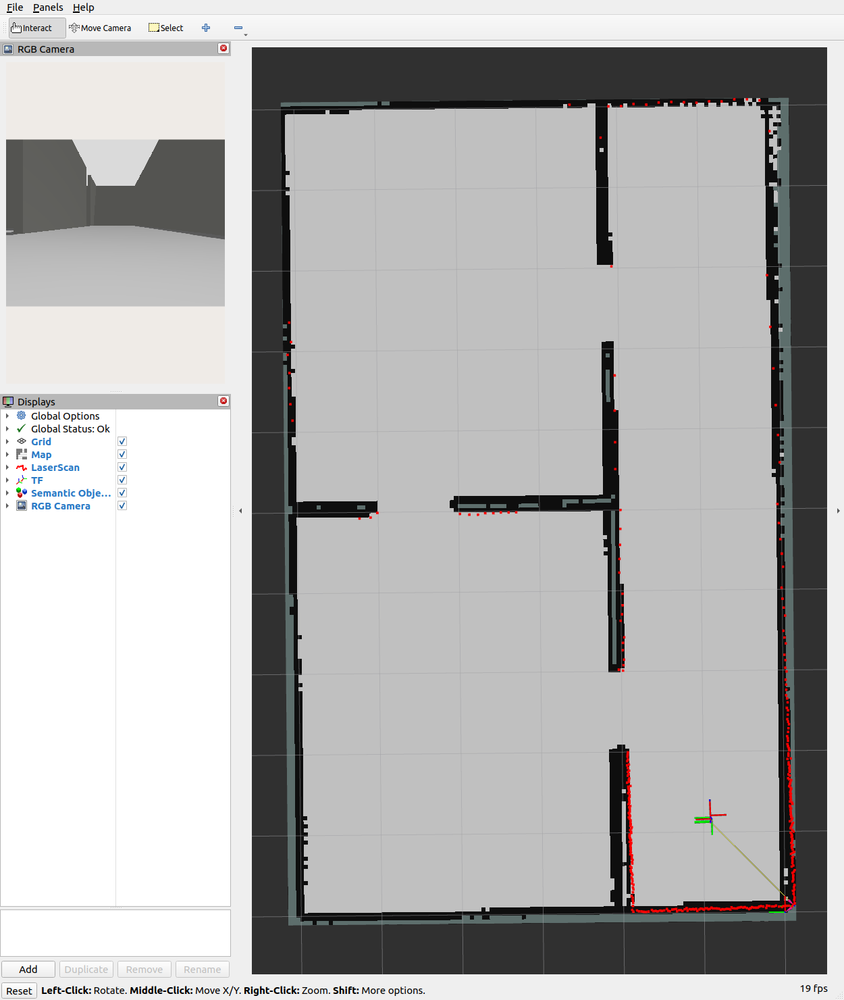

# Gazebo·RViz 실시간 화면 확인

2026-10-25, dev `167e2e6`에서 사용자가 보는 실제 X11 화면에 Gazebo와 RViz2를 나란히 실행했습니다.
`indoor_v1`, ROS_DOMAIN_ID=12, GZ_PARTITION=codex, `use_sim_time=true`입니다.
SLAM 설정은 원본을 변경하지 않은 별도 사본에서 loop OFF를 사용했습니다.

- Gazebo: 실내 벽과 JetAuto, 위에서 내려다보는 실제 GUI 장면.
- RViz: `/map` 점유지도, `/scan` 빨간 라이다 점, TF 좌표축, 실제 로봇 RGB 카메라 영상.
- 자동 주행: 기존 12 waypoint, 0.25m/s. 첫 회 12/12 도달·정지, 약 87.9초.
- 인터페이스 검사 통과, clock/map 각각 발행자 1개, 실제 odom 위치 변화 확인.
- 객체 검출·semantic mapper는 이번 화면에서 실행하지 않았습니다. RViz의 Semantic Objects 항목은 공통 설정에 포함된 표시 항목입니다.





각 앱의 창 내용만 캡처했으며 사용자 바탕화면은 포함하지 않았습니다.
화면 표시·주행 확인이며 독립 정답 지도 정확도나 실물 검증 결과는 아닙니다.
loop ON에서 관측한 실패는 [기존 조사](robot-readiness-evaluation.md)에 별도로 유지합니다.
사용자에게 보여 주기 위해 시뮬·RViz 창은 실행 상태로 남겼습니다.

## 다시 실행할 때의 구성

[환경 준비](setup.md)를 적용하고 시뮬과 RViz에 같은 도메인을 사용합니다.

```bash
export ROS_DOMAIN_ID=12 GZ_PARTITION=codex
# SLAM YAML 사본에서 do_loop_closing: false를 지정
ros2 launch mapping_slam simulation.launch.py gui:=true \
  params_file:=/absolute/path/slam-demo.yaml

# 같은 환경의 별도 터미널
rviz2 -d src/mapping_semantic/config/semantic.rviz --ros-args -p use_sim_time:=true
```

RViz에서 마우스 휠로 확대·축소합니다. TopDownOrtho의 왼쪽 드래그는 회전,
휠 버튼 드래그는 평면 이동입니다. Gazebo와 RViz 카메라는 서로 독립적입니다.

현재 실행 기록은 저장소 밖
`/home/blind/lab2/prometheus-evaluation-results/2026-10-25-live-demo-231235/`에 있습니다.
`session.json`에 명령·PID/PGID·프로세스 시작 시각, `slam-demo.yaml`·`live.rviz`에 실제 설정,
`preflight.log`, `motion_check.json`, `route_01/route_result.json`과 궤적·앱별 PNG를 보존했습니다.
`stop_demo.py`는 이 세션의 PID 시작 시각을 확인한 뒤 해당 프로세스 그룹에만 INT를 보냅니다.
일반 종료 규칙은 [실행 절차](setup.md#실행--시뮬레이션)를 따릅니다.
