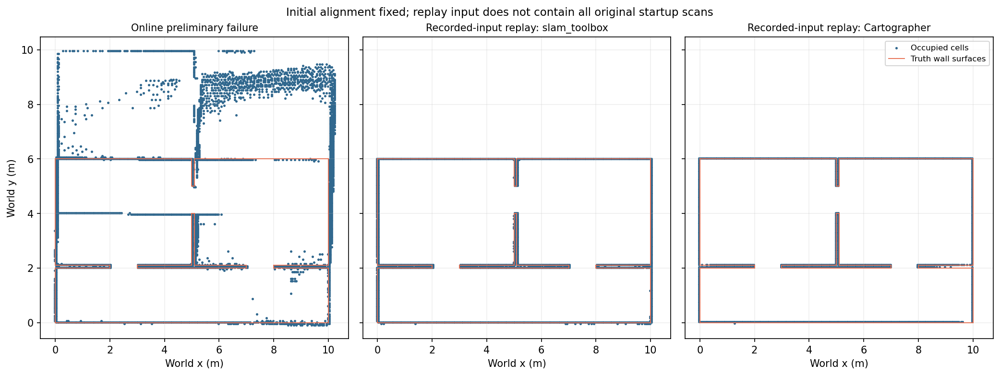

# 동일 입력 bag 재생 평가

기존 실패 bag에서 센서 입력만 추출해 새 SLAM에 재생합니다. 기록된 SLAM 출력이나
속도 명령이 다시 발행되지 않도록 화이트리스트로 입력을 제한합니다.

## 재현

ROS·외부 모델 오버레이·이 저장소 install을 source하고 기존 시뮬레이션을 종료한 상태에서 실행합니다.
원본은 저장소 밖에 두며 출력에는 새 디렉토리를 지정합니다.

```bash
export ROS_DOMAIN_ID=12 GZ_PARTITION=codex
ros2 run mapping_eval replay_benchmark \
  --bag /absolute/path/original-bag \
  --params-file src/mapping_slam/config/slam.yaml \
  --truth src/mapping_eval/config/indoor_v1_truth.yaml \
  --output /tmp/replay-new --confirm-simulation
```

- `/scan`, `/odom`, `/clock`, 허용된 `/tf`·`/tf_static`만 보존합니다.
- TF는 현재 시뮬 모델의 확인된 부모→자식 edge만 보존합니다. `map→odom`과 다른
  미허용 TF, `/map`, `/cmd_vel`, pose·semantic 출력은 재생하지 않습니다.
- bag record 시각, 원본 CDR payload(필터가 불필요한 메시지), QoS를 보존합니다.
  혼합 TF는 허용 edge만 새 TFMessage로 직렬화합니다.
- 원본 clock을 그대로 재생하고 `ros2 bag play --clock`으로 별도 clock을 만들지 않습니다.
- player를 paused로 시작하고 SLAM 구독자가 준비된 뒤 Resume 서비스로 재생합니다.
- 첫 유효 관측 시각의 map←odom 역변환을 고정합니다. 사후 fitting은 없습니다.
- 원본 끝 odom과 마지막 기록의 차이, 수신률·TF 기록률, clock·map 최신성을 검사합니다.
  유효하지 않은 실행은 부분 산출물을 보존한 뒤 실패 종료합니다.

EOF 뒤 벽시계 2.5초의 콜백 처리는 시뮬 시간을 진행시키지 않습니다. 저장 결과는
**EOF 시점에 마지막으로 수신한 지도**이며, 마지막 scan을 반영한 최종 최적화 지도를
보장하지 않습니다. map header 시각이 종료 clock보다 2초 넘게 오래되면 실패합니다.

## 산출물

`filtered/filter_manifest.json`에는 원본 파일 SHA-256, 유지·제거 메시지 및 TF 개수,
유지 레코드 payload 해시와 원본 odom 종료 시각이 있습니다. `replay_manifest.json`에는
실행 명령·코드·설정 해시, 유효성 판정·지도/궤적 지표를 기록합니다.
`effective_params.log`, `map.pgm/yaml`, `trajectory.csv`, `trajectory_metrics.json`,
`replay_observation.json`과 각 프로세스 로그를 함께 보존합니다.

같은 입력이어도 DDS·스레드 스케줄링·SLAM 내부 처리로 출력은 완전히 결정적이지 않을 수 있습니다.
Gazebo odom은 SLAM 입력에도 사용하므로 궤적 잔차는 독립적인 ATE가 아닙니다.

## Cartographer 비교

선택 기능이며 기본 `mapping.launch.py`는 slam_toolbox를 유지합니다.
Cartographer ROS 2 패키지가 있는 환경에서는 다음 인자만 바꿉니다.

```bash
# 일반 설치 환경의 추가 의존성. ros_gz 패키지를 바꾸지 않음.
sudo apt-get install ros-humble-cartographer-ros
ros2 run mapping_eval replay_benchmark \
  --bag /absolute/path/original-bag \
  --params-file src/mapping_slam/config/cartographer.lua \
  --slam-launch cartographer.launch.py --slam-node /cartographer_node \
  --truth src/mapping_eval/config/indoor_v1_truth.yaml \
  --output /tmp/cartographer-replay-new --confirm-simulation
```

Cartographer는 LaserScan 1개·외부 odom을 사용하고 IMU를 사용하지 않는 2D 비교 설정입니다.
`published_frame=odom`, `provide_odom_frame=false`로 map→odom만 추가하며,
입력 bag의 odom→base_footprint를 중복 발행하지 않습니다. 해상도는 0.05 m입니다.
기본 Lua 설정은 해당 패키지에서 읽어 실행 임시 폴더에 복사하고 종료 시 정리합니다.

이번 PC에서는 sudo 인증 없이도 독립 비교가 가능하도록 공식 APT deb를 저장소 밖의
`/home/blind/lab2/prometheus-tools/cartographer-overlay`에 풀어 사용했습니다.
시스템 `/opt`를 수정하거나 외부 `wf_gazebo`를 재빌드하지 않았습니다.
Cartographer 2.0.9004 / cartographer_ros 2.0.9002, Lua 5.2.4이며 정확한 deb 버전·해시는
결과 폴더 `cartographer_packages.json`, 기본 Lua 사본은 `cartographer_default_configs/`에 있습니다.

```bash
# 위 로컬 추출 경로에서 실행할 경우에만 사용
export AMENT_PREFIX_PATH=/home/blind/lab2/prometheus-tools/cartographer-overlay/opt/ros/humble:$AMENT_PREFIX_PATH
export LD_LIBRARY_PATH=/home/blind/lab2/prometheus-tools/cartographer-overlay/opt/ros/humble/lib:/home/blind/lab2/prometheus-tools/cartographer-overlay/usr/lib/x86_64-linux-gnu:$LD_LIBRARY_PATH
```

새 PC에서는 일반 패키지 설치나 동일 버전 로컬 의존성 준비 후 사용해야 합니다.
실물 알고리즘 최종 선정이나 모든 환경의 우열을 이 한 bag 비교로 결정하지 않습니다.

## 2026-10-25 실행 결과

원본은 예비 실패 실행의 `2026-10-25-baseline/run_01/bag`입니다.
모든 재생의 유지 레코드 payload SHA-256은
`d86d284d7e4a4e1e562227838abb8eebdbbf5af2474d9aecab803c852486562e`로 같았습니다.
원본 odom 1,384개를 모두 수신했습니다. 최초 ON 실행은 endpoint gate 보완 전 실행이지만,
기록된 마지막 표본·원본 종료 시각·map age를 사후 확인해 같은 조건에 적합함을 확인했습니다.

| 실행 | 벽 RMSE (cm) | 벽 P95 (cm) | precision (%) | coverage (%) | 급변 후보 |
|---|---|---|---|---|---|
| on | 2.29 | 3.44 | 100.00 | 100.00 | 0 |
| on_02 | 2.29 | 3.44 | 100.00 | 100.00 | 0 |
| on_03 | 2.29 | 3.44 | 100.00 | 100.00 | 0 |
| off | 4.32 | 9.44 | 100.00 | 99.91 | 0 |
| cartographer | 2.51 | 2.50 | 100.00 | 98.45 | 0 |
| cartographer_02 | 2.51 | 2.50 | 100.00 | 98.45 | 0 |
| cartographer_03 | 2.51 | 2.50 | 100.00 | 98.45 | 0 |

이번 입력에서는 slam_toolbox ON·Cartographer 각각 3회의 지도 지표가 일치했습니다.

두 알고리즘 모두 임시 기준을 만족하며, P95만으로 우열을 결정하지 않습니다.
Cartographer는 이 비교에서 coverage가 조금 낮고 slam_toolbox는 RMSE가 조금 작았습니다.
실물·다른 구조·센서 오차·CPU 부하 조건을 대표하지 않는 한 bag 결과입니다.

**기존 급변은 재현되지 않았으며 원인은 여전히 미확정입니다.** 원본 bag은 preflight 후
기록을 시작했으므로 원래 SLAM이 기록 시작 전에 처리한 초기 scan 전체를 포함하지 않습니다.
따라서 재생은 후보들 사이에서 같은 **기록 입력**을 사용한 비교이며 원래 온라인 실행의
내부 상태·전체 수신 순서까지 복제한 것이 아닙니다. 이 결과로 원래 실패를 기각하지 않습니다.

결과 폴더: `/home/blind/lab2/prometheus-evaluation-results/2026-10-25-replay/`.
`comparison.json`에 집계 원자료를 보존했습니다. 같은 실패를 추적할 때는 SLAM 시작 전부터
입력을 기록하고 처리한 scan 시각·그래프 연결을 추가 관측해야 합니다.



왼쪽은 최초 온라인 실패 지도, 가운데·오른쪽은 보존한 입력의 재생 결과입니다. 초기 입력 누락으로 원래 실행 전체를 복제한 비교는 아닙니다.
