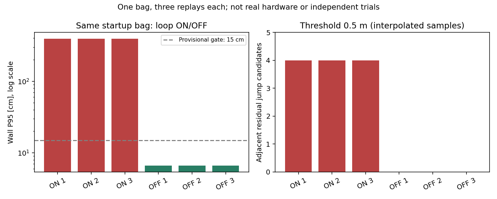

# 실물 배포 준비 검증 — 2026-10-25

기준 dev `ab06e3c` 이후 `feat/robot-deployment-readiness` 변경이며 구현 커밋은 `a4b5eaa`입니다.
실행은 Ubuntu 22.04·ROS 2 Humble·x86_64 개발 PC, domain 12/partition codex에서 수행했습니다.
**로봇·ARM64·실제 센서·물리 정지는 검증하지 않았습니다.**
[설치·도착 당일 실행](robot-deployment.md)과 [실물 인수](robot-acceptance.md)를 구분합니다.

## 구현과 실제 실행 확인

| 항목 | 확인 결과 | 범위·한계 |
|---|---|---|
| 빌드 | 5개 패키지 빌드, colcon 410개 검사 오류·실패 0 | x86 개발 환경 |
| 의존성 점검 | 실제 rosdep check 통과, Python buildtool 키 보완 | rosdep 데이터로 두 런타임 패키지 의존성 해결 확인 |
| 로봇 최소 런타임 | 외부 오버레이 없이 mapping_semantic·mapping_robot 두 패키지만 별도 빌드·launch 인자 확인 | Gazebo·wf_gazebo 불필요, ARM64 미검증 |
| 소스 bundle | 커밋 a4b5eaa의 63개 파일 묶음 추출·파일 해시 확인·두 패키지 재빌드 통과 | Git 커밋 원본 코드 사용, 가중치/바이너리 제외 |
| 설정 거부 | 미확인 template CLI 실패, 구조·모델해시·단위·토픽 오류 단위 검사 | 실제 장치 사양을 자동 보충하지 않음 |
| 센서 preflight | 10초, scan 5Hz·odom 20Hz·RGB/depth/info 5Hz, 카메라 50쌍 | 시스템 시각의 합성 드라이버, hardware_verified=false |
| TF 검사 | scan 시각 odom/base·base/laser 각 51회, odom pose/TF 200회, camera TF 50회 | 최대 pose 차이 0, authority 유일성은 미검증 |
| 실물용 launch | SLAM·NanoDet·semantic 모두 use_sim_time=false, 지도 저장·객체 저장 서비스 | 공개 RGB + 합성 2m depth·합성 장착 TF |
| BGR·16UC1 연결 | person 2개 3D 관측, z=2m, RGB header 보존 | 출력 89메시지, person 정적 저장 0개; 실제 3D 정확도 아님 |
| RGB-D 호환성 | BGR/16UC1 ↔ RGB/32FC1에서 chair_000001 유지, 30ms 허용 | 31ms·검출 timestamp 불일치·0깊이·0 CameraInfo 거부 |
| bag 기록 | scan 90·odom 358·RGB/depth/info 각 90, 정적 TF 및 odom→base 감사 | 구동 명령·clock 제외, 원본 TF에 섞인 SLAM 출력은 감사/재생에서 분리 |
| 실물 형식 bag 재생 | 센서 player + 시뮬 시각 SLAM, 지도 20회·clock 1785회 수신 | 합성 wall-time bag, 120×80셀·fixture_map. 종료 후 clock 발행자 0 |
| 실패 검사 | 센서 없는 5초 preflight 실패·JSON 보존 | 없는 센서를 정상으로 처리하지 않음 |
| 환경·자원 기록 | check-env 통과, 2초 자원 수집 5표본 | 개발 PC OS 원자료, GPU·전력·Jetson 성능 판정 아님 |

순수 검사에는 새 프로파일·기록/재생·배포물 변조·환경·동기화 검사를 포함합니다.
순수 테스트 445개가 통과했습니다. 원격 CI와 최종 배포물은 해당 PR 및 [평가 기록](evaluation.md)에 남깁니다.

## 검증 중 발견·보완한 문제

독립 에이전트가 구현과 별도로 검토했습니다. scan float32 경계의 잘못된 거부,
빈 카메라 payload 통과, odom pose/TF 불일치 누락을 보완했습니다.
기록 도구의 비단위 quaternion·중복 센서 발행자, bundle의 빈 manifest·추가 파일 검증도 보완했습니다.
실제 재생에서는 SLAM이 TF 메시지 발행 전부터 `/tf` endpoint를 광고해 시작을 거부하던 문제를
발견했습니다. 실제 입력 TF와 센서 발행자를 검사하고 대기 중 SLAM 출력 endpoint를 허용하도록 수정한 뒤
재생·지도 생성이 통과했습니다. 이후 지정 receiver의 여러 TF endpoint를 같은 DDS participant로 묶어 허용하고 조용한 다른 드라이버를 거부하도록 보완해 최종 v5 실행을 통과했습니다. Humble의 callback별 TF 발행원 식별 한계는 보고서에 남깁니다.

초기 합성 시험은 테스트 드라이버가 정적 TF 하나만 보존하고 큰 영상 수신이 늦어 preflight에
실패했습니다. 정적 TF를 함께 발행하고 320×240 영상·10초 관측으로 재검사했습니다.
두 번째 재생은 실행·지도 생성에 성공했지만 시험 관측기의 clock QoS가 맞지 않아 검증 assertion이
실패했고, BEST_EFFORT clock 구독으로 보완한 최종 시험에서 clock 수신까지 확인했습니다.
실패 기록은 삭제하지 않았습니다.

## 새 실패 bag의 반복 대조

기존 [시작 전 기록](slam-startup-capture.md)의 **같은 한 bag**을 조건별 3회로 확장했습니다.
추가 실행의 소스는 PR #10의 `391681f`이며 dev squash `ab06e3c`와 같은 코드입니다.

| 조건 | 벽 RMSE 3회 (cm) | 벽 P95 3회 (cm) | 인접 잔차 급변 후보 | 궤적 기록 유효 |
|---|---|---|---|---|
| loop ON | 175.65 / 175.65 / 175.65 | 391.30 / 391.30 / 391.30 | 4 / 4 / 4 | 모두 유효 |
| loop OFF | 3.80 / 3.80 / 3.80 | 6.63 / 6.63 / 6.63 | 0 / 0 / 0 | 모두 유효 |

ON/OFF 실효 파라미터 차이는 do_loop_closing입니다. 같은 입력·고정 초기 정합이며,
별개 환경 3개나 실물 실패 확률의 측정이 아닙니다. 루프 수락 제약/이유·과거 예비 실패와
동일 원인인지는 🔍입니다. 개발 기본 설정은 유지하고 **첫 실물 시험에 한정해 OFF**를 사용합니다.

사용한 indoor_v1의 실제 Gazebo 장면은 [기존 실제 캡처](slam-startup-capture.md#새-급변에서-확인한-사실)에
보존했습니다. 이번 그림은 재생 수치이며 새 Gazebo GUI 캡처나 실물 장면이 아닙니다.

## 원자료와 다음 확인

기준 디렉토리 `/home/blind/lab2/prometheus-evaluation-results/` 아래에 보존했습니다.

- `2026-10-25-robot-ready/`: 첫 합성 preflight 실패 원본.
- `2026-10-25-robot-ready-v2/`: 프로파일·preflight·지도·객체·bag·검사 로그·probe 스크립트.
  `integration.json`, `replay-integration-v5.json`은 최종 통합 결과이며 이전 재생 실패도 보존.
- `2026-10-25-rgbd-compat/`: depth·색상·동기화 경계 ROS 시험, `result.json`.
- `2026-10-25-runtime-only/`: Gazebo 없이 두 런타임 패키지를 빌드한 별도 workspace.
- `2026-10-25-startup-repeat-{on,off}-{02,03}/`: 추가 재생, 입력 사본·해시·실효 파라미터·지도·궤적.
- `2026-10-25-startup-repeat-summary/`: 6회 집계 JSON·재생성 스크립트.

로봇 도착 전 구현 가능한 설치·설정·입력 점검·실행·기록·격리 재생·OS 자원 기록 경로를
준비했습니다. 실제 OS/JetPack·센서 드라이버·주기·TF·보정·정지 기능·Jetson 처리 성능·목표 클래스
데이터 평가와 실물 지도 정확도는 [인수 절차](robot-acceptance.md)의 미검증 항목으로 남습니다.
