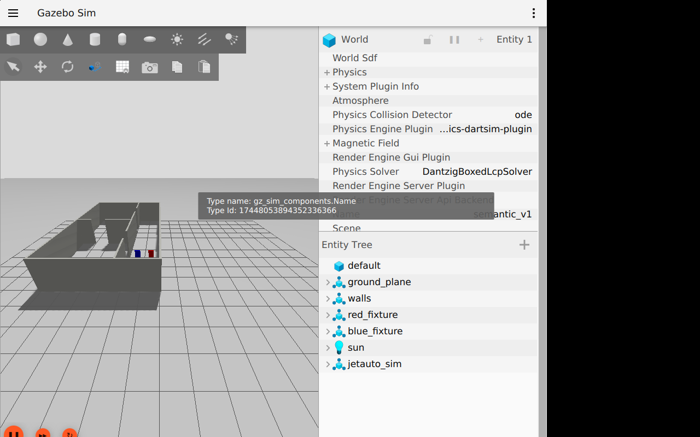
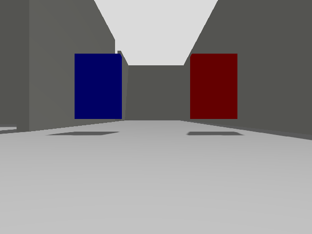

# RGB-D 시맨틱 파이프라인 검증

합성 색상 표적의 실제 Gazebo RGB-D 투영, 외부 검출 연결, 정적 객체 저장·복원을
각 입력의 정답 범위에 맞춰 검증했습니다. 실제 문·계단·소화기 인식·실물 정확도는 미검증입니다.

## 실제 Gazebo 입력·객체 지도

`semantic_v1.sdf`는 프로젝트의 실내 world에 red_fixture·blue_fixture를 추가한 장면입니다.
정답은 보이는 앞면 중심 빨강 (2.95, 0.55, 0.35), 파랑 (2.95, 1.45, 0.35) m입니다.
외부 wf_gazebo 모델·브리지·센서 파일을 복사하거나 수정하지 않았습니다.

```bash
source /opt/ros/humble/setup.bash
source ~/worker_following_ws/install/setup.bash
colcon build --symlink-install
source install/setup.bash
export ROS_DOMAIN_ID=12 GZ_PARTITION=codex
ros2 run mapping_eval run_semantic_benchmark \
  --output /tmp/semantic-new --record-camera --confirm-simulation
```

이 도구는 자기 시뮬레이션만 headless로 시작해 (1,1)에서 두 객체를 확정하고,
0.2m 전진을 목표(도착 허용 오차 0.02m)로 같은 ID를 확인한 뒤 저장·mapper 재시작·load를 시험합니다.
첫 객체 관측 시각의 map←odom 전체 3D 역변환을 고정하며 사후 정합은 하지 않습니다.
기존 JSON 덮어쓰기는 거부해야 하고, 새 mapper는 publisher GID와 instance_id로 확인합니다.
load의 증거는 서비스 성공·loads 증가·호출 구간의 저장 좌표 일치 발행입니다.
자연 관측과 좌표가 같을 수 있어 해당 발행의 인과를 독립적으로 증명하지는 않습니다.

| 단계 | 최대 3D 위치 오차 | 기준 10cm |
|---|---|---|
| 초기 | 1.04 cm | 통과 |
| 0.2m 이동 후 | 1.03 cm | 통과 |
| 저장 좌표 복원 | 1.03 cm | 통과 |

관측·저장·이동·복원 뒤 객체 ID를 유지했습니다. 실제 카메라는 rgb8·32FC1(m),
640×480, fx=fy=499.409, cx=320/cy=240, 공통 optical frame, 무왜곡 K를 확인했습니다.
base_footprint 기준 광학 프레임 높이는 0.119864m입니다.
카메라 bag의 10개 토픽과 종료 메타데이터를 확인했습니다.
초기 SLAM TF 준비 중 제한 시간 내 해석할 수 없던 영상은 버리고 카운터에 남겼습니다.
처리 지연·CPU 값은 개발 PC·해당 장면의 관측값이며 Jetson 지속 성능을 뜻하지 않습니다.



위 GUI는 별도 가상 디스플레이의 실제 캡처입니다. 자동 성능 시험은 headless입니다.



이 영상의 색상 표적은 투영 검증용입니다. 객체 검출 모델 성과와 구분합니다.

## 외부 검출과 학습 모델

| 시험 | 입력·확인 | 결과 |
|---|---|---|
| 외부 Detection2D 기하 | 저장한 실제 Gazebo RGB-D에 합성 chair/person bbox·정적 TF, use_sim_time=false | chair·person 표면 오차 약 1.15/0.88cm, chair만 저장, 잘못된 header 거부 |
| NanoDet 오프라인 | 공개 OpenCV basketball1 RGB + 공식 FP32 ONNX | person 2개 검출, 모델 SHA 검증 |
| NanoDet ROS | 동일 RGB, header·bbox 픽셀 좌표·빈 영상·잘못된 인코딩·입력 중단 | header 유지, 빈 결과·거부·과거 결과 미반복 확인 |
| 전체 연결 | 실제 NanoDet 추론 + 합성 상수 2m depth·정적 TF | person 2개 3D 관측, 정적 객체 0개·빈 JSON, 원본 시각 유지 |

합성 bbox 시험은 학습 모델 검출 정확도 시험이 아니며, 상수 깊이 시험은 실제 3D 위치
정확도 시험이 아닙니다. NanoDet 모델과 지원 클래스·라이선스·명령은
[검출 기준선](detector-baseline.md)에 있습니다. BEST_EFFORT 대형 영상은 손실될 수 있어
ROS 단발 입력 시험은 수신 확인 후 재전송했습니다. 외부 브리지의 대형 공유 메모리
설정을 적용한 전체 연결 시험에서는 RGB/depth/CameraInfo/검출 각각 6개와 6개 동기 묶음을 확인했습니다.

카메라 중단 뒤 map→odom에 0.3m 보정을 주입한 별도 시험에서 epoch가 1로 바뀌고
객체 목록이 비워졌습니다. 추가 영상 없이 보정 감시가 동작함을 확인했습니다.

## 결과 보존·검증 범위

- 기준 코드: dev `0add5f0` 이후 `feat/prehardware-readiness` 변경. 병합 PR에 최종 코드 식별자를 남깁니다.
- 최종 fixture 원자료: `/home/blind/lab2/prometheus-evaluation-results/2026-10-25-semantic-v3/`.
  `semantic_benchmark.json`, 설정·소스·외부 의존성 해시, 초기·재시작 실효 파라미터,
  objects.json, 전후 RGB PNG, camera_bag 및 로그 보존.
- 외부 기하: `2026-10-25-external-projection-v2/result.json`.
- CPU 검출: `2026-10-25-nanodet-positive.json`, `2026-10-25-nanodet-ros-v3/result.json`.
- 전체 연결: `2026-10-25-learned-chain/result.json`.
- 입력 프로브·GUI 캡처·외부 연결 시험 스크립트는 해당 결과 폴더의 probe.py에 보존합니다.
  이 스크립트는 로컬 원자료 경로를 사용합니다. 일반 실행은 패키지 CLI를 따릅니다.
- 4개 패키지 빌드 통과, 순수 테스트 285개, colcon 검사 303개 오류·실패 0.
- 중요한 구현은 작성자와 다른 에이전트가 읽기 전용으로 교차 검토했고 메인이 실행했습니다.

실물 센서·보정·Jetson 처리율·실제 목표 클래스 성능과 사용자 RViz 화면 확인은
[실물 인수 절차](robot-acceptance.md)에 남깁니다. RViz 설정은 제공하지만 GUI 시험은 아직 미완료입니다.

구현은 [PR #7](https://github.com/reconmap-lab/prometheus-mapping/pull/7), dev `f0b37c0`에 병합했습니다.
