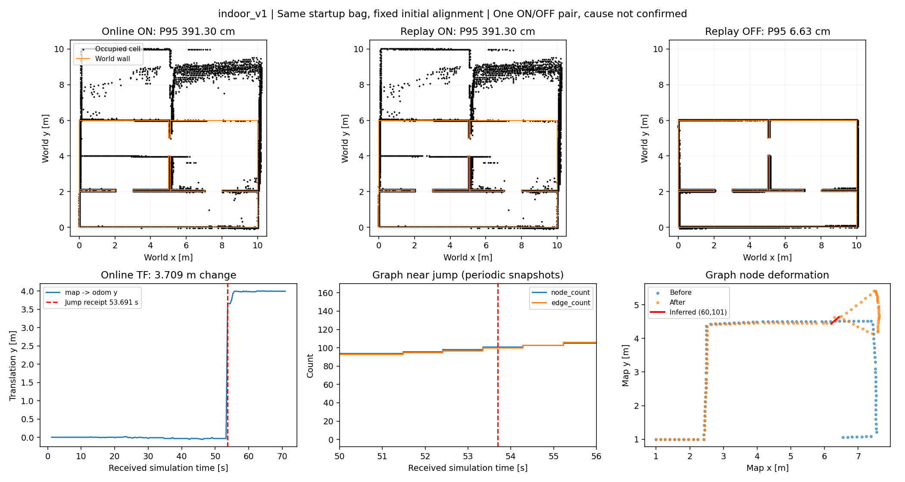
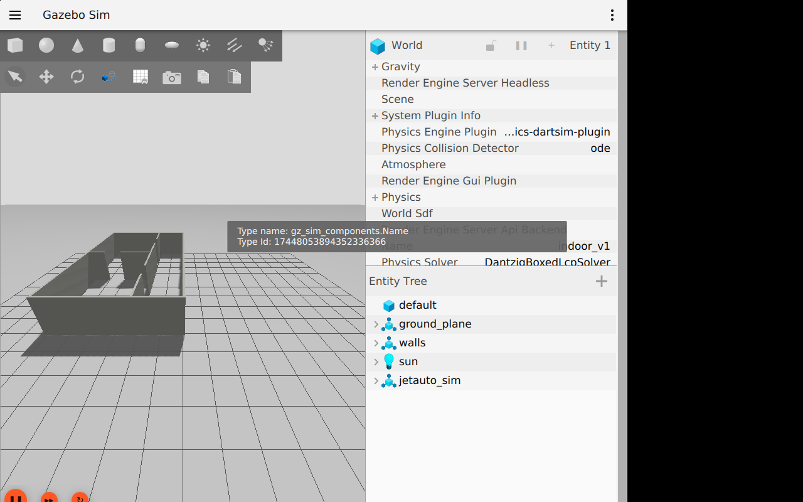

# SLAM 시작 전 입력 기록과 TF·그래프 진단

기존 예비 bag은 연결 검사 뒤 기록을 시작해 원래 SLAM이 처리한 초기 scan 전체가 없었습니다.
`run_benchmark --record`는 기록 구독을 먼저 준비한 뒤 Gazebo·SLAM을 순서대로 시작합니다.
기록 전 과거 입력을 복구하는 기능은 아니며 최초 급변 원인은 계속 미확정입니다.

## 실행 순서와 재현

```bash
source /opt/ros/humble/setup.bash
source ~/worker_following_ws/install/setup.bash
colcon build --symlink-install
source install/setup.bash
export ROS_DOMAIN_ID=12 GZ_PARTITION=codex
ros2 run mapping_eval run_benchmark --output /tmp/startup-new \
  --runs 1 --record --confirm-simulation
```

1. 기존 ROS 발행자가 없는지 검사하고, 진단 수집기의 구독·이벤트 서비스가 준비된 `ready.json`을 확인합니다.
2. recorder를 `--include-unpublished-topics --polling-interval 10`으로 시작합니다.
   진단 구독이 만든 토픽에 기록 구독을 미리 연결하고, 명시적 QoS로 핵심 8개 토픽 구독을 확인합니다.
3. headless Gazebo와 센서만 시작해 scan·odom·clock·센서 시각 TF를 검사합니다.
4. `slam_start` 이벤트를 기록한 뒤 별도 SLAM을 시작하고 지도·TF 연결과 실제 파라미터를 확인합니다.
5. `drive_start`를 기록하고 기존 12 waypoint 경로를 주행·평가합니다.
6. `capture_end` 뒤 SLAM·Gazebo를 종료하고 기록 큐를 처리한 뒤 recorder·진단 수집기를 종료합니다.
7. 닫힌 원본 bag과 진단 JSONL을 오프라인 대조합니다. 센서 coverage와 진단 수집 유효성 중 하나라도 실패하면 실행이 실패합니다.

이벤트는 서비스 처리 시각입니다. `slam_start`는 **프로세스 시작 요청 전**이며 첫 accepted scan 시각을 뜻하지 않습니다.
재생은 기록 입력을 그대로 사용하므로 온라인 SLAM 구독 준비 전에 기록된 scan을 추가로 처리할 수 있습니다.
전체 내부 상태·스레드 순서까지 동일한 재현이라고 해석하지 않습니다.
`--record`를 생략하면 기존 시뮬+SLAM 통합 launch를 사용합니다.

## 기록과 유효성

- bag: 기존 scan·odom·clock·TF·명령에 graph MarkerArray, `/pose`, `/rosout`, `/mapping_capture/events`를 추가합니다.
- `diagnostics/events.jsonl`: 단계 이름·sequence·수신 monotonic·수신 ROS clock·최초 scan 시각·관측 수.
- `diagnostics/sensor_stamps.jsonl`: scan·odom·pose의 원본 header와 수신 시각. clock 전체는 JSONL에 중복 기록하지 않습니다.
- `diagnostics/tf.jsonl`: 최초·변화한 map→odom의 xyz/quaternion·wrapped yaw 변화, 급변 후보와 인접 graph 참조.
- `diagnostics/graph.jsonl`: 원본 marker geometry·node 후보·edge 좌표쌍·매칭 모호성.
- `diagnostics/summary.json`: 정상 종료 여부·수신/오류/역행·graph/TF 누락 경고.
- `startup_audit.json`: 초기 sensor/static/dynamic TF 존재, 단계 순서·종료 coverage·관측 scan multiset 누락과 진단 유효성.

감사는 원본 bag을 변경하지 않으며, 종료 이벤트까지 진단 수집기가 받은 scan을 bag 전체와 비교합니다.
종료 뒤 큐 처리 중 추가된 진단 관측은 비교 window에서 제외합니다. odom/dynamic TF는 0.1초,
scan은 0.3초의 종료 허용차를 사용합니다. 독립 관측기도 손실될 수 있어 **완전 무손실의 증명은 아닙니다**.
초기 clock 0은 허용하되 SLAM 시작 전에 양수 clock이 필요합니다. 역행·잘못된 값은 거부합니다.

```bash
ros2 run mapping_eval audit_startup --bag /tmp/startup-new/run_01/bag \
  --diagnostics /tmp/startup-new/run_01/diagnostics \
  --output /tmp/startup-new/run_01/audit-repeat.json
```

## QoS와 재생

발행자 생성 전에 토픽을 기록하면 Humble bag의 `offered_qos_profiles`가 비어 있을 수 있습니다.
기존 원본 메타데이터는 보존하고, `replay_benchmark`가 `replay_input_qos.yaml`을 사본·해시와 함께
명시적으로 적용합니다. 특히 `/tf_static`은 RELIABLE/TRANSIENT_LOCAL이어야 늦은 TF 구독자도
정적 트리를 받습니다. 새 clock을 합성하지 않으며 기존 SLAM 출력 TF는 필터에서 제거합니다.
기록 QoS는 `startup_capture_qos.yaml`, 재생 QoS는 `replay_input_qos.yaml`로 별도 관리합니다.

## 진단 해석의 한계

현재 `transform_timeout=0.2`일 때 map→odom header는 최근 scan 시각에 0.2초를 더한 값입니다.
원본 header·수신 ROS clock·수신 monotonic을 함께 보존하고, 역산한 scan 시각은 추정치로 표시합니다.
TF 변화가 0.5m 또는 yaw 0.2rad를 넘으면 후보로 기록합니다. 이는 궤적 잔차 급변과 다른 지표입니다.

Graph는 현재 설정상 약 1초 주기로 발행돼 급변 직후의 내부 그래프를 보장하지 않습니다.
노드 marker ID는 sensor별 StateId이며 edge 메시지에는 endpoint ID·수락 이유·공분산이 없습니다.
좌표로 유일하게 연결할 수 있을 때만 후보를 추론하고 겹친 좌표는 모호성으로 남깁니다.
marker의 단위 quaternion은 로봇 yaw 관측값이 아닙니다. 새 edge만으로 false loop closure를 확정하지 않습니다.
원본 bag과 SLAM stdout 로그를 함께 검토해야 합니다.

## 실행 결과 — 2026-10-25

기준 dev `0448e5c` 이후 `feat/slam-startup-capture` 변경으로 실행했습니다.
Ubuntu 22.04, ROS 2 Humble, slam_toolbox 2.6.10, Gazebo Harmonic 8.15.0,
외부 `wf_gazebo` 오버레이, domain 12/partition codex, `indoor_v1`, 12 waypoint,
0.35m/s이며 자동 검증은 headless입니다. 외부 의존 파일 해시는 각 manifest에 보존했습니다.
4개 패키지 빌드, 순수 테스트 316개, colcon 334개 검사 오류·실패 0입니다.

| 실행 | 벽 RMSE (cm) | 벽 P95 (cm) | precision (10cm) | coverage (10cm) | 지도 임시 기준 |
|---|---|---|---|---|---|
| 시작 전 기록 1 | 2.10 | 3.21 | 100% | 100% | 통과 |
| 시작 전 기록 2 (v2, ON) | 175.76 | 391.30 | 48.41% | 97.40% | 실패 |
| v2 bag ON 재생 1회 | 175.65 | 391.30 | 49.11% | 98.54% | 실패 |
| v2 bag OFF 재생 1회 | 3.80 | 6.63 | 100% | 100% | 통과 |

**실행 절차·기록 유효성 통과와 지도 품질 통과는 다릅니다.** 실행기 `status=completed`,
`trajectory_valid=true`는 지도 정확도의 증거가 아닙니다. 온라인 v2 manifest의
`quality_pass=false`로 실패가 남아 있습니다. 첫 실행 뒤 QoS·감사 gate 보완을 포함한
두 번째 실행을 했으며 두 실행은 센서 시퀀스가 달라 반복 실패 확률을 추정하지 않습니다.
ON/OFF 대조는 v2의 같은 원본 bag·재생 속도 1.0·고정 초기 정합을 사용했고,
실효 ROS 파라미터 차이는 `do_loop_closing` 하나임을 확인했습니다.

v2는 첫 scan 0.002초, SLAM 프로세스 시작 요청 전 이벤트 0.631초, 종료 이벤트 74.495초입니다.
종료 전 진단 관측 scan 373개 중 bag 누락은 0개이고 bag 전체에는 374개가 있습니다.
초기/종료 sensor·static/dynamic TF coverage와 진단 유효성이 모두 통과했습니다.
첫 실행도 보완한 감사 CLI로 재검사해 두 유효성 검사를 통과했으며,
원본 `startup_audit.json`과 별도 `startup_audit-final.json`을 모두 보존했습니다.

### 새 급변에서 확인한 사실

- TF seq1597: 수신 sim 53.691초, header 53.8초, scan 추정 53.6초.
  map→odom 평행이동 변화 3.70894m, yaw 변화 −0.01962rad.
- 직전 graph seq1586(53.345초)는 노드 101/edge 100, 직후 seq1615(54.275초)는 103/103.
  순차 연결 (100,101)·(101,102)와 비연속 연결 후보 **(60,101)**가 추가됐고,
  endpoint 좌표 후보는 모두 유일했습니다.
- 노드0은 고정됐지만 노드60은 약 0.073m, 노드100은 약 3.511m 이동했습니다.
  궤적 CSV의 53.75초 위치 잔차 0.0441m가 53.8초 3.5955m로 증가했습니다.
- ON 재생은 0.5m 초과 인접 잔차 변화 4개, OFF 재생은 0개입니다.
  이 후보 수는 보간된 궤적 표본 기준이며 원본 TF 보정 횟수가 아닙니다.

루프 처리를 끈 대조만 정상이고 비연속 연결과 큰 보정이 인접해
잘못된 위치 연결 가설을 지지합니다. 다만 단일 ON/OFF 쌍이며 graph에는 제약값·수락 이유가
없습니다. Ceres 스레드 수 제한 경고 자체를 원인으로 볼 근거도 없습니다.
**🔍 잘못된 loop 수락의 확정 및 과거 예비 실패와 동일 원인인지는 미해결입니다.**
기본 SLAM 설정은 유지하며, 다음 조사는 같은 새 bag의 반복·상세 수락 로그와
그래프 제약 확인으로 진행합니다. Jetson·실물 안정성 결과가 아닙니다.



위 그림은 생성 지도·원본 진단으로 그렸습니다. 초기 정합 고정, 사후 최적 정합 없음.
그래프 연결 표시는 좌표 후보이며 실제 수락 로그를 대신하지 않습니다.



위는 별도 가상 디스플레이에서 `mapping_gazebo indoor.launch.py gui:=true`로 캡처한
실제 `indoor_v1` 장면입니다. `jetauto_sim`과 실내 벽 구성을 보여 주며,
성능 표의 headless 주행과 별도로 정지 장면을 캡처했습니다. SLAM 성능이나 인식 결과가 아닙니다.

### 원자료·재생 명령

원자료 기준: `/home/blind/lab2/prometheus-evaluation-results/` 아래 다음 디렉토리입니다.

- `2026-10-25-full-start/`: 첫 정상 기록, 입력·소스·해시·지도·bag·진단.
- `2026-10-25-full-start-v2/`: 새 실패 기록, `inputs/slam.yaml`, `run_01/bag`, 진단·실효 파라미터·manifest, `plot_startup.py`.
- `2026-10-25-full-start-replay/`: QoS 보완 전 첫 기록 재생 실패 로그(정적 TF durability 불일치).
- `2026-10-25-full-start-replay-v2/`, `2026-10-25-full-start-replay-off/`: 동일 v2 bag ON/OFF 재생, 실제 설정·해시·지도·궤적.
- `2026-10-25-startup-gui/`: 가상 디스플레이 GUI 원본·실행 로그·캡처 스크립트.

```bash
# 위 환경 준비 후, 새 출력 디렉토리로 실행
root=/home/blind/lab2/prometheus-evaluation-results
ros2 run mapping_eval replay_benchmark \
  --bag "$root/2026-10-25-full-start-v2/run_01/bag" \
  --params-file "$root/2026-10-25-full-start-v2/inputs/slam.yaml" \
  --truth src/mapping_eval/config/indoor_v1_truth.yaml \
  --output /tmp/startup-replay-new --confirm-simulation
```

OFF는 보존된 `2026-10-25-full-start-off.yaml`을 사용합니다.
원본 bag·외부 모델·대용량 로그는 Git에 넣지 않고 문서·작은 PNG만 관리합니다.

이후 같은 실패 bag의 ON/OFF를 각 3회로 확장한 결과와 첫 실물 시험 준비는 [배포 준비 검증](robot-readiness-evaluation.md)에 기록했습니다.
